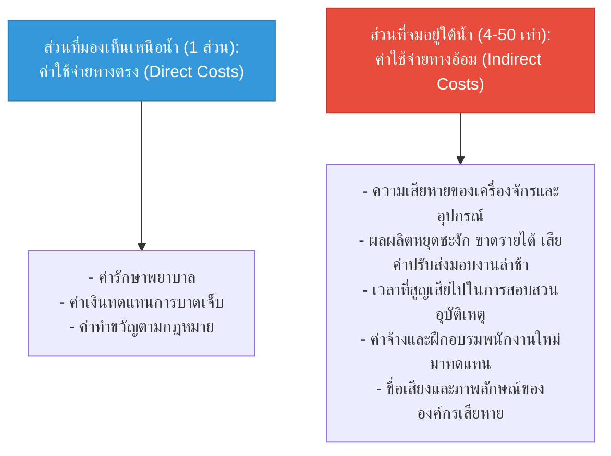

# Week 05: พื้นฐานการป้องกันอุบัติเหตุและการวินิจฉัยประเด็น OHS (Basics of Accident Prevention)

**วิชา:** OCCUPATIONAL HEALTH AND SAFETY (อาชีวอนามัยและความปลอดภัย)  
**สัปดาห์ที่:** Week 05  
**รหัสนักศึกษา:** 69030144  
**ชื่อ-นามสกุล:** นายปฏิภาณ พิพัฒน์พิทยากุล  
**ตอนเรียน:** Section 1  

---

## 📋 ส่วนที่ 1: การวิเคราะห์กรณีศึกษา 3 สถานการณ์ (OHS Diagnosis)

### กรณีศึกษาที่ 1: งานซ่อมบำรุงระบบสายพานลำเลียงในโรงงานอุตสาหกรรม
* **สถานการณ์:** ช่างซ่อมบำรุงมุดเข้าไปเปลี่ยนลูกกลิ้งใต้สายพานขณะที่เครื่องจักรยังไม่ได้ตัดสวิตช์หลัก เพื่อนร่วมงานเผลอกดปุ่มเริ่มเดินระบบ ทำให้เสื้อของช่างถูกลูกกลิ้งดึงเข้าไปหนีบแขน
* **การกระทำที่ไม่ปลอดภัย (Unsafe Act):** ไม่ทำการตัดแยกพลังงานและล็อกกุญแจตัดตอน (Lockout/Tagout: LOTO), ไม่แขวนป้ายเตือนซ่อมบำรุง
* **สภาพการณ์ที่ไม่ปลอดภัย (Unsafe Condition):** เครื่องจักรไม่มีเซนเซอร์ตัดการทำงานอัตโนมัติ (Safety Interlock) เมื่อเปิดฝาครอบบำรุงรักษา
* **แนวทางแก้ไขเชิงวิศวกรรม:** ติดตั้งระบบ Key Interlock และสวิตช์ดึงสายหยุดฉุกเฉิน (Emergency Pull Cord Switch) ตลอดแนวสายพาน

### กรณีศึกษาที่ 2: งานยกย้ายสารเคมีกัดกร่อนในห้องปฏิบัติการ
* **สถานการณ์:** พนักงานยกแกลลอนกรดไนตริกด้วยมือเปล่าโดยไม่ใช้รถเข็น แกลลอนลื่นหลุดมือตกกระแทกพื้น กรดกระเด็นใส่ขากางเกงและข้อเท้า
* **การกระทำที่ไม่ปลอดภัย (Unsafe Act):** ไม่สวมใส่อุปกรณ์คุ้มครองความปลอดภัยส่วนบุคคล (ถุงมือยางกันสารเคมี, เอี๊ยม PVC, รองเท้าบู๊ตหัวเหล็กกันสารเคมี), ยกของหนักเกินกำลังโดยไม่ใช้อุปกรณ์ทุ่นแรง
* **สภาพการณ์ที่ไม่ปลอดภัย (Unsafe Condition):** ไม่มีพาเลทหรือถาดรองรับสารเคมีหก (Spill Containment Pallet), พื้นผิวทางเดินเปียกลื่น
* **แนวทางแก้ไขเชิงวิศวกรรมและบริหาร:** จัดเตรียมรถเข็นสารเคมีโดยเฉพาะ (Chemical Transport Cart), ติดตั้งสถานีล้างตาและฝักบัวฉุกเฉิน (Emergency Eyewash & Shower) ในระยะไม่เกิน 10 วินาที

### กรณีศึกษาที่ 3: งานก่อสร้างต่อเติมบนนั่งร้านสูง
* **สถานการณ์:** คนงานขึ้นไปฉาบปูนบนนั่งร้านสูง 4 เมตร โดยไม่เกี่ยวตะขอนิรภัย (Lanyard) เข้ากับจุดยึด แผ่นไม้ปูทางเดินขยับตัว คนงานพลัดตกจากนั่งร้าน
* **การกระทำที่ไม่ปลอดภัย (Unsafe Act):** ไม่เกี่ยวตะขอเข็มขัดนิรภัยแบบเต็มตัว (Full Body Harness) กับจุดยึดที่มั่นคง, ไม่ตรวจสอบความมั่นคงของแผ่นนั่งร้านก่อนขึ้นปฏิบัติงาน
* **สภาพการณ์ที่ไม่ปลอดภัย (Unsafe Condition):** นั่งร้านไม่มีการติดตั้งราวกั้นตก (Guardrails) และไม่มีแผ่นกันของตก (Toe Boards), แผ่นไม้ปูนั่งร้านไม่ได้ผูกยึดลวดเข้ากับโครงเหล็ก
* **แนวทางแก้ไข:** ตรวจสอบความปลอดภัยของนั่งร้านด้วยระบบแท็กสี (Scaffold Tag System: Green/Red Tag) ก่อนอนุญาตให้ใช้งานทุกวัน

---

## 📊 ส่วนที่ 2: ทฤษฎีภูเขาน้ำแข็งแห่งความสูญเสีย (Iceberg Theory of Accident Costs)

เมื่อเกิดอุบัติเหตุขึ้น ความสูญเสียจะแบ่งออกเป็น 2 ส่วนใหญ่ ๆ:

> 💡 **สรุป:** ค่าใช้จ่ายทางอ้อมที่ซ่อนอยู่ใต้น้ำมักมีมูลค่าสูงกว่าค่ารักษาพยาบาลทางตรงถึง 5 ถึง 50 เท่าตัว การลงทุนในระบบความปลอดภัยจึงเป็นการประหยัดต้นทุนที่คุ้มค่าที่สุดขององค์กร
