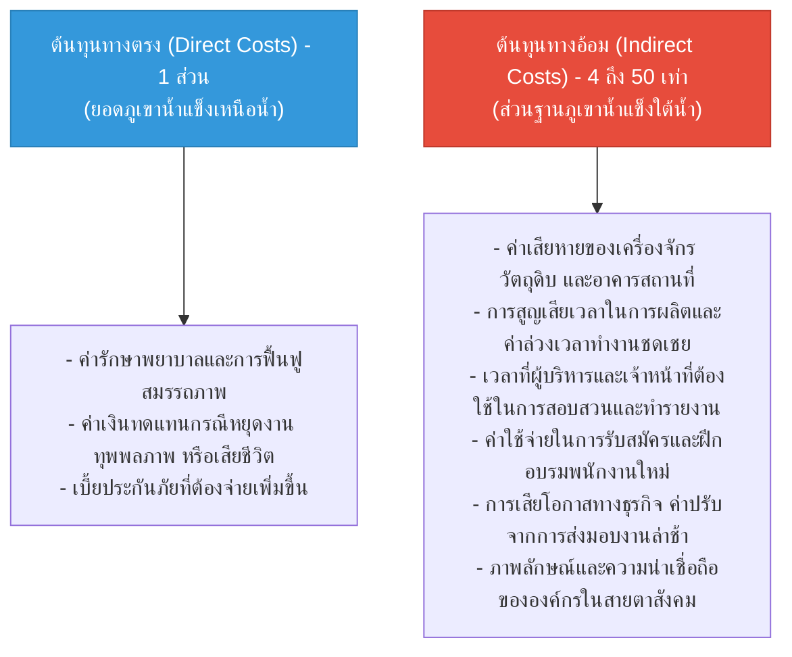

# Week 05: พื้นฐานการป้องกันอุบัติเหตุ (Basics of Accident Prevention)

**วิชา:** OCCUPATIONAL HEALTH AND SAFETY (อาชีวอนามัยและความปลอดภัย)  
**สัปดาห์ที่:** Week 05  
**รหัสนักศึกษา:** 69030450  
**ชื่อ-นามสกุล:** นายกิตติศักดิ์ พัฒนนิติศักดิ์  
**ตอนเรียน:** Section 1  

---

## 1. คำนิยามและแนวคิดพื้นฐาน (Key Concepts)

* **อุบัติเหตุ (Accident):** เหตุการณ์ที่เกิดขึ้นโดยมิได้คาดหมาย ไม่ได้วางแผนไว้ล่วงหน้า และส่งผลกระทบให้เกิดการบาดเจ็บ การเสียชีวิต ทรัพย์สินเสียหาย หรือกระบวนการผลิตหยุดชะงัก
* **อุบัติการณ์ (Incident):** เหตุการณ์ที่เกี่ยวเนื่องจากการทำงาน ซึ่งอาจนำไปสู่อุบัติเหตุ หรือเกือบเกิดอุบัติเหตุ ครอบคลุมทั้งกรณีที่เกิดความสูญเสียและไม่เกิดความสูญเสีย
* **เหตุการณ์เกือบเกิดอุบัติเหตุ (Near Miss):** เหตุการณ์ที่ไม่พึงประสงค์ที่เกิดขึ้น แต่ยังไม่มีผู้ได้รับบาดเจ็บหรือไม่มีทรัพย์สินเสียหาย เป็นสัญญาณเตือนล่วงหน้าที่ต้องเร่งแก้ไข
* **การกระทำที่ไม่ปลอดภัย (Unsafe Act):** พฤติกรรมของบุคคลที่ขัดต่อกฎระเบียบหรือขั้นตอนการทำงานที่ปลอดภัย
* **สภาพการณ์ที่ไม่ปลอดภัย (Unsafe Condition):** สภาพแวดล้อมทางกายภาพ อุปกรณ์ เครื่องจักร หรือสถานที่ทำงานที่มีความบกพร่องจนอาจก่อให้เกิดอันตราย

---

## 2. การวิเคราะห์กรณีศึกษา 3 สถานการณ์ตามทฤษฎีโดมิโน (Domino Theory)

### กรณีศึกษาที่ 1: งานซ่อมบำรุงในพื้นที่อับอากาศ (ถังเหล็กบรรจุสารเคมี)
* **สถานการณ์:** ช่างเชื่อมเข้าไปซ่อมแซมรอยรั่วภายในถังเหล็กบรรจุสารเคมีโดยไม่ตรวจวัดปริมาณก๊าซพิษและออกซิเจน ไม่พกอุปกรณ์ช่วยหายใจ และพัดลมระบายอากาศชำรุด ทำให้เกิดประกายไฟและขาดอากาศหายใจ
* **Unsafe Act:** เข้าปฏิบัติงานในที่อับอากาศโดยไม่มีใบอนุญาต (Confined Space Entry Permit), ไม่ตรวจวัดบรรยากาศอันตราย, ไม่สวมอุปกรณ์คุ้มครองความปลอดภัยระบบทางเดินหายใจ
* **Unsafe Condition:** พัดลมระบายอากาศ (Blower) ชำรุดไม่มีการซ่อมแซม, มีไอระเหยของสารเคมีตกค้างสะสมภายในถัง
* **การตัดวงจรตามทฤษฎีโดมิโน (ดึงโดมิโนตัวที่ 3 ออก):**
  1. บังคับใช้ระบบใบอนุญาตทำงานในที่อับอากาศอย่างเข้มงวด
  2. ตรวจวัดก๊าซ 4 ชนิด (Oxygen, Combustible Gas, Carbon Monoxide, Hydrogen Sulfide) ก่อนลงปฏิบัติงานและตรวจวัดต่อเนื่อง
  3. ติดตั้งระบบระบายอากาศแบบบังคับ (Forced Ventilation) ให้มีอัตราการถ่ายเทอากาศไม่น้อยกว่า 20 เท่าของปริมาตรถังต่อชั่วโมง

---

### กรณีศึกษาที่ 2: งานยกย้ายตู้คอนเทนเนอร์ด้วยปั้นจั่นท่าเรือ (Gantry Crane)
* **สถานการณ์:** ผู้ควบคุมเครนเร่งรีบยกตู้คอนเทนเนอร์ขนาด 40 ฟุต หนัก 20 ตัน ข้ามศีรษะพนักงานทางเดินด้านล่างโดยไม่กดสัญญาณเตือน และลวดสลิงมีรอยฉีกขาดสึกหรอเกิน 15%
* **Unsafe Act:** บังคับเครนยกของข้ามศีรษะผู้อื่นโดยไม่มีการส่งสัญญาณเตือน, ละเลยการตรวจสอบความปลอดภัยก่อนเริ่มงาน
* **Unsafe Condition:** ลวดสลิงเหล็กชำรุดเกินเกณฑ์ความปลอดภัยแต่ยังไม่ได้รับการเปลี่ยนทดแทน, ไม่มีแนวกั้นพื้นที่เสี่ยงด้านล่าง
* **การตัดวงจรตามทฤษฎีโดมิโน:**
  1. ติดตั้งระบบตัดการทำงานเมื่อน้ำหนักเกินพิกัด (Overload Protection) และระบบเตือนภัยอัตโนมัติ
  2. กำหนดเขตปลอดภัยห้ามบุคคลภายนอกเข้า (Exclusion Zone) ตลอดแนวการยกย้าย
  3. กำหนดเกณฑ์การปลดระวางลวดสลิงตามมาตรฐาน หากพบเส้นลวดขาดเกินกำหนดให้เปลี่ยนทันที

---

### กรณีศึกษาที่ 3: งานฉีดพ่นสารเคมีกำจัดศัตรูพืชทางการเกษตร
* **สถานการณ์:** เกษตรกรผสมและฉีดพ่นสารเคมีกำจัดแมลงกลุ่มออร์กาโนฟอสเฟตโดยใช้เพียงผ้าขาวม้าปิดจมูก เดินฉีดพ่นใต้ลม และถังพ่นยามีสายยางแตกรั่วซึมทำให้สารเคมีหยดรดหลัง
* **Unsafe Act:** ไม่สวมใส่อุปกรณ์ PPE สำหรับสารเคมี, เดินฉีดพ่นสารเคมีในทิศทางใต้ลม
* **Unsafe Condition:** อุปกรณ์พ่นยาและสายยางชำรุดแตกลายงา ขาดการบำรุงรักษา
* **การตัดวงจรตามทฤษฎีโดมิโน:**
  1. ให้ความรู้และฝึกอบรมเกษตรกรเกี่ยวกับความเป็นพิษของสารเคมีและทิศทางลมขณะพ่นยา
  2. สวมใส่ชุดคลุมกันสารเคมี ถุงมือไนไตรล์ และหน้ากากกรองไอระเหยสารอินทรีย์ (Half-mask Respirator with Organic Vapor Cartridge)
  3. ตรวจสอบแรงดันและรอยรั่วซึมของถังพ่นยาก่อนบรรจุสารเคมีทุกครั้ง

---

## 3. ทฤษฎีภูเขาน้ำแข็งแห่งความสูญเสีย (Iceberg Theory of Accident Costs)

เมื่อเกิดอุบัติเหตุขึ้น ค่าใช้จ่ายที่องค์กรต้องจ่ายสามารถจำแนกออกได้เป็น 2 ส่วน:

**บทสรุป:** การลงทุนในมาตรการด้านความปลอดภัยและการสร้างสภาพแวดล้อมที่ปลอดภัย ไม่ใช่ "ค่าใช้จ่ายสิ้นเปลือง" แต่คือ "การป้องกันความสูญเสียทางอ้อม" ที่มีมูลค่ามหาศาลกว่าต้นทุนทางตรงหลายเท่าตัว
