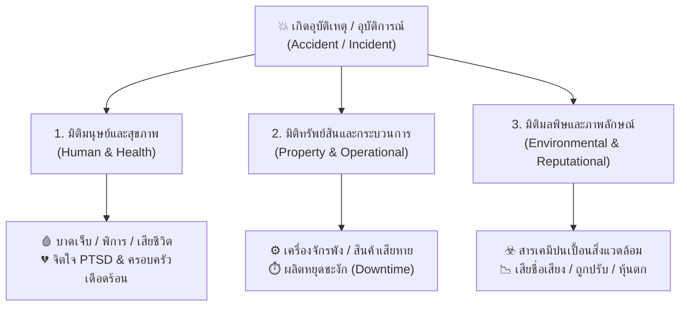

# Week 05: พื้นฐานการป้องกันอุบัติเหตุ (Basics of Accident Prevention)

---

## 📊 ส่วนที่ 3: ประเภทความสูญเสีย (Types of Losses in OHS)

> 💡 **บทนำ**  
> เมื่อเกิดอุบัติเหตุขึ้นในสถานที่ทำงาน คนทั่วไปมักมองเห็นเฉพาะ **"การบาดเจ็บของคน"** แต่ในทางอาชีวอนามัยและความปลอดภัย ความสูญเสียเปรียบเสมือน **"ระเบิดวงกว้าง"** ที่ไม่ได้กระทบแค่ร่างกายของผู้ประสบเหตุเท่านั้น แต่แผ่ขยายผลกระทบออกไปเป็น **3 มิติหลัก (3 Loss Dimensions)** ดังนี้:

---

### 🌐 ตาราง 3 มิติความสูญเสีย ถ่ายทอดผ่านกรณีศึกษาตัวละครทั่วโลก

| มิติความสูญเสีย (Loss Dimension)                                    | ขอบเขตผลกระทบ (Impact Scope)                                                                                                                                                                | ตัวอย่างเหตุการณ์และผลกระทบจริงจากตัวละครทั่วโลก (Global Character Examples)                                                                                                                                                                   |
| :------------------------------------------------------------------ | :------------------------------------------------------------------------------------------------------------------------------------------------------------------------------------------ | :--------------------------------------------------------------------------------------------------------------------------------------------------------------------------------------------------------------------------------------------- |
| **1. มิติการบาดเจ็บและสุขภาพ (Human & Health Loss)**             | • การบาดเจ็บเฉียบพลัน     (เจ็บเล็กน้อย/พิการ/เสียชีวิต) • โรคจากการทำงานสะสมเรื้อรัง • ผลกระทบทางจิตใจ     (PTSD/ภาวะซึมเศร้า) • ความเดือดร้อนของครอบครัวผู้ประสบเหตุ       | 🇲🇽 **คาร์ลอส (Carlos - เม็กซิโก):** ตกจากหลังคาสูง 6 เมตร กระดูกสันหลังและกระดูกเชิงกรานแตกหัก สูญเสียความสามารถในการเดิน (อัมพาตครึ่งท่อนถาวร) ไม่สามารถทำงานหาเลี้ยงลูกเมียได้ เกิดภาวะโศกเศร้าซึมเศร้ารุนแรงทั้งครอบครัว                  |
| **2. มิติทรัพย์สินและกระบวนการ (Property & Operational Loss)**   | • เครื่องจักร เครื่องมือ และอุปกรณ์ชำรุดเสียหาย • วัตถุดิบและชิ้นงานเสียหายถอนคืนไม่ได้ • สายการผลิตหยุดชะงัก    (Downtime) • ค่าใช้จ่ายซ่อมแซมและจัดหาเครื่องมือทดแทน          | 🇯🇵 **เคนจิ (Kenji - ญี่ปุ่น):** ขับฟอร์คลิฟต์ชนเสาอาคาร ทำให้อุปกรณ์งายกหัก ชิ้นส่วนเซมิคอนดักเตอร์มูลค่า 500,000 บาทตกกระจายเสียหายทั้งหมด สายประกอบรถยนต์ต้องหยุดผลิต (Downtime) 12 ชั่วโมง คิดเป็นมูลค่าสูญเสียโอกาสการผลิตกว่า 3 ล้านบาท |
| **3. มิติมลพิษและภาพลักษณ์ (Environmental & Reputational Loss)** | • สารเคมี/ก๊าซพิษรั่วไหลปนเปื้อน ดิน น้ำ อากาศ • ค่าปรับและโทษอาญาจากการฝ่าฝืนกฎหมาย • เสียชื่อเสียง แบรนด์ถูกแบน ลูกค้าcancelสัญญา • ราคาหุ้นตก และถูกเพิกถอนใบอนุญาตประกอบกิจการ | 🇨🇳 **หลี่เหว่ย (Li Wei - จีน):** คลังเคมีระเบิดทำให้สารตัวทำละลายไวไฟรั่วไหลลงสู่แม่น้ำสายหลัก ชุมชน 50,000 ครัวเรือนขาดน้ำประปา ปลานับแสนตัวตาย โรงงานถูกศาลสั่งปรับ 10 ล้านหยวน ถูกเพิกถอนใบอนุญาต และหุ้นบริษัทตก 40%                     |

---

### 🎨 สรุปแผนผังเชื่อมโยง 3 มิติความสูญเสีย (Mermaid Diagram)

---

> 💡 **บทสรุปสำคัญ:**  
> การป้องกันอุบัติเหตุจึงไม่ได้มีไว้เพื่อ *"ทำตามกฎหมายบังคับ"* เท่านั้น แต่คือการ **ปกป้องชีวิตมนุษย์ (Human Capital)** **คุ้มครองทรัพย์สินองค์กร (Asset Protection)** และ **รักษาความยั่งยืนของสิ่งแวดล้อมและชื่อเสียงธุรกิจ (Business Sustainability)** ในระยะยาว

## 📝 คำถาม / แบบทดสอบทบทวน ส่วนที่ 3

> 📌 **โจทย์และคำสั่งสำหรับนักศึกษา:**  
> จากเหตุการณ์จริงที่นักศึกษาได้เลือกวิเคราะห์ไว้ใน **ส่วนที่ 2 (แบบทดสอบทบทวน ส่วนที่ 2)** ให้นักศึกษาเขียน **เล่าเรื่องหรือสะท้อนความคิดเห็น (Reflection & Loss Analysis)** โดยตอบคำถามว่า:  
> **"นอกจากบาดแผล ร่างกายของผู้เจ็บป่วย หรือความเสียหายที่เห็นเด่นชัดด้วยตาเปล่า ณ หน้างาน (เช่น ไฟไหม้ เครื่องจักรพัง หรือการระเบิด) นักศึกษามองเห็น 'ความสูญเสียที่ซ่อนเร้น (Hidden Losses)' หรือผลกระทบอื่นๆ ในมิติใดอีกบ้างที่ตามมาหลังจากเหตุการณ์นั้นจบลง?"**

---

### 📋 แนวทางการเขียนตอบและประเด็นสะท้อนความคิดเห็น (Reflection Guidelines):

ให้นักศึกษาเขียนบรรยายความยาวประมาณ 10-15 บรรทัด โดยเจาะลึกความสูญเสียที่มากกว่าตาเห็น ในประเด็นดังต่อไปนี้:

1. 💔 **ผลกระทบทางจิตใจและสังคมซ่อนเร้น (Hidden Psychological & Social Losses):**
   * บาดแผลทางจิตใจ (PTSD, ภาวะซึมเศร้า, ฝันร้าย) ของผู้ประสบเหตุ เพื่อนร่วมงานที่เห็นเหตุการณ์ หรือครอบครัว
   * ภาระหนี้สิน ความเดือดร้อนของลูกเมีย/พ่อแม่ เมื่อหัวหน้าครอบครัวต้องสูญเสียรายได้หรือพิการ
2. ⏱️ **ความสูญเสียทางกระบวนการและโอกาสทางธุรกิจ (Hidden Operational & Opportunity Losses):**
   * เวลาที่ต้องสูญเสียไปกับการสอบสวนสวนคดี/การหยุดสายการผลิต (Downtime)
   * ค่าใช้จ่ายแฝง เช่น ค่าทำงานล่วงเวลา (OT) ของพนักงานคนอื่นเพื่อเร่งงานทดแทน, ค่าฝึกอบรมคนใหม่, เบี้ยประกันภัยที่ปรับตัวสูงขึ้น
   * การถูกยกเลิกสัญญาจ้างจากลูกค้า หรือการเสียโอกาสในการแข่งขันทางธุรกิจ
3. ☣️ **ความสูญเสียต่อชุมชน สิ่งแวดล้อม และภาพลักษณ์ (Hidden Environmental & Reputational Losses):**
   * มลพิษตกค้างในระยะยาวต่อสุขภาพของคนในชุมชนรอบข้าง (ฝุ่น พิษ ก๊าซ คราบสารเคมี)
   * ความบอบช้ำต่อชื่อเสียงขององค์กร ความเชื่อมั่นของสังคมและหุ้นส่วนที่ลดลง

ความเห็นและการวิเคราะห์ความสูญเสียซ่อนเร้น (Hidden Loss Reflection)
จากกรณีศึกษานักศึกษาฝึกงานถูกรถทับ บาดแผลทางร่างกายและกระดูกที่หักเป็นเพียงความสูญเสียส่วนน้อยที่เห็นได้ชัดด้วยตาเปล่า แต่เมื่อมองลึกลงไปหลังเหตุการณ์สงบลง ย่อมมี "ความสูญเสียที่ซ่อนเร้น (Hidden Losses)" เกิดขึ้นอย่างมหาศาลในทั้ง 3 มิติ ดังนี้:

💔 มิติทางจิตใจ สังคม และครอบครัว: นักศึกษาฝึกงานต้องเผชิญกับภาวะบาดแผลทางจิตใจรุนแรง (PTSD) เกิดความหวาดกลัว ไม่กล้าเข้าใกล้ หรือมุดใต้ท้องรถยนต์อีกเลย ซึ่งส่งผลกระทบต่ออนาคตการประกอบอาชีพช่างยนต์ ขณะเดียวกัน เพื่อนรุ่นพี่และเพื่อนนักศึกษาฝึกงานที่เห็นเหตุการณ์ตรงหน้า ย่อมเกิดความขวัญเสียและเสียสุขภาพจิต ในมิติครอบครัว พ่อแม่ต้องหยุดงานมาคอยเฝ้าไข้ สูญเสียรายได้ และต้องรับภาระค่าเดินทาง รวมถึงค่าใช้จ่ายในการฟื้นฟูร่างกายและกายภาพบำบัดซ่อนเร้นที่ประกันภัยอาจครอบคลุมไม่ทั้งหมด

⏱️ มิติกระบวนการ โอกาสทางธุรกิจ และค่าใช้จ่ายแฝง: อู่ซ่อมรถต้องหยุดให้บริการในช่องซ่อมนั้นเพื่อจัดสถานที่และสอบสวนอุบัติเหตุ ทำให้เกิด Downtime ช่างคนอื่นเสียเวลาทำงานปกติเพื่อมาช่วยปฐมพยาบาล นำส่งโรงพยาบาล และให้ปากคำ อู่เสียโอกาสในการรับคิวซ่อมรถลูกค้ารายอื่น ทำให้สูญเสียรายได้ และอาจต้องจ่ายค่าทำงานล่วงเวลา (OT) ให้ช่างคนอื่นเพื่อเร่งงานซ่อมที่ค้างอยู่ให้ทันส่งมอบ นอกจากนี้ ยังมีค่าใช้จ่ายในการซ่อมแซมแม่แรงไฮดรอลิก และค่าซื้อขาสลักรองรับน้ำหนัก (Jack Stands) ชุดใหม่เพิ่มขึ้นอีกด้วย

☣️ มิติมลพิษ สิ่งแวดล้อม และภาพลักษณ์องค์กร: คราบน้ำมันไฮดรอลิกที่รั่วซึมไหลปนเปื้อนลงสู่ท่อระบายน้ำสาธารณะสร้างมลพิษในพื้นที่ และที่สำคัญที่สุดคือ ความสูญเสียด้านภาพลักษณ์และความน่าเชื่อถือ ข่าวสารเรื่องนักศึกษาฝึกงานบาดเจ็บสาหัสจะแพร่กระจายไปยังสถานศึกษา ส่งผลให้อู่ถูกตัดสิทธิ์การรับนักศึกษาฝึกงานในรุ่นถัดไป ลูกค้าขาดความมั่นใจในมาตรฐานความปลอดภัยจนย้ายไปใช้บริการอู่แข่งขันอื่น ซึ่งคิดเป็นมูลค่าความสูญเสียทางธุรกิจที่ไม่สามารถประเมินเป็นตัวเงินได้ในระยะยาว

💡 บทสรุปสะท้อนความคิด:

อุบัติเหตุ 1 ครั้ง จึงไม่เคยจบลงแค่ "การจ่ายค่ารักษาพยาบาล" แต่เป็น "ปฏิกิริยาลูกโซ่แห่งความสูญเสีย" ที่กัดเซาะทั้งชีวิตของคนทำงาน เสถียรภาพทาง keuangan ของครอบครัว และความอยู่รอดขององค์กรอย่างรุนแรง การป้องกันอุบัติเหตุเชิงรุกจึงเป็นทางออกที่คุ้มค่าและยั่งยืนที่สุด
