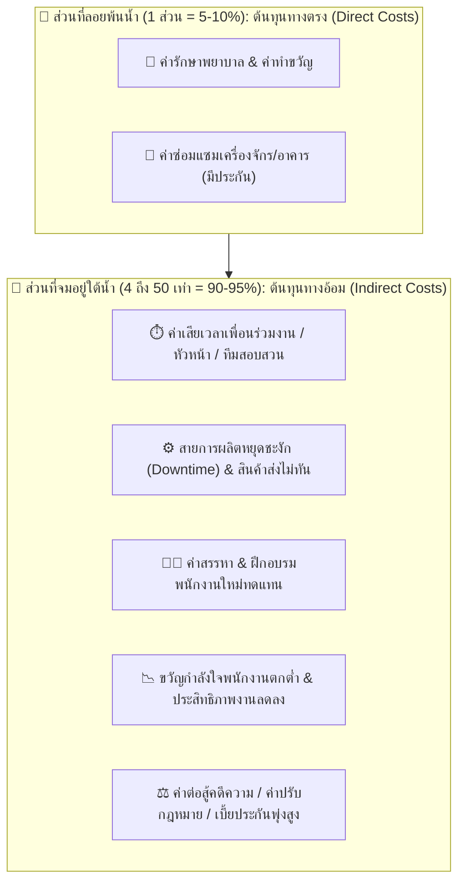

# Week 05: พื้นฐานการป้องกันอุบัติเหตุ (Basics of Accident Prevention)

---

## 🧊 ส่วนที่ 4: โครงสร้างต้นทุนความสูญเสีย (Cost of Accidents: Iceberg Model)

> 💡 **บทนำ**  
> เมื่อเกิดอุบัติเหตุขึ้น ผู้บริหารหลายคนมักมองเห็นเฉพาะ **"ยอดภูเขาน้ำแข็งที่ลอยพ้นน้ำ"** นั่นคือ **ต้นทุนทางตรง (Direct Costs)** เช่น ค่ารักษาพยาบาลหรือค่าประกันภัย แต่ในความเป็นจริง ความสูญเสียฉีดใหญ่ทางเศรษฐศาสตร์กลับซ่อนตัวอยู่ **"ใต้ผิวน้ำ"** นั่นคือ **ต้นทุนทางอ้อม (Indirect Costs)** ซึ่งมีมูลค่ามหาศาลแอบแฝงอยู่มากกว่า **4 ถึง 50 เท่า!**

---

### 🎨 แผนผังเปรียบเทียบทฤษฎีภูเขาน้ำแข็ง (Iceberg Model Diagram)



---

### 🌐 เจาะลึกประเภทต้นทุน ถ่ายทอดผ่านกรณีศึกษาตัวละครทั่วโลก

#### 4.1 ต้นทุนทางตรง (Direct Costs / Insured Costs)
คือ **ค่าใช้จ่ายที่เห็นเด่นชัดด้วยตาเปล่า มีใบเสร็จรับเงิน และสามารถเบิกเคลมประกันภัยได้ง่าย** (คิดเป็นเพียง 1 ส่วน หรือ 5-10% ของความสูญเสียทั้งหมด)
* **ค่ารักษาพยาบาล:** ค่าหมอ ค่ายา ค่าผ่าตัด ค่าห้องพักในโรงพยาบาล
* **ค่าทดแทนการหยุดงาน:** ค่าทำขวัญ ค่าชดเชยตามกฎหมายแรงงาน
* **ค่าซ่อมแซมทรัพย์สิน:** ค่าอะไหล่เครื่องจักร ค่าซ่อมอาคารที่ได้รับความคุ้มครองจากกรมธรรม์

> 🇩🇪 **ตัวอย่างทั่วโลก - ฮันส์ (Hans - เยอรมนี):**  
> ฮันส์ประสบอุบัติเหตุรถบรรทุกพลิกคว่ำบนทางหลวง Autobahn  
> * **ต้นทุนทางตรง (Direct Costs):** ค่ารักษาพยาบาลในโรงพยาบาลเบอร์ลิน 150,000 ยูโร + ค่าซ่อมซากรถบรรทุก 80,000 ยูโร ➔ **รวม 230,000 ยูโร (เบิกประกันภัยได้ทั้งหมด)**

---

#### 4.2 ต้นทุนทางอ้อม (Indirect Costs / Uninsured Costs)
คือ **ค่าใช้จ่ายแอบแฝงที่มองไม่เห็นทันที เบิกเคลมประกันไม่ได้ และมักมีมูลค่าสูงกว่าต้นทุนทางตรงถึง 4 ถึง 50 เท่า!** (คิดเป็น 90-95% ของความสูญเสียทั้งหมด)

| มิติต้นทุนทางอ้อม (Indirect Cost Dimensions) | รายละเอียดผลกระทบแอบแฝง (Hidden Impact Details) | กรณีศึกษาตัวละครทั่วโลก (Global Character Examples) |
| :--- | :--- | :--- |
| **1. ด้านเวลา<br>(Time Losses)** | • เวลาที่สูญเสียไปของเพื่อนร่วมงานที่ต้องหยุดงานมาช่วยมุงดู/ปฐมพยาบาล<br>• เวลาของหัวหน้างานและทีม Safety ที่ต้องใช้สอบสวนคดีและทำรายงานส่งรัฐ | 🇯🇵 **เคนจิ (Kenji - ญี่ปุ่น):** วิศวกรและผู้จัดการโรงงานต้องหยุดงาน 48 ชั่วโมงเพื่อสอบสวนสาเหตุรถยกชนเสา คิดเป็นค่าแรงที่เสียเปล่ากว่า 400,000 เยน |
| **2. ด้านการผลิต<br>(Operational Losses)** | • สายการผลิตหยุดชะงัก (Downtime)<br>• วัตถุดิบชำรุดเสียหาย<br>• ส่งมอบสินค้าให้ลูกค้าไม่ทันตามสัญญา ต้องจ่ายค่าปรับรุนแรง | 🇯🇵 **เคนจิ (Kenji - ญี่ปุ่น):** สายประกอบรถยนต์หยุดผลิต 12 ชั่วโมง ปรับส่งชิปเซมิคอนดักเตอร์ล่าช้า ➔ **สูญเสียรายได้แฝง 15 ล้านเยน (คิดเป็น 30 เท่าของค่างานฟอร์คลิฟต์ที่หัก)** |
| **3. ด้านบุคลากร<br>(Human Resource Losses)** | • ค่าใช้จ่ายในการประกาศรับสมัครพนักงานใหม่มาแทนผู้บาดเจ็บ/พิการ<br>• ค่าวิทยากรและเวลาในการฝึกอบรมช่างคนใหม่ให้ได้ทักษะเท่าคนเดิม | 🇲🇽 **คาร์ลอส (Carlos - เม็กซิโก):** บริษัทต้องจ่ายค่าลงประกาศรับสมัครช่างหลังคาคนใหม่ + ค่าอบรมทักษะ 3 เดือน ➔ **สูญเสียเงินแฝงสูงกว่าค่ารักษาพยาบาลขั้นต้น 15 เท่า** |
| **4. ด้านขวัญกำลังใจ<br>(Morale & Productivity)** | • พนักงานหน้างานเกิดความวิตกกังวลและหวาดกลัว<br>• ขวัญกำลังใจตกต่ำ ทำให้อัตราการผลิตและประสิทธิภาพงานลดลงทั่วทั้งกะ | 🇫🇷 **ปีแอร์ (Pierre - ฝรั่งเศส):** เพื่อนร่วมงานในกะผลิตก๊าซเสียขวัญ วิตกกังวลความปลอดภัย ทำให้อัตราการผลิตรวมของโรงงานตกต่ำลง 25% ในเดือนถัดมา |
| **5. ด้านกฎหมายและภาพลักษณ์<br>(Legal & Reputational Losses)** | • ค่าทนายความและค่าสู้คดีความในศาล<br>• เบี้ยประกันภัยโรงงานปรับตัวสูงขึ้นร้อยละ 100-300% ในปีถัดไป<br>• หุ้นบริษัทตก ลูกค้า cancel สัญญาจ้าง | 🇨🇳 **หลี่เหว่ย (Li Wei - จีน):** โรงงานถูกศาลสั่งปรับ 10 ล้านหยวน + เบี้ยประกันภัยปีถัดไปพุ่ง 300% + ราคาหุ้นตก 40% ➔ **สูญเสียเงินแฝงคิดเป็น 50 เท่าของค่ารักษาพยาบาล!** |

---

### 📊 สรุปตารางเปรียบเทียบอัตราส่วน Direct vs Indirect Costs

```
┌─────────────────────────────────────────────────────────────┐
│ 🧊 Direct Costs   (ต้นทุนทางตรง)  = 1 ส่วน   (5 - 10%)      │
├─────────────────────────────────────────────────────────────┤
│ 🌊 Indirect Costs (ต้นทุนทางอ้อม) = 4 - 50 เท่า (90 - 95%)  │
└─────────────────────────────────────────────────────────────┘
```

> 💡 **สรุปสำหรับนักจัดการความปลอดภัย:**  
> การลงทุนในระบบความปลอดภัย (Safety Investment) เช่น การซื้อ PPE ดีๆ การจัดอบรม หรือการซ่อมบำรุงเครื่องจักร **ไม่ใช่ "ค่าใช้จ่ายที่สิ้นเปลือง"** แต่เป็นการ **"ประหยัดเงินมหาศาล"** จากการป้องกันไม่ให้ภูเขาน้ำแข็งส่วนใต้น้ำ (Indirect Costs) พุ่งขึ้นมาทำลายองค์กรนั่นเอง!

## 📝 คำถาม / แบบทดสอบทบทวน ส่วนที่ 4

> 📌 **โจทย์และคำสั่งสำหรับนักศึกษา:**  
> จากเหตุการณ์จริงที่นักศึกษาได้เลือกวิเคราะห์ไว้ใน **ส่วนที่ 2 และส่วนที่ 3** ให้นักศึกษาประเมินและจำแนก **โครงสร้างต้นทุนความสูญเสียตามทฤษฎีภูเขาน้ำแข็ง (Iceberg Model Cost Analysis)** ออกเป็น 2 ส่วนหลัก พร้อมทั้งเสนอแนวคิดเชิงบริหาร:

---

### 📋 โครงสร้างแบบตอบคำถาม ส่วนที่ 4:

#### 1️⃣ การจำแนกต้นทุนทางตรง (Direct Costs / Insured Costs - ส่วนลอยพ้นน้ำ):
* ประเมินรายการค่าใช้จ่ายที่เห็นชัดเจนและมีประกันคุ้มครอง (เช่น ค่ารักษาพยาบาล ค่าเงินชดเชย ค่าซ่อมแซมซากเครื่องจักร)
* *(ประมาณการเป็นจำนวนเงินเบื้องต้น เช่น 50,000 บาท)*

---

#### 2️⃣ การจำแนกต้นทุนทางอ้อม (Indirect Costs / Uninsured Costs - ส่วนจมใต้น้ำ):
* ระบุรายการค่าใช้จ่ายแอบแฝงอย่างน้อย 3 ด้านขึ้นไป (เช่น ค่าเสียเวลาสอบสวน, ค่า Downtime สายการผลิตหยุดชะงัก, ค่าปรับส่งสินค้าล่าช้า, ค่าฝึกอบรมช่างคนใหม่, ค่าต่อสู้คดีความ หรือค่าเบี้ยประกันภัยปีถัดไปพุ่งสูง)
* *(ประมาณการเป็นจำนวนเงินแอบแฝง เช่น 500,000 บาท)*

---

#### 3️⃣ การเปรียบเทียบอัตราส่วนและการโน้มน้าวฝ่ายบริหาร (Management Pitching):
* **อัตราส่วนประเมิน:** ในกรณีนี้ ต้นทุนทางอ้อมคิดเป็นกี่เท่าของต้นทุนทางตรง? *(เช่น 1 : 10 เท่า)*
* **กลยุทธ์โน้มน้าวผู้บริหาร:** หากนักศึกษาต้องสวมบทบาทเป็น **เจ้าหน้าที่ความปลอดภัย (จป.)** นักศึกษาจะนำตัวเลขอัตราส่วนภูเขาน้ำแข็งนี้ ไปพูดโน้มน้าวผู้บริหารหรือเจ้าของบริษัทอย่างไร เพื่อให้อนุมัติงบประมาณในการปรับปรุงความปลอดภัยหน้างาน? *(บรรยาย 3-5 บรรทัด)*

* สรุปกรณีศึกษาหลักที่ใช้ในการวิเคราะห์
เหตุการณ์: พนักงานประกอบอาหารลื่นไถลคราบน้ำมันในครัว ทำให้น้ำแกงร้อนราดใส่แขนและลำตัว เกิดแผลพุพองระดับสอง (Second-degree burn) หยุดงานรักษาตัว 2 สัปดาห์

📝 รวมเฉลยแนวทางการตอบคำถามทุกส่วน (Week 05)
1️⃣ ส่วนที่ 2: ทฤษฎีการเกิดอุบัติเหตุ (Accident Causation Theories)
1. ทฤษฎีโดมิโนของไฮน์ริช (Heinrich's Domino Theory, 1931)
การระบุตัวโดมิโนทั้ง 5 ตัว:

โดมิโนตัวที่ 1 (ภูมิหลัง/สิ่งแวดล้อม): เติบโตในร้านอาหารขนาดเล็กที่ไม่เน้น Safety ติดนิสัยทำงานเร่งรีบ

โดมิโนตัวที่ 2 (ความบกพร่องของบุคคล): ใจร้อน มั่นใจในตัวเองสูง ชะล่าใจ

โดมิโนตัวที่ 3 (Unsafe Act / Unsafe Condition - สาเหตุทางตรง):

Unsafe Act: เดินยกหม้อแกงร้อนคนเดียวอย่างรวดเร็วและบังทัศนวิสัย

Unsafe Condition: พื้นครัวมีคราบน้ำมันเกาะลื่น และไม่มีแผ่นยางกันลื่น

โดมิโนตัวที่ 4 (อุบัติเหตุ): ขาลื่นไถลคราบน้ำมัน หงายท้อง ล้มหม้อแกงคว่ำ

โดมิโนตัวที่ 5 (บาดเจ็บ/สูญเสีย): น้ำแกงร้อนราดใส่แขนและลำตัว ผิวหนังพุพอง หยุดงาน 14 วัน

⏳ บทคำเตือนทะลุมิติย้อนเวลา (ดึงโดมิโนตัวที่ 3 ออก):

🗣️ "หยุดก้าวขาเดินก่อน! วางหม้อแกงลงเดี๋ยวนี้! เช็ดคราบน้ำมันบนพื้นให้แห้ง สวมรองเท้าพื้นยางกันลื่น แล้วหาคนมาช่วยยกหม้อร่วมกัน 2 คน!"

(ตัดปฏิกิริยาลูกโซ่ที่โดมิโนตัวที่ 3 ทำให้ไม่เกิดการลื่นไถล)

2. ทฤษฎีโดมิโนดัดแปลงของเบิร์ดและลอฟตัส (Bird & Loftus Domino Theory, 1976)
ลำดับสาเหตุ 5 ขั้นตอน (เน้นระบบบริหารจัดการ):

Lack of Control (ขาดการควบคุม): ไม่มีกำหนดการทำความสะอาดคราบน้ำมัน (Housekeeping Schedule) และไม่มีคู่มือขั้นตอน SOP สำหรับการยกของร้อน

Basic Causes (สาเหตุพื้นฐาน):

ปัจจัยคน: พนักงานขาดการอบรม Safety และขาดความตระหนักรู้ภัย

ปัจจัยงาน: พื้นครัวเลือกใช้กระเบื้องชนิดลื่น ไม่มีแผ่นยางกันลื่น และไม่มีอุปกรณ์ช่วยยก

Immediate Causes (สาเหตุทางตรง): เดินยกของร้อนคนเดียวด้วยความเร็ว (Unsafe Act) + คราบน้ำมันขังบนพื้นกระเบื้อง (Unsafe Condition)

Incident (อุบัติการณ์): การสัมผัสพลังงานความร้อน (น้ำแกงร้อนอุณหภูมิสูงราดใส่ร่างกาย)

Loss (ความสูญเสีย): พนักงานบาดเจ็บสาหัส ร้านอาหารเสียค่ารักษาพยาบาลและการผลิตสะดุด

⏳ บทคำเตือนทะลุมิติย้อนเวลา (แก้ไขระบบตั้งแต่โดมิโนตัวที่ 1):

🗣️ "ถึงผู้จัดการและหัวหน้าครัว! หยุดเร่งงานแล้วจัดวางระบบครัวเดี๋ยวนี้! ทำกำหนดการเช็ดคราบน้ำมันทุก 2 ชั่วโมง ปูแผ่นยางกันลื่นชนิดพิเศษ และออกกฎบังคับให้ยกหม้อแกงร้อน 2 คนเสมอพร้อมใส่ผ้ากันเปื้อนทนความร้อน!"

3. โมเดลเนยแข็งสวิส (Reason's Swiss Cheese Model, 1990)
การวิเคราะห์รูรั่วบนแผ่นเนยป้องกันทั้ง 4 ด่าน:

🧀 ด่านที่ 1 (นโยบาย/กฎระเบียบ): [Latent] ฝ่ายบริหารละเลยการ Safety Inspection เพราะเน้นเร่งเสิร์ฟอาหารให้ทัน

🧀 ด่านที่ 2 (ระบบวิศวกรรม/เซฟตี้): [Latent] ร่องระบายน้ำมันชำรุดทำให้น้ำมันล้นขังบนพื้น และไม่มีแผ่นยางกันลื่น

🧀 ด่านที่ 3 (ขั้นตอน SOP/ป้ายเตือน): [Active] ไม่มีการตั้งป้ายเตือน "เตือนภัยพื้นลื่น" และข้ามขั้นตอนการเรียกคนช่วยยก

🧀 ด่านที่ 4 (อุปกรณ์ PPE): [Active] พนักงานสวมรองเท้าแตะธรรมดา (ไม่ใช่รองเท้าเซฟตี้กันลื่น) และไม่ใส่ปลอกแขนกันความร้อน

💥 จุดที่รูเนยตรงกัน (Alignment of Flaws): ไม่มีระบบตรวจ ➔ พื้นมีน้ำมันขัง ➔ ไม่ติดป้ายเตือนและยกคนเดียว ➔ ใส่รองเท้าแตะลื่น ➔ เกิดอุบัติเหตุรุนแรงทันที!

⏳ บทคำเตือนทะลุมิติย้อนเวลา (อุดรูรั่วไม่ให้ตรงกัน):

🗣️ "ยั้งมือไว้ก่อน! อุดรูรั่วแผ่นเนยด่านที่ 2 และ 4 เดี๋ยวนี้! ไปเปลี่ยนใส่รองเท้าเซฟตี้พื้นยางกันลื่น ซ่อมระบบระบายน้ำมัน แล้ววางแผ่นยางกันลื่นบนพื้นครัวก่อนที่จะยกหม้อแกงเดินผ่าน!"

2️⃣ ส่วนที่ 3: ประเภทความสูญเสีย (Types of Losses in OHS)
📝 การวิเคราะห์ความสูญเสียที่ซ่อนเร้น (Hidden Losses - Iceberg Theory)
💔 มิติด้านจิตใจและครอบครัว (Hidden Human & Psychological Loss):

บาดแผลทางกายรักษาหายใน 2 สัปดาห์ แต่เกิดภาวะหวาดผวา (PTSD) ทุกครั้งที่เข้าใกล้ภาวะความร้อน เกิดความเครียดจากรอยแผลเป็น

ครอบครัวขาดรายได้ชั่วคราว เกิดภาระหนี้สินและความเครียดในบ้าน

เพื่อนร่วมงานที่เห็นเหตุการณ์เสียขวัญ บรรยากาศทำงานเต็มไปด้วยความความระแวงจนเสียประสิทธิภาพ

⏱️ มิติด้านกระบวนการผลิตและโอกาสทางธุรกิจ (Hidden Operational & Opportunity Loss):

เกิด Downtime ทันที 2-3 ชั่วโมงเพื่อปฐมพยาบาล เคลียร์พื้นที่ และสอบสวนอุบัติเหตุ ออเดอร์ถูกยกเลิก ร้านเสียรายได้ทันที

ต้องจ่ายค่าทำงานล่วงเวลา (OT) ให้คนอื่นมาเข้ากะแทน เสียเวลาและงบประมาณในการหา/ฝึกอบรมพนักงานใหม่

เบี้ยประกันภัยสุขภาพและอุบัติเหตุขององค์กรปรับตัวสูงขึ้นในรอบปีถัดไป

📉 มิติด้านภาพลักษณ์และความเชื่อมั่น (Hidden Reputational Loss):

หากถูกถ่ายคลิปเผยแพร่ลงโซเชียล ภาพลักษณ์ Hygiene และความปลอดภัยของร้านจะเสียหายอย่างหนัก ความเชื่อมั่นลูกค้าน้อยลง

เสี่ยงโดนหน่วยงานรัฐ (กรมสวัสดิการและคุ้มครองแรงงาน) เข้าตรวจและสั่งปรับฐานไม่จัดมาตรฐานความปลอดภัย

💡 สรุปบทเรียน: อุบัติเหตุ 1 ครั้ง บาดแผลทางกายเป็นเพียงยอดของภูเขาน้ำแข็ง แต่ความสูญเสียที่ซ่อนอยู่ใต้น้ำ ทั้งจิตใจ ระบบงาน เงินแฝง และชื่อเสียง คือสิ่งที่ทำลายองค์กรได้อย่างมหาศาล การป้องกันอุบัติเหตุจึงเป็นการคุ้มครองคุณค่าทุกมิติของชีวิตและธุรกิจอย่างแท้จริง
