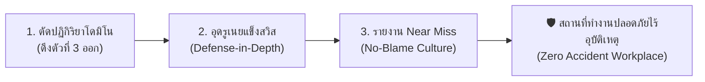

# Week 05: พื้นฐานการป้องกันอุบัติเหตุ (Basics of Accident Prevention)

---

## 🛡️ ส่วนที่ 5: การประยุกต์ใช้ในการป้องกันอุบัติเหตุ (Practical Applications in Safety Management)

> 💡 **บทนำ:**  
> ทฤษฎีความปลอดภัยไม่ได้มีไว้แค่สละเวลาท่องจำไปสอบผ่านเท่านั้น แต่คือ **"ยุทธวิธีกู้ชีวิตหน้างานจริง"** ที่นักจัดการความปลอดภัยและวิศวกรต้องนำไปประยุกต์ใช้อย่างมีกลยุทธ์ เพื่อเปลี่ยนหน้างานที่เสี่ยงอันตรายให้กลายเป็น **"พื้นที่ปลอดภัย 100%"** ผ่าน 3 กลยุทธ์หลักดังต่อไปนี้:

---

### 🚀 3 กลยุทธ์ปฏิบัติการหน้างาน

---

#### 1️⃣ กลยุทธ์ที่ 1: การตัดปฏิกิริยาลูกโซ่โดมิโน (Interrupting the Domino Chain)
* **หลักการ:** ไฮน์ริชชี้ว่า โดมิโนตัวที่ 1 (ภูมิหลัง) และ 2 (นิสัย) แก้ไขยากที่สุด **แต่เราสามารถหยุดอุบัติเหตุได้ทันทีโดยการ "ดึงโดมิโนตัวที่ 3 (Unsafe Act / Unsafe Condition) ออกไป!"**
* 🎭 **สถานการณ์ตัวละคร (บราซิล - เหงื่อตกปนตื่นเต้น):**  
  🇧🇷 **โรเบอร์โต** ช่างเจียรเหล็กสุดเก๋า กำลังเร่งงานส่งมอบกะดึก เหงื่อไหลไคลย้อยจนแว่นตาหมอง โรเบอร์โตรำคาญจึงถอดแว่นตานิรภัยออก แล้วเตรียมกดสวิตช์หินเจียรที่ไม่มีการ์ดบัง!  
  💥 **การตัดวงจรหน้างาน:** เจ้าหน้าที่ความปลอดภัย (จป.) วิ่งกระโดดสไลด์เข้ามาหยุดมือโรเบอร์โตได้ทันวินาทีวิกฤต! จากนั้นสั่งติดตั้ง **ฝาครอบบังหินเจียร (Engineering Control - กำจัด Unsafe Condition)** และมอบ **แว่นตานิรภัยแบบมีรูระบายอากาศทูโทน (กำจัด Unsafe Act)** ➔ ผลลัพธ์: แม้โรเบอร์โตจะใจร้อนอยากรีบทำงานเสร็จ แต่อุบัติเหตุเศษเหล็กพุ่งเจาะตาก็ถูกตัดขาดทันที!

---

#### 2️⃣ กลยุทธ์ที่ 2: การสร้างแนวป้องกันหลายชั้นและอุดรูเนยแข็ง (Swiss Cheese Defense-in-Depth & Plugging Flaws)
* **หลักการ:** อย่าหวังพึ่งพาแนวป้องกันเพียงด่านเดียว! ต้องสร้าง **แนวป้องกันหลายชั้น (Defense-in-Depth)** ทั้งนโยบาย ➔ วิศวกรรม ➔ ขั้นตอน SOP ➔ อุปกรณ์ PPE และคอยสุ่มตรวจ **อุดรูรั่วซ่อนเร้น (Latent Conditions)** อยู่เสมอ
* 🎭 **สถานการณ์ตัวละคร (เยอรมนี - เครียดแต่จบสวย):**  
  🇩🇪 **ฮันส์** ขับรถบรรทุกส่งสินค้าข้ามประเทศ อากาศหนาวเหน็บและฝนตกหนัก ฮันส์เกิดอาการง่วงนอนสะลึมสะลือ ตาปรือหน้าพวงมาลัย (*Active Failure - รูรั่วด่านคน*)  
  🛡️ **การอุดรูเนยแข็ง 4 ด่าน:**  
  * *ด่านที่ 1 (นโยบาย):* บริษัทมีกฎเข้มงวดให้หยุดพักทุก 4 ชั่วโมง  
  * *ด่านที่ 2 (วิศวกรรม):* รถบรรทุกติดตั้งระบบเบรกฉุกเฉินอัตโนมัติ (AEB) และระบบเตือนออกนอกเลน  
  * *ด่านที่ 3 (SOP):* กำหนดให้วิ่งชิดซ้ายไม่เกิน 80 กม./ชม. ช่วงฝนตก  
  * *ด่านที่ 4 (PPE):* ฮันส์สวมเข็มขัดนิรภัยแน่นหนา  
  ➔ ผลลัพธ์: แม้รูรั่วที่ด่านตัวฮันส์จะเปิดออก (ง่วง) แต่ด่านวิศวกรรมระบบเตือนเสียงดังขึ้น พร้อมเบรกอัตโนมัติทำงาน ช่วยเซฟชีวิตฮันส์และรถบรรทุกไม่ให้พุ่งตกเหว!

---

#### 3️⃣ กลยุทธ์ที่ 3: การรายงานเกือบเกิดอุบัติเหตุ (Near Miss Reporting) & วัฒนธรรมไม่มุ่งโทษบุคคล (No-Blame Culture)
* **หลักการ:** ตามสามเหลี่ยมไฮน์ริช ทุกๆ 1 อุบัติเหตุรุนแรง มี **Near Miss (เหตุการณ์เกือบเกิดอุบัติเหตุ) ซ่อนอยู่ถึง 300 ครั้ง!** หากองค์กรสร้าง **วัฒนธรรมความปลอดภัยแบบไม่มุ่งโทษบุคคล (No-Blame Culture)** พนักงานจะกล้าแจ้งเหตุ Near Miss นำไปสู่การปรับปรุงแก้ไขก่อนจะกลายเป็นอุบัติเหตุจริง
* 🎭 **สถานการณ์ตัวละคร (ญี่ปุ่น - ลุ้นระทึกแต่ฮา):**  
  🇯🇵 **เคนจิ** ขับฟอร์คลิฟต์ถอยหลังในคลังสินค้า ด้วยความรีบ งาฟอร์คลิฟต์ไปเกี่ยวเฉียดลังสินค้ามูลค่า 1 ล้านเยนตกอย่างน่าเสียวไส้ลงมากระแทกพื้นห่างจากเท้าเคนจิแค่ 5 เซนติเมตร! (*Near Miss - ไม่มีใครบาดเจ็บ สินค้าไม่พัง*)  
  😅 **ถ้าเป็นสังคมเก่า:** เคนจิคงแอบยกลังเก็บเงียบๆ เพราะกลัวโดนประธานบริษัทดุและหักเงินเดือน  
  🏆 **การใช้ No-Blame Culture:** เคนจิเดินเข้าห้องประธานบริษัทแล้วยื่น **"ใบรายงาน Near Miss"** ประธานบริษัทนอกจากจะไม่ดุด่าแล้ว ยังยิ้มกว้างมอบเงินรางวัล **"Safety Hero of the Month"** 5,000 เยนให้เคนจิ! จากนั้นสั่งช่างให้มาขยายทางเดินคลังสินค้า และติดกระจกโค้งมุมอับทันที ➔ ป้องกันไม่ให้ฟอร์คลิฟต์คันอื่นชนสินค้าตกทับคนในอนาคต!

---

## 📝 คำถาม / แบบทดสอบทบทวน ส่วนที่ 5

> 📌 **โจทย์และคำสั่งสำหรับนักศึกษา:**  
> จากเหตุการณ์จริงที่นักศึกษาได้เลือกวิเคราะห์และถอดบทเรียนมาตั้งแต่ **ส่วนที่ 2, 3 และ 4** ให้นักศึกษาจัดทำ **"แผนปฏิบัติการป้องกันอุบัติเหตุหน้างาน (Practical Safety Action Plan)"** โดยตอบคำถาม 3 ประเด็นดังต่อไปนี้:

---

### 📋 โครงสร้างแบบตอบคำถาม ส่วนที่ 5:

#### 1️⃣ การกำหนดมาตรการตัดโดมิโนตัวที่ 3 (Domino Interrupt Action):
* นักศึกษาจะมีมาตรการเฉพาะเจาะจงอย่างไรในการ **กำจัด Unsafe Act (พฤติกรรมเสี่ยง)** และ **กำจัด Unsafe Condition (สภาพแวดล้อมเสี่ยง)** ในเหตุการณ์นั้น? *(บรรยาย 3-5 บรรทัด)*

---

#### 2️⃣ การออกแบบแนวป้องกัน 4 ชั้นตาม Swiss Cheese Model (Defense-in-Depth Design):
* ออกแบบมาตรการป้องกันให้ครบทั้ง 4 ด่านเพื่อไม่ให้รูเนยตรงกัน:
  * 🧀 *ด่านที่ 1 (นโยบาย/กฎระเบียบ):* ...
  * 🧀 *ด่านที่ 2 (ระบบวิศวกรรม/การตัดไฟ/การ์ดกั้น):* ...
  * 🧀 *ด่านที่ 3 (ขั้นตอน SOP/ป้ายเตือน/การอบรม):* ...
  * 🧀 *ด่านที่ 4 (อุปกรณ์ป้องกันส่วนบุคคล PPE):* ...

---

#### 3️⃣ การส่งเสริม Near Miss & บทพูดสร้างแรงจูงใจลูกน้อง (Safety Leadership & Motivation Speech):
* **มาตรการ Near Miss:** จะใช้วิธีการใดจูงใจให้คนทำงานกล้าแจ้งเหตุการณ์เกือบเกิดอุบัติเหตุโดยไม่กลัวโดนลงโทษ?
* 🗣️ **บทพูดสร้างแรงจูงใจ (Motivations Speech):** สมมติว่านักศึกษาเป็น **หัวหน้างาน/จป.** ก่อนเริ่มงานกะเช้า นักศึกษาจะพูดปลุกใจลูกน้อง 3 บรรทัดอย่างไร ให้ทุกคนตระหนักถึงความปลอดภัยและอยากสวมใส่อุปกรณ์ PPE กลับบ้านไปหาครอบครัวอย่างปลอดภัย?

* คำถาม / แบบทดสอบทบทวน ส่วนที่ 5

Practical Safety Action Plan

กรณีศึกษา: คาร์ลอสประสบอุบัติเหตุตกจากหลังคาสูง 6 เมตรขณะทำงาน ส่งผลให้กระดูกสันหลังและกระดูกเชิงกรานแตกหัก และสูญเสียความสามารถในการเดินอย่างถาวร

1. การกำหนดมาตรการตัดโดมิโนตัวที่ 3 (Domino Interrupt Action)

การกำจัด Unsafe Act (พฤติกรรมเสี่ยง): กำหนดให้พนักงานที่ทำงานบนที่สูงต้องผ่านการอบรมความปลอดภัย ตรวจสอบความพร้อมก่อนเริ่มงาน และใช้อุปกรณ์ป้องกันการตกอย่างถูกต้อง ห้ามทำงานบนหลังคาโดยประมาทหรือไม่ปฏิบัติตามขั้นตอนที่กำหนด

การกำจัด Unsafe Condition (สภาพแวดล้อมเสี่ยง): ติดตั้งราวกันตกและจัดให้มีจุดยึดอุปกรณ์ป้องกันการตกที่แข็งแรง พร้อมตรวจสอบนั่งร้าน บันได และพื้นผิวทำงานก่อนใช้งาน หากพบสภาพไม่ปลอดภัยต้องหยุดงานและแก้ไขทันที เพื่อป้องกันไม่ให้พนักงานตกจากที่สูง

2. การออกแบบแนวป้องกัน 4 ชั้นตาม Swiss Cheese Model (Defense-in-Depth Design)

ด่านที่ 1 นโยบายและกฎระเบียบ (Policy & Regulations)

บริษัทต้องกำหนดนโยบายการทำงานบนที่สูงอย่างชัดเจน กำหนดให้ประเมินความเสี่ยงและอนุญาตให้เริ่มงานได้เมื่อมีมาตรการป้องกันครบถ้วน พร้อมให้หัวหน้างานตรวจสอบการปฏิบัติตามกฎความปลอดภัยอย่างสม่ำเสมอ

ด่านที่ 2 ระบบวิศวกรรม (Engineering Controls)

ติดตั้งราวกันตก แผ่นปิดช่องเปิด และระบบป้องกันการตกที่เหมาะสมกับลักษณะงาน จัดให้มีจุดยึดที่ผ่านการออกแบบสำหรับอุปกรณ์ป้องกันการตก และตรวจสอบความแข็งแรงของหลังคาและพื้นที่ทำงานก่อนเริ่มปฏิบัติงาน

ด่านที่ 3 ขั้นตอนการทำงานและการอบรม (SOP & Training)

จัดทำขั้นตอนการทำงานอย่างปลอดภัย (SOP) สำหรับงานบนที่สูง อบรมวิธีใช้อุปกรณ์ป้องกันการตกอย่างถูกต้อง ตรวจสอบพื้นที่ก่อนเริ่มงาน และกำหนดให้หยุดปฏิบัติงานเมื่อสภาพอากาศหรือพื้นที่ไม่ปลอดภัย รวมถึงจัดเตรียมแผนช่วยเหลือเมื่อเกิดเหตุฉุกเฉิน

ด่านที่ 4 อุปกรณ์ป้องกันส่วนบุคคล (PPE)

จัดให้พนักงานใช้หมวกนิรภัยที่เหมาะสม รองเท้านิรภัย และชุดเข็มขัดนิรภัยแบบเต็มตัว (Full Body Harness) ที่เชื่อมต่อกับระบบยึดรั้งหรือระบบหยุดการตกที่เหมาะสม โดยต้องตรวจสอบอุปกรณ์ก่อนใช้งานทุกครั้ง ทั้งนี้ PPE ต้องใช้ร่วมกับมาตรการป้องกันการตกด้านอื่น ไม่ใช่ใช้ทดแทนราวกันตกหรือระบบป้องกันทางวิศวกรรม

3. การส่งเสริม Near Miss และบทพูดสร้างแรงจูงใจ (Safety Leadership & Motivation Speech)

มาตรการส่งเสริม Near Miss Reporting

บริษัทควรจัดให้มีช่องทางรายงานเหตุการณ์เกือบเกิดอุบัติเหตุที่สะดวก เช่น แบบฟอร์มออนไลน์หรือกล่องรับรายงาน พร้อมเปิดโอกาสให้รายงานโดยไม่เปิดเผยชื่อเมื่อเหมาะสม หัวหน้างานต้องรับฟังโดยไม่มุ่งตำหนิผู้รายงาน และนำข้อมูลไปวิเคราะห์สาเหตุเพื่อแก้ไขความเสี่ยงอย่างจริงจัง นอกจากนี้ควรแจ้งผลการแก้ไขให้พนักงานทราบและยกย่องผู้ที่ช่วยรายงานอันตราย เพื่อสร้างวัฒนธรรมความปลอดภัยร่วมกัน

บทพูดสร้างแรงจูงใจก่อนเริ่มงานกะเช้า

“ก่อนเริ่มงานวันนี้ ขอให้ทุกคนตรวจสอบพื้นที่ทำงานและอุปกรณ์ป้องกันของตัวเองให้พร้อม หากพบสิ่งผิดปกติหรือเหตุการณ์เกือบเกิดอุบัติเหตุ ขอให้รีบแจ้งทันที เพราะความปลอดภัยของทุกคนสำคัญกว่างานที่ต้องเร่งให้เสร็จ

อย่าลืมสวมใส่อุปกรณ์ PPE ให้ถูกต้องทุกครั้ง และอย่าเสี่ยงทำงานในสภาพที่ไม่ปลอดภัย เพราะอุบัติเหตุเพียงครั้งเดียวอาจเปลี่ยนชีวิตเราและครอบครัวไปตลอด

เป้าหมายของเราไม่ใช่แค่ทำงานให้เสร็จ แต่คือการทำงานอย่างปลอดภัยและกลับบ้านไปหาครอบครัวอย่างครบถ้วนทุกคนครับ/ค่ะ”

สรุป

การป้องกันอุบัติเหตุอย่างมีประสิทธิภาพต้องอาศัยทั้งการกำจัดพฤติกรรมและสภาพแวดล้อมที่ไม่ปลอดภัย การสร้างแนวป้องกันหลายชั้น และการส่งเสริมให้พนักงานกล้ารายงานเหตุการณ์เกือบเกิดอุบัติเหตุ เมื่อทุกคนร่วมมือกันและผู้บริหารสนับสนุนมาตรการความปลอดภัยอย่างจริงจัง ก็จะช่วยลดโอกาสเกิดอุบัติเหตุและลดความสูญเสียต่อชีวิต ทรัพย์สิน และองค์กรได้
