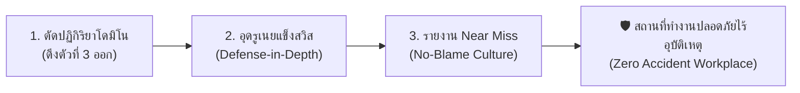

# Week 05: พื้นฐานการป้องกันอุบัติเหตุ (Basics of Accident Prevention)

---

## 🛡️ ส่วนที่ 5: การประยุกต์ใช้ในการป้องกันอุบัติเหตุ (Practical Applications in Safety Management)

> 💡 **บทนำ:**  
> ทฤษฎีความปลอดภัยไม่ได้มีไว้แค่สละเวลาท่องจำไปสอบผ่านเท่านั้น แต่คือ **"ยุทธวิธีกู้ชีวิตหน้างานจริง"** ที่นักจัดการความปลอดภัยและวิศวกรต้องนำไปประยุกต์ใช้อย่างมีกลยุทธ์ เพื่อเปลี่ยนหน้างานที่เสี่ยงอันตรายให้กลายเป็น **"พื้นที่ปลอดภัย 100%"** ผ่าน 3 กลยุทธ์หลักดังต่อไปนี้:

---

### 🚀 3 กลยุทธ์ปฏิบัติการหน้างาน

---

#### 1️⃣ กลยุทธ์ที่ 1: การตัดปฏิกิริยาลูกโซ่โดมิโน (Interrupting the Domino Chain)
* **หลักการ:** ไฮน์ริชชี้ว่า โดมิโนตัวที่ 1 (ภูมิหลัง) และ 2 (นิสัย) แก้ไขยากที่สุด **แต่เราสามารถหยุดอุบัติเหตุได้ทันทีโดยการ "ดึงโดมิโนตัวที่ 3 (Unsafe Act / Unsafe Condition) ออกไป!"**
* 🎭 **สถานการณ์ตัวละคร (บราซิล - เหงื่อตกปนตื่นเต้น):**  
  🇧🇷 **โรเบอร์โต** ช่างเจียรเหล็กสุดเก๋า กำลังเร่งงานส่งมอบกะดึก เหงื่อไหลไคลย้อยจนแว่นตาหมอง โรเบอร์โตรำคาญจึงถอดแว่นตานิรภัยออก แล้วเตรียมกดสวิตช์หินเจียรที่ไม่มีการ์ดบัง!  
  💥 **การตัดวงจรหน้างาน:** เจ้าหน้าที่ความปลอดภัย (จป.) วิ่งกระโดดสไลด์เข้ามาหยุดมือโรเบอร์โตได้ทันวินาทีวิกฤต! จากนั้นสั่งติดตั้ง **ฝาครอบบังหินเจียร (Engineering Control - กำจัด Unsafe Condition)** และมอบ **แว่นตานิรภัยแบบมีรูระบายอากาศทูโทน (กำจัด Unsafe Act)** ➔ ผลลัพธ์: แม้โรเบอร์โตจะใจร้อนอยากรีบทำงานเสร็จ แต่อุบัติเหตุเศษเหล็กพุ่งเจาะตาก็ถูกตัดขาดทันที!

---

#### 2️⃣ กลยุทธ์ที่ 2: การสร้างแนวป้องกันหลายชั้นและอุดรูเนยแข็ง (Swiss Cheese Defense-in-Depth & Plugging Flaws)
* **หลักการ:** อย่าหวังพึ่งพาแนวป้องกันเพียงด่านเดียว! ต้องสร้าง **แนวป้องกันหลายชั้น (Defense-in-Depth)** ทั้งนโยบาย ➔ วิศวกรรม ➔ ขั้นตอน SOP ➔ อุปกรณ์ PPE และคอยสุ่มตรวจ **อุดรูรั่วซ่อนเร้น (Latent Conditions)** อยู่เสมอ
* 🎭 **สถานการณ์ตัวละคร (เยอรมนี - เครียดแต่จบสวย):**  
  🇩🇪 **ฮันส์** ขับรถบรรทุกส่งสินค้าข้ามประเทศ อากาศหนาวเหน็บและฝนตกหนัก ฮันส์เกิดอาการง่วงนอนสะลึมสะลือ ตาปรือหน้าพวงมาลัย (*Active Failure - รูรั่วด่านคน*)  
  🛡️ **การอุดรูเนยแข็ง 4 ด่าน:**  
  * *ด่านที่ 1 (นโยบาย):* บริษัทมีกฎเข้มงวดให้หยุดพักทุก 4 ชั่วโมง  
  * *ด่านที่ 2 (วิศวกรรม):* รถบรรทุกติดตั้งระบบเบรกฉุกเฉินอัตโนมัติ (AEB) และระบบเตือนออกนอกเลน  
  * *ด่านที่ 3 (SOP):* กำหนดให้วิ่งชิดซ้ายไม่เกิน 80 กม./ชม. ช่วงฝนตก  
  * *ด่านที่ 4 (PPE):* ฮันส์สวมเข็มขัดนิรภัยแน่นหนา  
  ➔ ผลลัพธ์: แม้รูรั่วที่ด่านตัวฮันส์จะเปิดออก (ง่วง) แต่ด่านวิศวกรรมระบบเตือนเสียงดังขึ้น พร้อมเบรกอัตโนมัติทำงาน ช่วยเซฟชีวิตฮันส์และรถบรรทุกไม่ให้พุ่งตกเหว!

---

#### 3️⃣ กลยุทธ์ที่ 3: การรายงานเกือบเกิดอุบัติเหตุ (Near Miss Reporting) & วัฒนธรรมไม่มุ่งโทษบุคคล (No-Blame Culture)
* **หลักการ:** ตามสามเหลี่ยมไฮน์ริช ทุกๆ 1 อุบัติเหตุรุนแรง มี **Near Miss (เหตุการณ์เกือบเกิดอุบัติเหตุ) ซ่อนอยู่ถึง 300 ครั้ง!** หากองค์กรสร้าง **วัฒนธรรมความปลอดภัยแบบไม่มุ่งโทษบุคคล (No-Blame Culture)** พนักงานจะกล้าแจ้งเหตุ Near Miss นำไปสู่การปรับปรุงแก้ไขก่อนจะกลายเป็นอุบัติเหตุจริง
* 🎭 **สถานการณ์ตัวละคร (ญี่ปุ่น - ลุ้นระทึกแต่ฮา):**  
  🇯🇵 **เคนจิ** ขับฟอร์คลิฟต์ถอยหลังในคลังสินค้า ด้วยความรีบ งาฟอร์คลิฟต์ไปเกี่ยวเฉียดลังสินค้ามูลค่า 1 ล้านเยนตกอย่างน่าเสียวไส้ลงมากระแทกพื้นห่างจากเท้าเคนจิแค่ 5 เซนติเมตร! (*Near Miss - ไม่มีใครบาดเจ็บ สินค้าไม่พัง*)  
  😅 **ถ้าเป็นสังคมเก่า:** เคนจิคงแอบยกลังเก็บเงียบๆ เพราะกลัวโดนประธานบริษัทดุและหักเงินเดือน  
  🏆 **การใช้ No-Blame Culture:** เคนจิเดินเข้าห้องประธานบริษัทแล้วยื่น **"ใบรายงาน Near Miss"** ประธานบริษัทนอกจากจะไม่ดุด่าแล้ว ยังยิ้มกว้างมอบเงินรางวัล **"Safety Hero of the Month"** 5,000 เยนให้เคนจิ! จากนั้นสั่งช่างให้มาขยายทางเดินคลังสินค้า และติดกระจกโค้งมุมอับทันที ➔ ป้องกันไม่ให้ฟอร์คลิฟต์คันอื่นชนสินค้าตกทับคนในอนาคต!

---

## 📝 คำถาม / แบบทดสอบทบทวน ส่วนที่ 5

> 📌 **โจทย์และคำสั่งสำหรับนักศึกษา:**  
> จากเหตุการณ์จริงที่นักศึกษาได้เลือกวิเคราะห์และถอดบทเรียนมาตั้งแต่ **ส่วนที่ 2, 3 และ 4** ให้นักศึกษาจัดทำ **"แผนปฏิบัติการป้องกันอุบัติเหตุหน้างาน (Practical Safety Action Plan)"** โดยตอบคำถาม 3 ประเด็นดังต่อไปนี้:

---

### 📋 โครงสร้างแบบตอบคำถาม ส่วนที่ 5:

#### 1️⃣ การกำหนดมาตรการตัดโดมิโนตัวที่ 3 (Domino Interrupt Action):
* นักศึกษาจะมีมาตรการเฉพาะเจาะจงอย่างไรในการ **กำจัด Unsafe Act (พฤติกรรมเสี่ยง)** และ **กำจัด Unsafe Condition (สภาพแวดล้อมเสี่ยง)** ในเหตุการณ์นั้น? *(บรรยาย 3-5 บรรทัด)*

---

#### 2️⃣ การออกแบบแนวป้องกัน 4 ชั้นตาม Swiss Cheese Model (Defense-in-Depth Design):
* ออกแบบมาตรการป้องกันให้ครบทั้ง 4 ด่านเพื่อไม่ให้รูเนยตรงกัน:
  * 🧀 *ด่านที่ 1 (นโยบาย/กฎระเบียบ):* ...
  * 🧀 *ด่านที่ 2 (ระบบวิศวกรรม/การตัดไฟ/การ์ดกั้น):* ...
  * 🧀 *ด่านที่ 3 (ขั้นตอน SOP/ป้ายเตือน/การอบรม):* ...
  * 🧀 *ด่านที่ 4 (อุปกรณ์ป้องกันส่วนบุคคล PPE):* ...

---

#### 3️⃣ การส่งเสริม Near Miss & บทพูดสร้างแรงจูงใจลูกน้อง (Safety Leadership & Motivation Speech):
* **มาตรการ Near Miss:** จะใช้วิธีการใดจูงใจให้คนทำงานกล้าแจ้งเหตุการณ์เกือบเกิดอุบัติเหตุโดยไม่กลัวโดนลงโทษ?
* 🗣️ **บทพูดสร้างแรงจูงใจ (Motivations Speech):** สมมติว่านักศึกษาเป็น **หัวหน้างาน/จป.** ก่อนเริ่มงานกะเช้า นักศึกษาจะพูดปลุกใจลูกน้อง 3 บรรทัดอย่างไร ให้ทุกคนตระหนักถึงความปลอดภัยและอยากสวมใส่อุปกรณ์ PPE กลับบ้านไปหาครอบครัวอย่างปลอดภัย?

1️⃣ การกำหนดมาตรการตัดโดมิโนตัวที่ 3 (Domino Interrupt Action)การกำจัดพฤติกรรมที่ไม่ปลอดภัย (Eliminating Unsafe Act):กำหนดบังคับใช้ ระบบใบอนุญาตทำงานที่ก่อให้เกิดความร้อนและความประกายไฟ (Hot Work Permit System) ก่อนเริ่มงานเจียร/เชื่อมทุกครั้ง พนักงานต้องทำการวัดระดับก๊าซไวไฟ ($LEL < 10\%$) เคลียร์ย้ายวัตถุไวไฟออกจากระยะ 10 เมตร พร้อมสวมใส่ชุด PPE กันไฟและสวมกระบังหน้า (Face Shield)การกำจัดสภาพการณ์ที่ไม่ปลอดภัย (Eliminating Unsafe Condition):ดำเนินการซ่อมบำรุงเปลี่ยนวาล์วถังบรรจุสารเคมีที่รั่วซึมทันที ติดตั้งระบบพัดลมระบายอากาศทนการระเบิด (Explosion-proof Exhaust Fan) และจัดวางถังดับเพลิงเคมีแห้งขนาด 15 ปอนด์ ไว้ประจำจุดซ่อมบำรุงในระยะไม่เกิน 5 เมตร2️⃣ การออกแบบแนวป้องกัน 4 ชั้นตาม Swiss Cheese Model (Defense-in-Depth Design)🧀 ด่านที่ 1 (Policy & Regulations):ประกาศใช้นโยบายความปลอดภัย Zero Harm และระเบียบปฏิบัติงานความร้อน (Hot Work Safety Standard) โดยกำหนดให้งานที่มีประกายไฟทุกชนิดต้องผ่านการอนุมัติจาก จป.วิชาชีพ หรือหัวหน้างานก่อนลงมือทำ🧀 ด่านที่ 2 (Engineering Controls):ติดตั้งระบบระบายอากาศทนประกายไฟ (Explosion-proof Ventilation), กั้นห้องแยกสำหรับจัดเก็บสารเคมีไวไฟโดยเฉพาะ (Flammable Storage Room) และติดตั้งเซนเซอร์ตรวจจับก๊าซไวไฟรั่วไหลพร้อมเสียงสัญญาณเตือน🧀 ด่านที่ 3 (Administrative Controls & SOP):จัดทำขั้นตอนการปฏิบัติงานมาตรฐาน (SOP) และป้ายเตือน "เขตสารเคมีไวไฟ ห้ามทำให้เกิดประกายไฟ", บังคับทำ Safety Checklist ก่อนเริ่มงาน และจัดอบรมการดับเพลิงเบื้องต้นและการรับมือเหตุฉุกเฉินให้แก่พนักงานทุกคนทุก 6 เดือน🧀 ด่านที่ 4 (Personal Protective Equipment - PPE):บังคับสวมใส่ชุดปฏิบัติงานทนไฟ (Flame-retardant Overalls), ถุงมือหนังสำหรับงานความร้อน, กระบังหน้านิรภัย (Face Shield) และรองเท้าเซฟตี้พื้นกันสปาร์กขณะเจียรตัดโลหะ3️⃣ การส่งเสริม Near Miss & บทพูดสร้างแรงจูงใจลูกน้อง (Safety Leadership & Motivation Speech)มาตรการส่งเสริมการรายงาน Near Miss (No-Blame Culture):จัดตั้งโปรแกรม "Near Miss Safety Rewards" เปิดโอกาสให้พนักงานส่งรายงานเหตุการณ์เกือบเกิดอุบัติเหตุผ่านแอปพลิเคชันหรือกล่องรับเรื่อง โดยเน้นการแก้ไขที่ตัวระบบ ไม่มีการลงโทษหรือตัดคะแนนพนักงาน และแจกบัตรของขวัญหรือรางวัล Safety Hero ประจำเดือนให้กับรายงาน Near Miss ที่ช่วยป้องกันอันตรายได้ดีที่สุด🗣️ บทพูดสร้างแรงจูงใจก่อนเริ่มงาน (Toolbox Talk / Motivation Speech):"พี่น้องช่างทุกคนครับ งานที่เร่งด่วนแค่ไหนก็ไม่มีค่าเท่ากับชีวิตและความปลอดภัยของพวกเราแม้แต่คนเดียว ก่อนกดสวิตช์เครื่องเจียรหรือจุดไฟวันนี้ ช่วยเสียเวลาเช็กพื้นที่และใส่ PPE ให้ครบถ้วน เพราะหมวกนิรภัย แว่นตา และถุงมือที่พวกเราสวมใส่ ไม่ได้ใส่เพื่อทำตามกฎของ จป. แต่ใส่เพื่อให้พวกเรามีอวัยวะครบ 32 ประการ กลับไปกินข้าวเย็น ยิ้ม และกอดลูกเมียที่บ้านได้อย่างปลอดภัยในเย็นวันนี้ครับ!"
