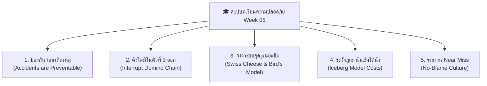

# Week 05: พื้นฐานการป้องกันอุบัติเหตุ (Basics of Accident Prevention)

---

## 📝 สรุปเนื้อหาประจำสัปดาห์ (Week 05 Summary)

> 💡 **บทสรุปภาพรวม (Executive Summary):**  
> สัปดาห์นี้เราได้เรียนรู้ว่า **"อุบัติเหตุไม่ใช่เรื่องของโชคชะตาหรือดวงชะตา"** แต่คือเหตุการณ์ที่มีสาเหตุรากเหง้าซ่อนอยู่เสมอ หากเรารู้วิธีวิเคราะห์ผ่านทฤษฎีโดมิโน โมเดลเนยแข็งสวิส และทฤษฎีภูเขาน้ำแข็ง เราจะสามารถตัดปฏิกิริยาลูกโซ่อุบัติเหตุและอุดรูรั่วเชิงระบบได้อย่างมีประสิทธิภาพ

---

### 🌐 5 ประเด็นสรุปสำคัญ คำคมและสุภาษิตนานาชาติ (Global Safety Proverbs)

---

#### 1️⃣ อุบัติเหตุไม่ได้เกิดจากโชคชะตา แต่ป้องกันได้เสมอ
* 🇬🇧 **สุภาษิตภาษาอังกฤษ (UK / USA):**  
  🗣️ *"An ounce of prevention is worth a pound of cure."*  
  🇹🇭 *(แปลไทย: "การป้องกันเพียงหนึ่งออนซ์ มีค่ามากกว่าการรักษาพยาบาลถึงหนึ่งปอนด์")* — Benjamin Franklin
* 💡 **แก่น OHS:** อุบัติเหตุไม่ใช่เรื่องสุดวิสัย การลงทุนป้องกันความปลอดภัยเพียงเล็กน้อยในวันนี้ ช่วยประหยัดชีวิตและงบประมาณในการรักษาพยาบาลมหาศาลในวันข้างหน้า

---

#### 2️⃣ การดึงโดมิโนตัวที่ 3 ออกเพื่อตัดวงจรอันตราย (Domino Theory)
* 🇯🇵 **สุภาษิตภาษาญี่ปุ่น (Japan):**  
  🗣️ *"転ばぬ先の杖"* *(Korobanu saki no tsue)*  
  🇹🇭 *(แปลไทย: "ยื่นไม้เท้าพยุงตัวไว้ล่วงหน้า ก่อนที่จะลื่นไถลหกล้มลงไป")*
* 💡 **แก่น OHS:** ไฮน์ริชสอนว่า เราไม่อาจเปลี่ยนประวัติหรือนิสัยลึกๆ ของคนได้ทันที แต่เราสามารถยื่น "ไม้เท้าป้องกัน" โดยการ **กำจัด Unsafe Act และ Unsafe Condition (ดึงโดมิโนตัวที่ 3 ออก)** เพื่อไม่ให้อุบัติเหตุและความสูญเสียล้มตามลงมา

---

#### 3️⃣ อย่าโทษแค่คนทำงาน ให้เน้นอุดรูรั่วเชิงระบบ (Bird & Loftus & Swiss Cheese Model)
* 🇩🇪 **สุภาษิตภาษาเยอรมัน (Germany):**  
  🗣️ *"Vorsorge ist besser als Nachsorge."*  
  🇹🇭 *(แปลไทย: "การคิดวางแผนป้องกันระบบไว้ก่อน ดีกว่าการตามล้างตามเช็ดแก้ปัญหาทีหลัง")*
* 💡 **แก่น OHS:** ทฤษฎี Bird & Loftus และ Swiss Cheese Model เน้นย้ำว่า ฝ่ายบริหารต้องกุมโดมิโนตัวที่ 1 (Lack of Control) เพื่อสร้างแนวป้องกันหลายชั้น (Defense-in-Depth) และคอยอุด **"รูรั่วซ่อนเร้นเชิงระบบ (Latent Conditions)"** ก่อนที่รูเนยแข็งทุกแผ่นจะตรงกัน

---

#### 4️⃣ ตระหนักถึงความสูญเสียที่ซ่อนอยู่ใต้น้ำ (Iceberg Model Costs)
* 🇨🇳 **สุภาษิตภาษาจีน (China):**  
  🗣️ *"宜未雨而绸缪，毋临渴而掘井"* *(Yí wèi yǔ ér chóumóu, wú lín kě ér jué jǐng)*  
  🇹🇭 *(แปลไทย: "จงซ่อมหลังคาบ้านตั้งแต่แดดออกก่อนฝนจะตก อย่ารอจนกระทั่งคอแห้งหิวน้ำแล้วค่อยเริ่มขุดบ่อน้ำ")*
* 💡 **แก่น OHS:** ความสูญเสียจากอุบัติเหตุเปรียบเหมือนภูเขาน้ำแข็ง ค่ารักษาพยาบาลทางตรงคือยอดพ้นน้ำแค่ 1 ส่วน แต่ **ต้นทุนทางอ้อมใต้น้ำ (Downtime, ขวัญกำลังใจ, คดีความ, ภาพลักษณ์) มีขนาดใหญ่กว่า 4 ถึง 50 เท่า** หากรอให้เกิดเหตุแล้วค่อยแก้ ก็สายเกินไปเสียแล้ว

---

#### 5️⃣ สร้างวัฒนธรรมความปลอดภัยและการรายงาน Near Miss
* 🇲🇽 🇪🇸 **สุภาษิตภาษาสเปน (Mexico / Spain):**  
  🗣️ *"Más vale prevenir que lamentar."*  
  🇹🇭 *(แปลไทย: "การป้องกันไว้ก่อน มีคุณค่าและดีกว่าการต้องมานั่งโศกเศร้าเสียใจทีหลัง")*
* 🇹🇭 **สุภาษิตไทย (Thailand):**  
  🗣️ *"เปลี่ยนจาก 'วัวหายแล้วล้อมคอก' เป็น 'ล้อมคอกก่อนวัวจะหาย'"*
* 💡 **แก่น OHS:** ส่งเสริม **วัฒนธรรมการไม่มุ่งโทษบุคคล (No-Blame Culture)** เพื่อให้พนักงานกล้าแจ้งเหตุการณ์เกือบเกิดอุบัติเหตุ (Near Miss) 300 ครั้ง นำไปสู่การล้อมคอกแก้ไขก่อนจะเกิดอุบัติเหตุรุนแรงจริง

---

> ⭐️ **ข้อคิดสะกิดใจส่งท้ายบทเรียน (Final Thought):**  
> *"Safety is not a gadget, but a state of mind."*  
> (ความปลอดภัยไม่ใช่แค่อุปกรณ์เซฟตี้ที่สวมใส่ แต่คือสภาวะจิตใจ ความตระหนักรู้ และความใส่ใจดูแลกันในทุกๆ วันทำงาน)
>
คำนิยามพื้นฐาน (Key Definitions):Incident (อุบัติการณ์): เหตุการณ์เกี่ยวเนื่องจากการทำงาน ซึ่งอาจนำไปสู่หรือส่งผลให้เกิดการบาดเจ็บ/สูญเสีย (เป็นคำครอบคลุมทั้ง Accident และ Near Miss)Accident (อุบัติเหตุ): เหตุการณ์ที่ไม่ได้วางแผนไว้ ส่งผลให้เกิดการบาดเจ็บ เจ็บป่วย ทรัพย์สินเสียหาย หรือกระบวนการผลิตหยุดชะงักNear Miss (เหตุการณ์เกือบเกิดอุบัติเหตุ): เหตุการณ์ที่ไม่คาดคิดเกิดขึ้น แต่ ยังไม่ส่งผล ให้เกิดบาดเจ็บหรือทรัพย์สินเสียหาย (สัญญาณเตือนภัยล่วงหน้า)Unsafe Act / Condition: การกระทำที่ไม่ปลอดภัย (พฤติกรรมบุคคล) และ สภาพการณ์ที่ไม่ปลอดภัย (สิ่งแวดล้อม/เครื่องจักรชำรุด)สัดส่วนอุบัติเหตุ (Accident Triangles):Heinrich's Ratio ($1 : 29 : 300$): $1$ เหตุการณ์รุนแรง/เสียชีวิต $\leftarrow$ $29$ เหตุการณ์บาดเจ็บเล็กน้อย $\leftarrow$ $300$ เหตุการณ์เกือบเกิดอุบัติเหตุ (Near Misses)Frank Bird's Ratio ($1 : 10 : 30 : 600$): $1$ บาดเจ็บรุนแรง $\leftarrow$ $10$ บาดเจ็บเล็กน้อย $\leftarrow$ $30$ ทรัพย์สินเสียหาย $\leftarrow$ $600$ Near Missesทฤษฎีการเกิดอุบัติเหตุ (Accident Causation Theories):Heinrich's Domino Theory: โดมิโน 5 ตัวเรียงต่อกัน การป้องกันทำได้โดย "ดึงโดมิโนตัวที่ 3 (Unsafe Act / Unsafe Condition) ออก"Bird & Loftus Modified Domino Theory: มุ่งเน้นการแก้ปัญหารากเหง้าที่ โดมิโนตัวที่ 1 (Lack of Control - การขาดการควบคุมโดยฝ่ายบริหาร)Reason's Swiss Cheese Model: แผ่นเนยแข็งสวิสมารวมกัน 4 ด่าน (นโยบาย, วิศวกรรม, SOP, PPE) อุบัติเหตุจะเกิดขึ้นเมื่อ "รูรั่วของทุกแผ่นตรงกัน (Alignment of Flaws)"โครงสร้างต้นทุนภูเขาน้ำแข็ง (Iceberg Model Costs):Direct Costs (ต้นทุนทางตรง - ยอดพ้นน้ำ $5\text{--}10\%$): ค่ารักษาพยาบาล, ค่าชดเชยการหยุดงาน, ค่าซ่อมแซม (เบิกประกันได้)Indirect Costs (ต้นทุนทางอ้อม - ส่วนจมใต้น้ำ $90\text{--}95\%$): เสียเวลาสอบสวน, สายการผลิตหยุดชะงัก (Downtime), ค่าฝึกอบรมคนใหม่, ขวัญกำลังใจตกต่ำ, ค่าสู้คดีความ (แอบแฝงสูงกว่าทางตรง 4 ถึง 50 เท่า)ยุทธวิธีปฏิบัติการหน้างาน (Practical Action Plan):ตัดโดมิโนตัวที่ 3: กำจัด Unsafe Act / Unsafe Condition หน้างานทันทีสร้างแนวป้องกันหลายชั้น (Defense-in-Depth): ออกแบบมาตรการให้ครอบคลุมทั้ง 4 ด่านตาม Swiss Cheese Modelส่งเสริมวัฒนธรรมไม่มุ่งโทษบุคคล (No-Blame Culture): สร้างแรงจูงใจให้รายงาน Near Miss เพื่อปรับปรุงระบบก่อนเกิดอุบัติเหตุจริง🎯 แบบทดสอบประเมินผลตนเองประจำสัปดาห์ที่ 5 (Self-Assessment Test)ให้นักศึกษาตอบคำถามปรนัย 10 ข้อด้านล่างนี้ เพื่อทบทวนและวัดความเข้าใจเนื้อหาประจำสัปดาห์โจทย์ข้อสอบ (Questions 1 - 10)เหตุการณ์ที่เกิดขึ้นโดยไม่ได้วางแผนไว้ แต่ ยังไม่ส่งผล ให้เกิดการบาดเจ็บ เจ็บป่วย หรือทรัพย์สินเสียหาย จัดเป็นคำนิยามในข้อใด?ก. Accidentข. Near Missค. Unsafe Conditionง. Latent Conditionตามกฎอัตราส่วนของ Heinrich ($1 : 29 : 300$) ตัวเลข $300$ ที่ฐานพีระมิดหมายถึงเหตุการณ์ประเภทใด?ก. การบาดเจ็บสาหัสถึงขั้นเสียชีวิตข. การบาดเจ็บเล็กน้อยที่ต้องการการปฐมพยาบาลค. เหตุการณ์เกือบเกิดอุบัติเหตุ (Near Misses) ที่ไม่มีผู้ได้รับบาดเจ็บง. เหตุการณ์ที่ทรัพย์สินเสียหายมูลค่ามากกว่า 100,000 บาทตามทฤษฎีโดมิโนของ Heinrich การยับยั้งไม่ให้อุบัติเหตุและความสูญเสียเกิดขึ้น สามารถทำได้มีประสิทธิภาพที่สุดโดยการดำเนินการกับโดมิโนตัวใด?ก. ตัวที่ 1 (Ancestry & Social Environment)ข. ตัวที่ 2 (Fault of Person)ค. ตัวที่ 3 (Unsafe Act / Unsafe Condition)ง. ตัวที่ 4 (Accident)ทฤษฎีโดมิโนดัดแปลงของ Bird & Loftus (1976) มีจุดเน้นที่แตกต่างจากทฤษฎีเดิมของ Heinrich อย่างไร?ก. เน้นโทษการกระทำของพนักงานหน้างานเป็นหลักข. ชี้ให้เห็นว่ารากเหง้าของอุบัติเหตุเกิดจากการขาดการควบคุมโดยฝ่ายบริหาร (Lack of Control)ค. ยกเลิกการใช้อุปกรณ์คุ้มครองความปลอดภัยส่วนบุคคล (PPE)ง. มุ่งเน้นการคิดคำนวณเบี้ยประกันภัยทรัพย์สินเพียงอย่างเดียวในทฤษฎี Swiss Cheese Model ของ James Reason จุดบกพร่องเชิงระบบที่แฝงตัวอยู่นานแล้วในระดับผู้บริหารหรือการออกแบบระบบเรียกว่าอะไร?ก. Active Failuresข. Direct Causesค. Latent Conditionsง. Immediate Causesตามทฤษฎีภูเขาน้ำแข็ง (Iceberg Model) ต้นทุนประเภทใดที่เปรียบเสมือนส่วนที่จมอยู่ใต้น้ำและมีมูลค่าแอบแฝงสูงกว่าทางตรง 4 ถึง 50 เท่า?ก. Direct Costsข. Insured Costsค. Indirect Costsง. Medical Costsข้อใดจัดเป็น ต้นทุนทางตรง (Direct Cost) จากการเกิดอุบัติเหตุ?ก. ค่าใช้จ่ายในการฝึกอบรมพนักงานคนใหม่มาปฏิบัติงานแทนข. สูญเสียรายได้จากสายการผลิตหยุดชะงัก (Downtime)ค. ค่ารักษาพยาบาลและค่าเบิกจ่ายชดเชยตามกฎหมายแรงงานง. ค่าเบี้ยประกันภัยโรงงานปรับตัวสูงขึ้นในปีถัดไปการที่พนักงานขับรถโฟร์กลิฟต์ด้วยความเร็วเกินกำหนดในคลังสินค้า ถือเป็นประเด็นใดใน OHS?ก. Unsafe Conditionข. Unsafe Actค. Latent Conditionง. Property Lossกลยุทธ์ No-Blame Culture ในการบริหารจัดการความปลอดภัย มีวัตถุประสงค์หลักเพื่อสิ่งใด?ก. เพื่อหาผู้กระทำผิดมาลงโทษและหักเงินเดือนข. เพื่อส่งเสริมให้พนักงานกล้ารายงานเหตุการณ์เกือบเกิดอุบัติเหตุ (Near Miss) โดยไม่กลัวโดนลงโทษค. เพื่อยกเลิกขั้นตอนใบอนุญาตทำงานความร้อน (Hot Work Permit)ง. เพื่อลดงบประมาณในการจัดซื้ออุปกรณ์เซฟตี้การจัดทำแนวป้องกันหลายชั้น (Defense-in-Depth) ประกอบด้วย นโยบาย $\rightarrow$ วิศวกรรม $\rightarrow$ ขั้นตอน SOP $\rightarrow$ PPE เป็นการประยุกต์ใช้กรอบความคิดจากทฤษฎีใด?ก. Heinrich's 1:29:300 Triangleข. Reason's Swiss Cheese Modelค. Iceberg Theory Modelง. Domino Theory 1931🔑 เฉลยและคำอธิบายอย่างละเอียด (Answer Key & Explanations)ข้อเฉลยคำอธิบายอย่างละเอียด1ขNear Miss (เหตุการณ์เกือบเกิดอุบัติเหตุ) คือเหตุการณ์ที่ไม่คาดคิดเกิดขึ้น แต่ยังไม่มีผู้ได้รับบาดเจ็บหรือทรัพย์สินเสียหาย2คในพีระมิด $1 : 29 : 300$ ของ Heinrich ตัวเลข $300$ คือเหตุการณ์ Near Misses ที่ฐานพีระมิด ซึ่งเกิดขึ้นบ่อยที่สุดแต่ถูกมองข้าม3คHeinrich ชี้ว่าการเปลี่ยนภูมิหลัง (ตัวที่ 1) หรือนิสัย (ตัวที่ 2) ทำได้ยาก แต่สามารถตัดปฏิกิริยาลูกโซ่ได้ทันทีโดย ดึงโดมิโนตัวที่ 3 (Unsafe Act / Unsafe Condition) ออก4ขBird & Loftus ปรับปรุงทฤษฎีโดยมองว่า สาเหตุรากเหง้าที่ทำให้เกิดความบกพร่องหน้างาน มาจากการบริหารจัดการล้มเหลว (Lack of Control)5คLatent Conditions คือเงื่อนไขซ่อนเร้นเชิงระบบ เช่น การตัดลดงบซ่อมบำรุง หรือการออกแบบระบบที่ซับซ้อน ส่วน Active Failures คือความผิดพลาดหน้างาน6คIndirect Costs (ต้นทุนทางอ้อม) คือส่วนที่จมอยู่ใต้น้ำ เบิกประกันไม่ได้ และมีมูลค่าสูงกว่าต้นทุนทางตรง $4\text{--}50$ เท่า7คค่ารักษาพยาบาล และค่าชดเชยตามกฎหมายมีใบเสร็จชัดเจน เบิกประกันได้ จึงจัดเป็น Direct Costs ส่วนข้ออื่นเป็น Indirect Costs8ขการขับรถเร็วเกินกำหนดเป็นพฤติกรรมเสี่ยงของบุคคล จึงจัดเป็น Unsafe Act (การกระทำที่ไม่ปลอดภัย)9ขNo-Blame Culture เน้นสร้างความไว้วางใจให้พนักงานรายงาน Near Miss เพื่อนำข้อมูลไปปรับปรุงระบบก่อนเกิดอุบัติเหตุจริง10ขการสร้างแนวป้องกันหลายชั้นเพื่ออุดรูรั่วในแต่ละด่าน คือหัวใจสำคัญของการประยุกต์ใช้ Swiss Cheese Model ของ James Reason
