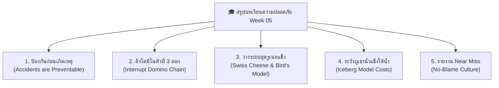

# Week 05: พื้นฐานการป้องกันอุบัติเหตุ (Basics of Accident Prevention)

---

## 📝 สรุปเนื้อหาประจำสัปดาห์ (Week 05 Summary)

> 💡 **บทสรุปภาพรวม (Executive Summary):**  
> สัปดาห์นี้เราได้เรียนรู้ว่า **"อุบัติเหตุไม่ใช่เรื่องของโชคชะตาหรือดวงชะตา"** แต่คือเหตุการณ์ที่มีสาเหตุรากเหง้าซ่อนอยู่เสมอ หากเรารู้วิธีวิเคราะห์ผ่านทฤษฎีโดมิโน โมเดลเนยแข็งสวิส และทฤษฎีภูเขาน้ำแข็ง เราจะสามารถตัดปฏิกิริยาลูกโซ่อุบัติเหตุและอุดรูรั่วเชิงระบบได้อย่างมีประสิทธิภาพ

---

### 🌐 5 ประเด็นสรุปสำคัญ คำคมและสุภาษิตนานาชาติ (Global Safety Proverbs)

---

#### 1️⃣ อุบัติเหตุไม่ได้เกิดจากโชคชะตา แต่ป้องกันได้เสมอ
* 🇬🇧 **สุภาษิตภาษาอังกฤษ (UK / USA):**  
  🗣️ *"An ounce of prevention is worth a pound of cure."*  
  🇹🇭 *(แปลไทย: "การป้องกันเพียงหนึ่งออนซ์ มีค่ามากกว่าการรักษาพยาบาลถึงหนึ่งปอนด์")* — Benjamin Franklin
* 💡 **แก่น OHS:** อุบัติเหตุไม่ใช่เรื่องสุดวิสัย การลงทุนป้องกันความปลอดภัยเพียงเล็กน้อยในวันนี้ ช่วยประหยัดชีวิตและงบประมาณในการรักษาพยาบาลมหาศาลในวันข้างหน้า

---

#### 2️⃣ การดึงโดมิโนตัวที่ 3 ออกเพื่อตัดวงจรอันตราย (Domino Theory)
* 🇯🇵 **สุภาษิตภาษาญี่ปุ่น (Japan):**  
  🗣️ *"転ばぬ先の杖"* *(Korobanu saki no tsue)*  
  🇹🇭 *(แปลไทย: "ยื่นไม้เท้าพยุงตัวไว้ล่วงหน้า ก่อนที่จะลื่นไถลหกล้มลงไป")*
* 💡 **แก่น OHS:** ไฮน์ริชสอนว่า เราไม่อาจเปลี่ยนประวัติหรือนิสัยลึกๆ ของคนได้ทันที แต่เราสามารถยื่น "ไม้เท้าป้องกัน" โดยการ **กำจัด Unsafe Act และ Unsafe Condition (ดึงโดมิโนตัวที่ 3 ออก)** เพื่อไม่ให้อุบัติเหตุและความสูญเสียล้มตามลงมา

---

#### 3️⃣ อย่าโทษแค่คนทำงาน ให้เน้นอุดรูรั่วเชิงระบบ (Bird & Loftus & Swiss Cheese Model)
* 🇩🇪 **สุภาษิตภาษาเยอรมัน (Germany):**  
  🗣️ *"Vorsorge ist besser als Nachsorge."*  
  🇹🇭 *(แปลไทย: "การคิดวางแผนป้องกันระบบไว้ก่อน ดีกว่าการตามล้างตามเช็ดแก้ปัญหาทีหลัง")*
* 💡 **แก่น OHS:** ทฤษฎี Bird & Loftus และ Swiss Cheese Model เน้นย้ำว่า ฝ่ายบริหารต้องกุมโดมิโนตัวที่ 1 (Lack of Control) เพื่อสร้างแนวป้องกันหลายชั้น (Defense-in-Depth) และคอยอุด **"รูรั่วซ่อนเร้นเชิงระบบ (Latent Conditions)"** ก่อนที่รูเนยแข็งทุกแผ่นจะตรงกัน

---

#### 4️⃣ ตระหนักถึงความสูญเสียที่ซ่อนอยู่ใต้น้ำ (Iceberg Model Costs)
* 🇨🇳 **สุภาษิตภาษาจีน (China):**  
  🗣️ *"宜未雨而绸缪，毋临渴而掘井"* *(Yí wèi yǔ ér chóumóu, wú lín kě ér jué jǐng)*  
  🇹🇭 *(แปลไทย: "จงซ่อมหลังคาบ้านตั้งแต่แดดออกก่อนฝนจะตก อย่ารอจนกระทั่งคอแห้งหิวน้ำแล้วค่อยเริ่มขุดบ่อน้ำ")*
* 💡 **แก่น OHS:** ความสูญเสียจากอุบัติเหตุเปรียบเหมือนภูเขาน้ำแข็ง ค่ารักษาพยาบาลทางตรงคือยอดพ้นน้ำแค่ 1 ส่วน แต่ **ต้นทุนทางอ้อมใต้น้ำ (Downtime, ขวัญกำลังใจ, คดีความ, ภาพลักษณ์) มีขนาดใหญ่กว่า 4 ถึง 50 เท่า** หากรอให้เกิดเหตุแล้วค่อยแก้ ก็สายเกินไปเสียแล้ว

---

#### 5️⃣ สร้างวัฒนธรรมความปลอดภัยและการรายงาน Near Miss
* 🇲🇽 🇪🇸 **สุภาษิตภาษาสเปน (Mexico / Spain):**  
  🗣️ *"Más vale prevenir que lamentar."*  
  🇹🇭 *(แปลไทย: "การป้องกันไว้ก่อน มีคุณค่าและดีกว่าการต้องมานั่งโศกเศร้าเสียใจทีหลัง")*
* 🇹🇭 **สุภาษิตไทย (Thailand):**  
  🗣️ *"เปลี่ยนจาก 'วัวหายแล้วล้อมคอก' เป็น 'ล้อมคอกก่อนวัวจะหาย'"*
* 💡 **แก่น OHS:** ส่งเสริม **วัฒนธรรมการไม่มุ่งโทษบุคคล (No-Blame Culture)** เพื่อให้พนักงานกล้าแจ้งเหตุการณ์เกือบเกิดอุบัติเหตุ (Near Miss) 300 ครั้ง นำไปสู่การล้อมคอกแก้ไขก่อนจะเกิดอุบัติเหตุรุนแรงจริง

---

> ⭐️ **ข้อคิดสะกิดใจส่งท้ายบทเรียน (Final Thought):**  
> *"Safety is not a gadget, but a state of mind."*  
> (ความปลอดภัยไม่ใช่แค่อุปกรณ์เซฟตี้ที่สวมใส่ แต่คือสภาวะจิตใจ ความตระหนักรู้ และความใส่ใจดูแลกันในทุกๆ วันทำงาน)
>
จุดเน้นสำคัญ (Key Takeaways) และสูตรลับเทคนิคการจำสำหรับทำข้อสอบ OHS เรื่องพื้นฐานการป้องกันอุบัติเหตุ (Week 05) มีดังนี้🎯 จุดเน้นสำคัญ & สูตรลับเทคนิคการจำ (Exam Key Takeaways)1. แยกความแตกต่างคำนิยาม (Definitions)Incident: คำใหญ่ครอบคลุมทุกเหตุการณ์เกี่ยวเนื่องกับการทำงานAccident: ไม่ได้วางแผน + เกิดความสูญเสีย (เจ็บป่วย/ตาย/ทรัพย์สินพัง/Downtime)Near Miss: ไม่ได้วางแผน + เกือบเกิด + ไม่มีใครเจ็บ/ทรัพย์สินไม่เสียหายUnsafe Act: การกระทำ/พฤติกรรมเสี่ยงของ "คน" (ไม่สวม PPE, ทำงานลัดขั้นตอน)Unsafe Condition: สภาพแวดล้อม/อุปกรณ์ชำรุดของ "ระบบ/เครื่องจักร" (ไฟมืด, ปลั๊กไฟรั่ว, บันไดลื่น)2. สูตรจำสัดส่วนพีระมิด (Safety Triangles)Heinrich Ratio (1 : 29 : 300):1 = บาดเจ็บรุนแรง/เสียชีวิต (Major Injury/Fatality)29 = บาดเจ็บเล็กน้อย (Minor Injuries)300 = เหตุการณ์เกือบเกิดอุบัติเหตุ (Near Misses)Frank Bird Ratio (1 : 10 : 30 : 600):1 = บาดเจ็บรุนแรง/เสียชีวิต10 = บาดเจ็บเล็กน้อย30 = ทรัพย์สินเสียหาย (Property Damage)600 = เหตุการณ์เกือบเกิดอุบัติเหตุ (Near Misses)3. เทคนิคจำคีย์เวิร์ดประจำทฤษฎี (Causation Theories)ทฤษฎี / โมเดลคีย์เวิร์ดเน้นออกสอบจุดเน้นและการแก้ไขHeinrich's Domino (1931)โดมิโน 5 ตัว / ตัดโดมิโนตัวที่ 3ดึงโดมิโนตัวที่ 3 (Unsafe Act / Condition) ออกเพื่อตัดวงจรอุบัติเหตุBird & Loftus Domino (1976)Lack of Control / การบริหารจัดการรากเหง้าอยู่ที่ ฝ่ายบริหาร (กุมโดมิโนตัวที่ 1) ต้องวางระบบและควบคุมReason's Swiss Cheese (1990)Latent Conditions vs Active Failuresอุบัติเหตุเกิดเมื่อรูเนยทุกแผ่น ตรงกัน (Alignment of Flaws)Iceberg Costs ModelDirect (1 ส่วน / 5-10%) vs Indirect (4-50 เท่า / 90-95%)ต้นทุนทางอ้อมจมใต้น้ำ (Downtime, ขวัญกำลังใจ, คดีความ) มหาศาลกว่าทางตรง💡 สูตรลัด 3 สเต็ปสำหรับทำข้อสอบวิเคราะห์ (Scenario Diagnosis)สเต็ปที่ 1 (หาคน): พฤติกรรมของพนักงานในโจทย์ที่ทำผิดกฎ SOP คือ Unsafe Actสเต็ปที่ 2 (หาของ): เครื่องจักรชำรุด/ไฟมืด/พื้นเปียกในโจทย์ คือ Unsafe Conditionสเต็ปที่ 3 (ดูผลลัพธ์):หากเฉียบพลันหลบทัน/ไม่เจ็บ ➔ Near Missหากเจ็บ/พัง/เสียเงิน ➔ Accident
