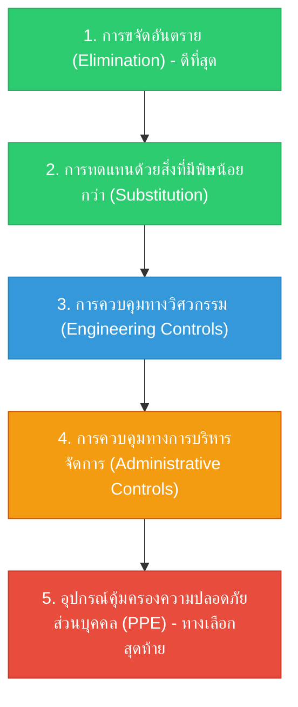

# Week 06: มาตรการป้องกันอุบัติเหตุและการสอบสวนอุบัติเหตุ (Accident Prevention & Investigation)

**วิชา:** OCCUPATIONAL HEALTH AND SAFETY (อาชีวอนามัยและความปลอดภัย)  
**สัปดาห์ที่:** Week 06  
**รหัสนักศึกษา:** 69030144  
**ชื่อ-นามสกุล:** นายปฏิภาณ พิพัฒน์พิทยากุล  
**ตอนเรียน:** Section 1  

---

## 1. มาตรการป้องกันเชิงรุก (Proactive Measures) & ลำดับขั้นการควบคุมอันตราย (Hierarchy of Controls)

การป้องกันอุบัติเหตุที่มีประสิทธิภาพสูงสุด ต้องเริ่มตั้งแต่การควบคุมอันตรายที่ต้นตอทางกายภาพตามหลักสากล 5 ลำดับขั้น:

### การประยุกต์ใช้ในโรงงานอุตสาหกรรม
1. **Elimination:** ยกเลิกการใช้สารละลายอินทรีย์ระเหยง่าย (VOCs) ในกระบวนการล้างชิ้นงาน
2. **Substitution:** เปลี่ยนจากการใช้ตัวทำละลายสารเคมีอันตราย มาใช้น้ำยาทำความสะอาดฐานน้ำ (Water-based Degreaser)
3. **Engineering Controls:** ติดตั้งครอบป้องกันใบเลื่อย (Machine Guard) และระบบท่อดูดควันเฉพาะที่ (LEV)
4. **Administrative Controls:** กำหนดขั้นตอนการทำงานที่ปลอดภัย (SOP), จัดอบรม KYT และหมุนเวียนกะการทำงานลดความเมื่อยล้า
5. **PPE:** บังคับสวมแว่นตานิรภัย หน้ากากกรองสารเคมี และรองเท้าหัวเหล็ก

---

## 2. มาตรการป้องกันเชิงรับและการสอบสวนอุบัติเหตุ (Accident Investigation & Root Cause Analysis)

เมื่อเกิดอุบัติเหตุขึ้น การสอบสวนต้องไม่ใช่การ "หาคนผิดมาลงโทษ (No Blame Culture)" แต่เป็นการหา **"สาเหตุที่แท้จริง (Root Cause)"** เพื่อวางมาตรการป้องกันไม่ให้เกิดซ้ำ

### 2.1 เทคนิคการถาม 5 Whys (Why-Why Analysis)
* **ปัญหา:** พนักงานลื่นล้มหน้าห้องอบขนม
  - *Why 1:* ทำไมถึงลื่นล้ม? -> เพราะพื้นมีน้ำมันหกเลอะ
  - *Why 2:* ทำไมมีน้ำมันเลอะที่พื้น? -> เพราะซีลของเครื่องผสมแป้งรั่วซึม
  - *Why 3:* ทำไมซีลถึงรั่วซึม? -> เพราะใช้งานเกินกำหนดอายุและไม่เคยเปลี่ยน
  - *Why 4:* ทำไมไม่เปลี่ยนตามกำหนด? -> เพราะไม่มีระบบบันทึกแผนบำรุงรักษาเชิงป้องกัน (PM)
  - *Why 5 (Root Cause):* ทำไมไม่มีระบบ PM? -> เพราะโรงงานไม่มีขั้นตอนและบุคลากรรับผิดชอบงานบำรุงรักษาเชิงป้องกันอย่างเป็นทางการ
* **มาตรการแก้ไขที่ต้นเหตุ (Corrective & Preventive Action: CAPA):** จัดทำระบบ Maintenance Schedule พร้อมเซ็นเซอร์ตรวจสอบการรั่วซึม

### 2.2 ผังก้างปลา (Fishbone Diagram / Ishikawa 4M+1E)
วิเคราะห์ 5 ปัจจัย:
- **Man (คน):** ขาดการฝึกอบรม, เร่งรีบทำงาน, เหนื่อยล้าสะสม
- **Machine (เครื่องจักร):** ขาดการซ่อมบำรุง, ไม่มีระบบตัดไฟฉุกเฉิน, อุปกรณ์ชำรุด
- **Method (วิธีการ):** ไม่มีคู่มือ SOP ที่ชัดเจน, ลัดขั้นตอนการทำงาน
- **Material (วัสดุ):** วัตถุดิบมีขอบคม, บรรจุภัณฑ์ไม่มีหูจับ
- **Environment (สภาพแวดล้อม):** แสงสว่างไม่เพียงพอ, พื้นลื่น, อากาศถ่ายเทไม่สะดวก

---

## 3. ดัชนีชี้วัดความปลอดภัย (Safety Performance Indicators)
- **Leading Indicators (ตัวชี้วัดเชิงรุก):** จำนวนรายงาน Near-Miss ที่ได้รับการแก้ไข, ร้อยละของการตรวจ Safety Patrol ตามแผน, ชั่วโมงการอบรมความปลอดภัยของพนักงาน
- **Lagging Indicators (ตัวชี้วัดเชิงรับ):** อัตราความถี่การเกิดอุบัติเหตุ ($FR$), อัตราความรุนแรง ($SR$), จำนวนวันทำงานที่สูญเสีย ($Lost Workdays$)
