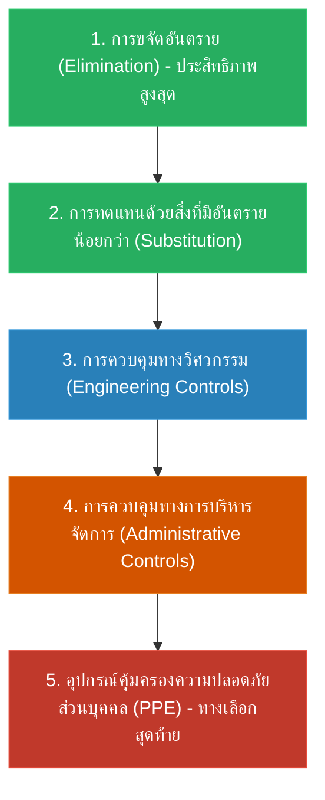

# Week 06: มาตรการป้องกันและการสอบสวนอุบัติเหตุ (Accident Prevention & Investigation)

**วิชา:** OCCUPATIONAL HEALTH AND SAFETY (อาชีวอนามัยและความปลอดภัย)  
**สัปดาห์ที่:** Week 06  
**รหัสนักศึกษา:** 69030450  
**ชื่อ-นามสกุล:** นายกิตติศักดิ์ พัฒนนิติศักดิ์  
**ตอนเรียน:** Section 1  

---

## 1. แบบฝึกหัดทดสอบความเข้าใจ (Self-Assessment Questions)

### ข้อ 1: ตามหลักการ Hierarchy of Controls มาตรการใดมีประสิทธิภาพในการป้องกันอุบัติเหตุสูงสุด?
* **คำตอบ:** การยกเลิกหรือขจัดอันตรายนั้นออกไป (Elimination)
* **เหตุผลทางวิชาการ:** ตามลำดับชั้นการควบคุมอันตราย การขจัดอันตราย (Elimination) อยู่ในจุดสูงสุดของพีระมิด เนื่องจากเป็นการกำจัดแหล่งกำเนิดอันตรายออกไปจากกระบวนการผลิตอย่างถาวร ทำให้ไม่ต้องพึ่งพาพฤติกรรมหรือความผิดพลาดของมนุษย์ ในขณะที่การควบคุมระดับอื่น เช่น การบริหารจัดการ หรือการใส่ PPE ยังมีความเสี่ยงที่พนักงานจะละเลยหรือไม่สวมใส่ได้

### ข้อ 2: วัตถุประสงค์หลักของการใช้เทคนิค "5 Whys Analysis" ในการสอบสวนอุบัติเหตุคืออะไร?
* **คำตอบ:** เพื่อเจาะลึกไปถึงรากเหง้าของปัญหา (Root Cause) และวางมาตรการป้องกันไม่ให้เกิดอุบัติเหตุซ้ำ
* **เหตุผลทางวิชาการ:** การสอบสวนอุบัติเหตุที่มีประสิทธิภาพตามหลัก OHS ต้องยึดหลัก "วัฒนธรรมไม่มุ่งโทษบุคคล" (No-Blame Culture) การถามทำไม 5 ครั้ง จะช่วยก้าวข้ามความผิดพลาดระดับบุคคล (Human Error) เพื่อค้นพบช่องโหว่ในระดับนโยบาย แผนงาน หรือการบริหารจัดการ ซึ่งเป็นต้นเหตุที่แท้จริง

### ข้อ 3: กรณีศึกษาของบริษัท Alcoa ภายใต้การนำของ Paul O'Neill พิสูจน์ให้เห็นถึงหลักการสำคัญข้อใด?
* **คำตอบ:** ความปลอดภัยสามารถขับเคลื่อนนวัตกรรมและสร้างผลกำไรได้อย่างยั่งยืน (Safety as a Strategic Habit)
* **เหตุผลทางวิชาการ:** เมื่อ Paul O'Neill ประกาศให้ความปลอดภัยเป็นเป้าหมายสูงสุดเพียงหนึ่งเดียวของ Alcoa ทำให้ทุกหน่วยงานต้องเปิดเผยข้อมูล ปรับปรุงการสื่อสาร และยกเครื่องกระบวนการผลิตที่มีความเสี่ยง ส่งผลให้เกิดประสิทธิภาพในการทำงานที่ดีขึ้น ลดการสูญเสีย และผลักดันผลกำไรของบริษัทให้เติบโตขึ้นอย่างมหาศาล

---

## 2. ลำดับขั้นการควบคุมอันตราย (Hierarchy of Controls)

### ตัวอย่างการประยุกต์ใช้ในโรงงานอุตสาหกรรม
1. **Elimination:** ยกเลิกการใช้สารทำความสะอาดที่มีสารประกอบอินทรีย์ระเหยง่าย (VOCs)
2. **Substitution:** เปลี่ยนมาใช้น้ำยาทำความสะอาดสูตรน้ำ (Water-based Degreaser) ที่ไม่ติดไฟและไม่มีสารก่อมะเร็ง
3. **Engineering Controls:** ติดตั้งการ์ดป้องกันจุดหมุน (Machine Guard) และระบบท่อดูดไอระเหยเฉพาะที่ (Local Exhaust Ventilation: LEV)
4. **Administrative Controls:** จัดทำขั้นตอนปฏิบัติงานมาตรฐาน (SOP), จัดอบรม KYT และหมุนเวียนกะเพื่อลดความล้า
5. **PPE:** สวมแว่นตานิรภัย ถุงมือยางไนไตรล์ และรองเท้าหัวเหล็ก

---

## 3. การสอบสวนอุบัติเหตุและการค้นหารากเหง้าของปัญหา (Root Cause Analysis)

### 3.1 การวิเคราะห์ด้วยเทคนิค 5 Whys (Why-Why Analysis)
* **เหตุการณ์:** พนักงานลื่นหกล้มในพื้นที่แผนกผสมวัตถุดิบจนข้อมือซ้น
  * **Why 1:** ทำไมพนักงานถึงลื่นหกล้ม?  
    $\rightarrow$ เพราะพื้นทางเดินมีคราบน้ำมันหล่อลื่นหกเลอะ
  * **Why 2:** ทำไมถึงมีคราบน้ำมันหล่อลื่นเลอะบนพื้น?  
    $\rightarrow$ เพราะชุดซีลกันรั่วของปั๊มสูบจ่ายวัตถุดิบเกิดการฉีกขาดทำให้น้ำมันซึมออกมา
  * **Why 3:** ทำไมชุดซีลถึงฉีกขาดและไม่มีการตรวจพบ?  
    $\rightarrow$ เพราะชุดซีลถูกใช้งานเกินชั่วโมงการทำงานที่ผู้ผลิตกำหนดและไม่ได้รับการเปลี่ยนตามกำหนด
  * **Why 4:** ทำไมถึงไม่ได้รับการเปลี่ยนชิ้นส่วนตามกำหนดเวลา?  
    $\rightarrow$ เพราะไม่มีระบบบันทึกและแจ้งเตือนแผนบำรุงรักษาเชิงป้องกัน (Preventive Maintenance: PM)
  * **Why 5 (Root Cause):** ทำไมถึงไม่มีระบบบันทึกแผน PM?  
    $\rightarrow$ เพราะโรงงานขาดระบบการจัดการงานซ่อมบำรุงที่มีมาตรฐาน และไม่มีการมอบหมายผู้รับผิดชอบงาน PM อย่างเป็นทางการ
* **มาตรการแก้ไขเชิงป้องกัน (CAPA):** นำระบบโปรแกรมบริหารงานบำรุงรักษา (CMMS) มาใช้ และจัดทำตารางตรวจสอบเปลี่ยนชิ้นส่วนสิ้นเปลืองตามอายุการใช้งาน

### 3.2 การวิเคราะห์ด้วยผังก้างปลา (Fishbone Diagram / 4M+1E)
* **Man (คน):** พนักงานขาดการสังเกต, รีบเร่งเดินเพื่อให้ทันเวลา, ไม่รายงานคราบน้ำมันที่พบเห็น
* **Machine (เครื่องจักร):** เครื่องจักรเก่า, ขาดระบบตรวจจับการรั่วไหลอัตโนมัติ
* **Method (วิธีการ):** ไม่มีคู่มือการตรวจสอบรอยรั่วประจำวัน, ขาดการประสานงานระหว่างฝ่ายผลิตและฝ่ายช่าง
* **Material (วัสดุ):** ชิ้นส่วนซีลยางที่จัดซื้อไม่ได้มาตรฐานตามสเปกของผู้ผลิตเครื่องจักร
* **Environment (สภาพแวดล้อม):** แสงสว่างบริเวณทางเดินไม่เพียงพอ, พื้นผิวทางเดินขาดความฝืด (ไม่มีสารเคลือบกันลื่น)
