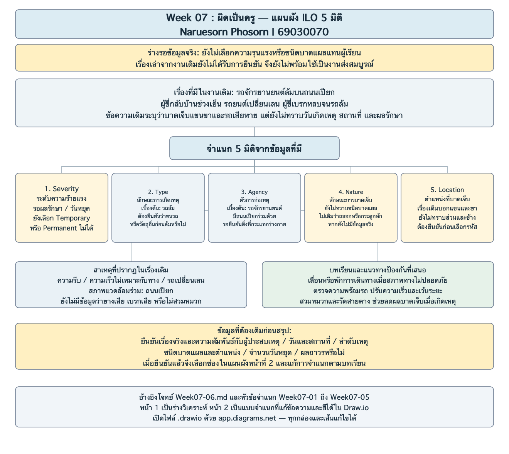
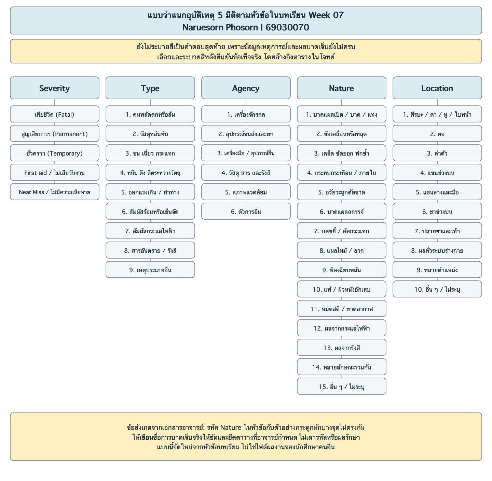

# Week 07: ร่างเตรียมเรื่องเล่า “ผิดเป็นครู”

Naruesorn Phosorn | 69030070

งานนี้ยังขาดข้อมูลเหตุการณ์จริงและการบาดเจ็บ จึงเป็นร่างเตรียมคำตอบไว้ก่อน

## เรื่องที่จะนำมาวิเคราะห์

ในงาน Week 05 เดิมมีเรื่องผู้ขี่รถจักรยานยนต์กลับบ้านบนถนนเปียก แล้วมีรถยนต์เปลี่ยนเลน ผู้ขี่เบรกหลบจนรถล้มและบาดเจ็บแขนขา ผมใช้ข้อความนี้เป็นจุดเริ่มต้นของร่าง แต่ยังยืนยันรายละเอียดจริงเพิ่มไม่ได้ จึงยังไม่พร้อมใช้เล่าเป็นประสบการณ์จริงตามโจทย์

## วิเคราะห์ 5 มิติจากข้อมูลที่มี

| มิติ | สิ่งที่พอระบุได้ | สิ่งที่ยังไม่รู้ |
|---|---|---|
| Severity | เรื่องเดิมบอกว่ามีคนบาดเจ็บ จึงไม่ใช่ Near Miss ถ้าข้อมูลนั้นถูกต้อง | หยุดเรียนหรืองานกี่วัน และมีผลถาวรหรือไม่ |
| Type | เบื้องต้นมองว่าเป็นการตกหรือล้มจากรถ | มีการชนรถก่อนล้มไหม และร่างกายกระแทกอะไร |
| Agency | รถจักรยานยนต์เป็นตัวการเบื้องต้น โดยมีถนนเปียกเป็นสภาพแวดล้อมร่วม | ต้องรู้ลำดับเหตุให้ชัดก่อนเลือกรหัสสุดท้าย |
| Nature | ยังระบุชนิดบาดแผลไม่ได้ | เป็นแผลถลอก ฟกช้ำ แผลเปิด หรือกระดูกหัก |
| Location | เรื่องเดิมระบุเพียงแขนและขา | ส่วนใดและข้างใดของร่างกาย |

ผมยังไม่เลือกความรุนแรงเป็น Temporary หรือ Permanent เพราะแค่รู้ว่าบาดเจ็บยังไม่พอ ต้องมีข้อมูลผลบาดเจ็บและวันหยุดก่อน

## สาเหตุที่ควรดู

จากเรื่องเดิมมีทั้งความรีบ ถนนเปียก และรถอีกคันเปลี่ยนเลน จึงต้องดูร่วมกัน ไม่ควรสรุปว่าคนขี่ผิดคนเดียว ส่วนสภาพยาง เบรก การสวมหมวกและระยะห่างรถยังไม่ทราบ ผมจึงยังไม่ใส่เป็นสาเหตุของเหตุการณ์นี้

แนวทางป้องกันที่นำไปคุยต่อได้คือเผื่อเวลาเดินทาง ตรวจรถก่อนใช้ และปรับความเร็วกับระยะห่างตามสภาพทาง ถ้าฝนหนักจนไม่ปลอดภัยก็พักก่อน ส่วนหมวกช่วยลดอันตรายต่อศีรษะเมื่อเกิดเหตุ แต่ไม่ได้ป้องกันรถล้มโดยตรง

## ข้อมูลที่ต้องเติมก่อนนำเสนอ

1. ยืนยันว่าเป็นเหตุการณ์จริงของตนเองหรือคนใกล้ชิดที่นำมาใช้ได้
2. ลักษณะบาดแผล ตำแหน่ง และผลระยะยาว
3. จำนวนวันหยุดเรียนหรืองาน ถ้าไม่ได้หยุดให้ระบุว่าไม่ได้หยุด
4. ลำดับเหตุว่าชนอะไรและบาดเจ็บอย่างไร

พอได้ข้อมูลครบจะเล่าบริบทก่อน แล้วอธิบาย 5 มิติ สาเหตุ และสิ่งที่ควรแก้ ใช้เวลาพูดประมาณ 3 นาที และเผื่อถามตอบอีก 1–2 นาที

## ที่มา

- [โจทย์กิจกรรม Week07-06](https://github.com/koson/OHS_2569/blob/c61e123c45f5fbc0f24dc890078d9d574006ee35/Week-07/Week07-06.md)
- เรื่องรถจักรยานยนต์จาก Homework-05-02.md ในงานเดิม ใช้เป็นร่างโดยยังรอการยืนยันข้อมูลจริง

## แผนผังประกอบ

- [เปิดแก้ไขแผนผัง 2 หน้าใน Draw.io](Week07_69030070.drawio)
- [ภาพหน้า 1: ร่างวิเคราะห์กรณี](Week07_69030070_page1.png)
- [ภาพหน้า 2: แบบจำแนก ILO](Week07_69030070_page2.png)
- [ภาพ SVG หน้า 1](Week07_69030070_page1.svg) / [หน้า 2](Week07_69030070_page2.svg)

ผมทำแผนผังจากหัวข้อใน Week07-06 และรายการจำแนกใน Week07-01 ถึง Week07-05 ของอาจารย์ หน้าแรกแสดงสิ่งที่พอวิเคราะห์จากเรื่องเดิมได้ หน้าที่สองเป็นช่องให้เลือกและระบายสีหลังได้ข้อมูลครบ
ตอนนี้ยังไม่เลือกความรุนแรงกับชนิดแผลเป็นคำตอบสุดท้าย เพราะยังไม่ทราบผลรักษาและวันหยุด
ไฟล์ .drawio เปิดด้วย app.diagrams.net แล้วเลือก File > Open from > Device ได้ ทุกกล่อง ข้อความและเส้นแก้ไขต่อได้

### หน้า 1

### หน้า 2

