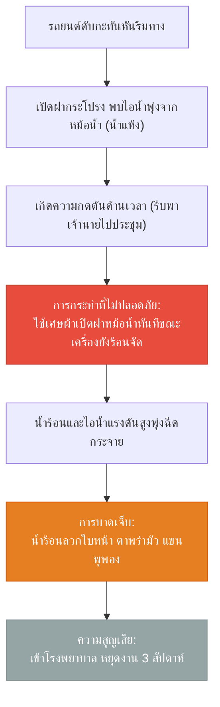

# Week 07: แผนผังลำดับเหตุการณ์และการวิเคราะห์อุบัติเหตุ (Incident Flowchart & Causal Analysis)

**วิชา:** OCCUPATIONAL HEALTH AND SAFETY (อาชีวอนามัยและความปลอดภัย)  
**สัปดาห์ที่:** Week 07  
**รหัสนักศึกษา:** 69030144  
**ชื่อ-นามสกุล:** นายปฏิภาณ พิพัฒน์พิทยากุล  
**ตอนเรียน:** Section 1  

---

## 1. สถานการณ์กรณีศึกษา (กรณีสมโชคเปิดฝาหม้อน้ำ)

นายสมโชค ขับรถพาเจ้านายไปประชุมที่ต่างจังหวัด รถเกิดดับกะทันหันกลางทาง เขาจอดรถริมทางและเปิดฝากระโปรงรถพบว่าน้ำในหม้อน้ำแห้ง ด้วยความรีบร้อนเพื่อให้ทันเวลาประชุม จึงนำเศษผ้ามาเปิดฝาหม้อน้ำทันที ทำให้ไอน้ำและน้ำร้อนแรงดันสูงพุ่งใส่ใบหน้าและแขนอย่างรุนแรง สมโชคได้รับบาดเจ็บผิวหนังไหม้ ตาพร่ามัว ถูกนำส่งโรงพยาบาลและต้องหยุดงานเพื่อรักษาตัว 3 สัปดาห์

---

## 2. แผนผังลำดับเหตุการณ์การเกิดอุบัติเหตุ (Incident Sequence Flowchart)

---

## 3. แผนผังการวิเคราะห์สาเหตุและมาตรการป้องกัน (Cause & Barrier Diagram)

```mermaid
graph LR
    subgraph Causes["ปัจจัยสาเหตุ"]
        C1["ขาดการตรวจเช็คสภาพรถก่อนเดินทาง"]
        C2["ขาดความรู้เรื่องแรงดันไอน้ำในระบบปิด"]
        C3["ความรีบร้อนและแรงกดดันจากเวลา"]
    end

    subgraph Barriers["แนวกั้นความปลอดภัยที่หายไป (Missing Barriers)"]
        B1["ระบบแจ้งเตือนระดับน้ำหล่อเย็นล่วงหน้า"]
        B2["ขั้นตอนมาตรฐาน SOP: ห้ามเปิดฝาหม้อน้ำขณะร้อน"]
        B3["การใช้อุปกรณ์ป้องกัน PPE หรือถุงมือทนความร้อน"]
    end

    subgraph Action["มาตรการแก้ไขที่ถูกต้อง"]
        A1["ดับเครื่องยนต์และรออย่างน้อย 30-45 นาทีให้ความดันลดลง"]
        A2["สังเกตหม้อพักน้ำสำรอง (Reservoir Tank) แทนการเปิดฝาหลัก"]
        A3["ทำ Checklist ตรวจสภาพรถยนต์ก่อนออกปฏิบัติงานทุกครั้ง"]
    end

    Causes --> Barriers
    Barriers --> Action
```

---

## 4. สรุปการป้องกันตามหลักวิศวกรรมความปลอดภัย
1. **การควบคุมทางวิศวกรรม (Engineering Controls):** ออกแบบฝาหม้อน้ำชนิด Safety Lever Cap (มีคันโยกคลายแรงดันส่วนเกินออกก่อนเปิดฝาได้)
2. **การควบคุมทางการบริหารจัดการ (Administrative Controls):** กำหนด Checklist ตรวจเช็ครถประจำวัน และอบรมคนขับรถเรื่องการปฏิบัติตัวเมื่อรถเครื่องร้อนจัด
