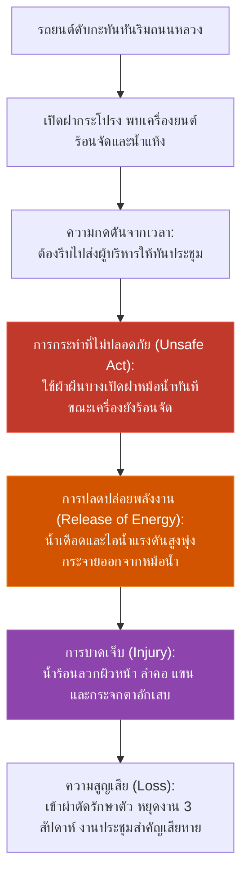

# Week 07: แผนผังลำดับเหตุการณ์การเกิดอุบัติเหตุและการวิเคราะห์แนวกั้นความปลอดภัย (Incident Sequence & Barrier Analysis)

**วิชา:** OCCUPATIONAL HEALTH AND SAFETY (อาชีวอนามัยและความปลอดภัย)  
**สัปดาห์ที่:** Week 07  
**รหัสนักศึกษา:** 69030450  
**ชื่อ-นามสกุล:** นายกิตติศักดิ์ พัฒนนิติศักดิ์  
**ตอนเรียน:** Section 1  

---

## 1. กรณีศึกษา: อุบัติเหตุเปิดฝาหม้อน้ำรถยนต์ขณะเครื่องยนต์ร้อนจัด

**สถานการณ์:**  
นายสมโชค พนักงานขับรถประจำสำนักงาน กำลังขับรถพาคณะผู้บริหารไปประชุมด่วนต่างจังหวัด ระหว่างทางรถยนต์เกิดความร้อนขึ้นสูงผิดปกติและเครื่องยนต์ดับลงกะทันหันกลางทาง นายสมโชคจอดรถชิดไหล่ทางและเปิดฝากระโปรงหน้ารถ พบว่ามีไอน้ำพวยพุ่งออกมาจากหม้อน้ำ ด้วยความกดดันจากเวลาที่ใกล้จะถึงนัดหมายประชุม นายสมโชคจึงตัดสินใจนำผ้าขนหนูชุบน้ำผืนบางมาบิดเปิดฝาหม้อน้ำหลักทันที โดยไม่ได้รอให้เครื่องยนต์เย็นลง ส่งผลให้น้ำร้อนเดือดและไอน้ำที่มีแรงดันมหาศาลพุ่งกระเด็นฉีดเข้าใส่ใบหน้า ลำคอ และแขนของนายสมโชคอย่างรุนแรง ทำให้ผิวหนังไหม้พุพองและมีแผลลวกที่กระจกตา ต้องนำตัวส่งโรงพยาบาลฉุกเฉินและต้องหยุดงานเพื่อรักษาตัวเป็นเวลา 3 สัปดาห์

---

## 2. แผนผังลำดับเหตุการณ์การเกิดอุบัติเหตุ (Incident Sequence Flowchart)

---

## 3. แผนผังการวิเคราะห์สาเหตุและแนวกั้นความปลอดภัย (Cause & Barrier Analysis)

```mermaid
graph LR
    subgraph Causes["1. ปัจจัยสาเหตุ (Causal Factors)"]
        C1["ละเลยการตรวจสภาพรถประจำวัน (Daily Inspection)"]
        C2["ขาดความรู้เรื่องระบบความดันในระบบหล่อเย็นปิด"]
        C3["ความกดดันทางเวลาและการตัดสินใจภายใต้ภาวะเร่งด่วน"]
    end

    subgraph MissingBarriers["2. แนวกั้นที่ขาดหายไป (Missing Barriers)"]
        B1["ระบบเซนเซอร์แจ้งเตือนระดับน้ำล่วงหน้าบนหน้าปัด"]
        B2["ขั้นตอนมาตรฐาน (SOP): การปฏิบัติตัวเมื่อรถ Overheat"]
        B3["อุปกรณ์ป้องกันส่วนบุคคล (PPE) ทนความร้อน"]
    end

    subgraph EffectiveControls["3. มาตรการแก้ไขเชิงระบบ (Systemic Controls)"]
        A1["ดับเครื่อง รออย่างน้อย 30-45 นาที ให้แรงดันลดลงสมบูรณ์"]
        A2["สังเกตระดับน้ำที่ถังพักสำรอง (Reservoir) แทนการเปิดฝาหลัก"]
        A3["บังคับใช้ Checklist ตรวจเช็ครถยนต์ก่อนออกเดินทางทุกครั้ง"]
    end

    Causes --> MissingBarriers
    MissingBarriers --> EffectiveControls
```

---

## 4. มาตรการควบคุมตามหลักการยศาสตร์และวิศวกรรมความปลอดภัย

1. **การควบคุมทางวิศวกรรม (Engineering Controls):**
   - เปลี่ยนมาใช้ฝาหม้อน้ำประเภท **Safety Pressure Release Lever Cap** ซึ่งเป็นฝาที่มีก้านโยกคลายแรงดันส่วนเกินออกก่อนที่จะสามารถหมุนเปิดฝาได้
   - บำรุงรักษาระบบพัดลมหม้อน้ำและวาล์วน้ำ (Thermostat) ตามระยะทางที่กำหนดในคู่มือ

2. **การควบคุมทางการบริหารจัดการ (Administrative Controls):**
   - จัดทำคู่มือปฏิบัติงานฉุกเฉิน (Emergency SOP) ติดไว้ในลิ้นชักหน้ารถทุกคัน
   - กำหนดเกณฑ์ห้ามเปิดฝาหม้อน้ำขณะเครื่องยนต์ร้อนจัดโดยเด็ดขาด ให้ใช้วิธีติดต่อหน่วยบริการช่วยเหลือฉุกเฉิน (Roadside Assistance)
   - อบรมเชิงปฏิบัติการเรื่องการบำรุงรักษารถยนต์เบื้องต้นสำหรับพนักงานขับรถทุกคน
