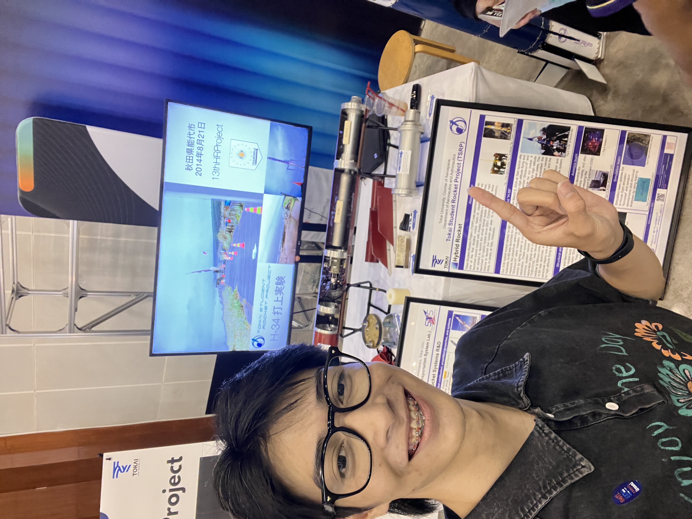
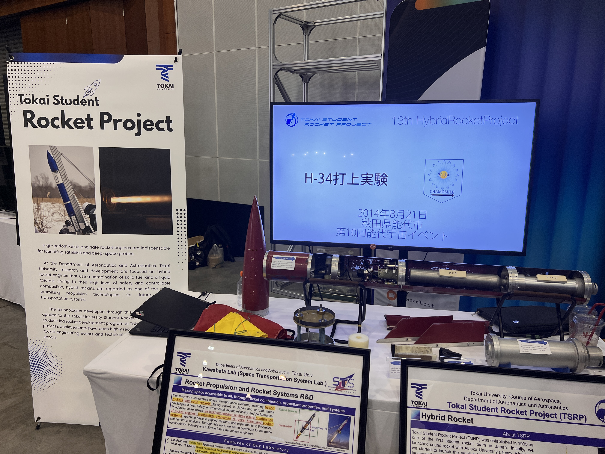
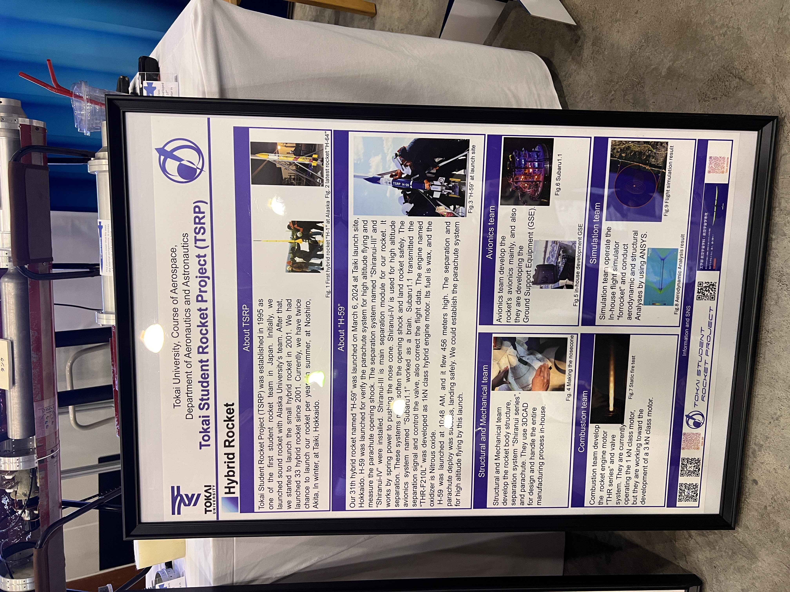
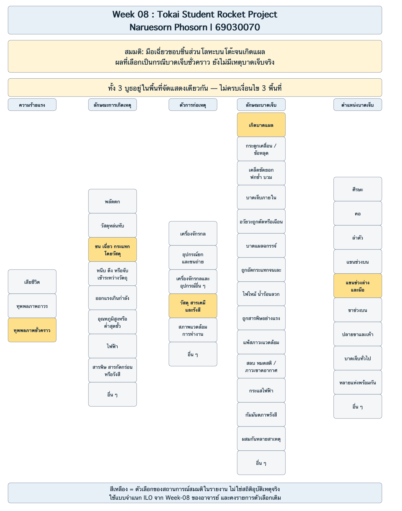
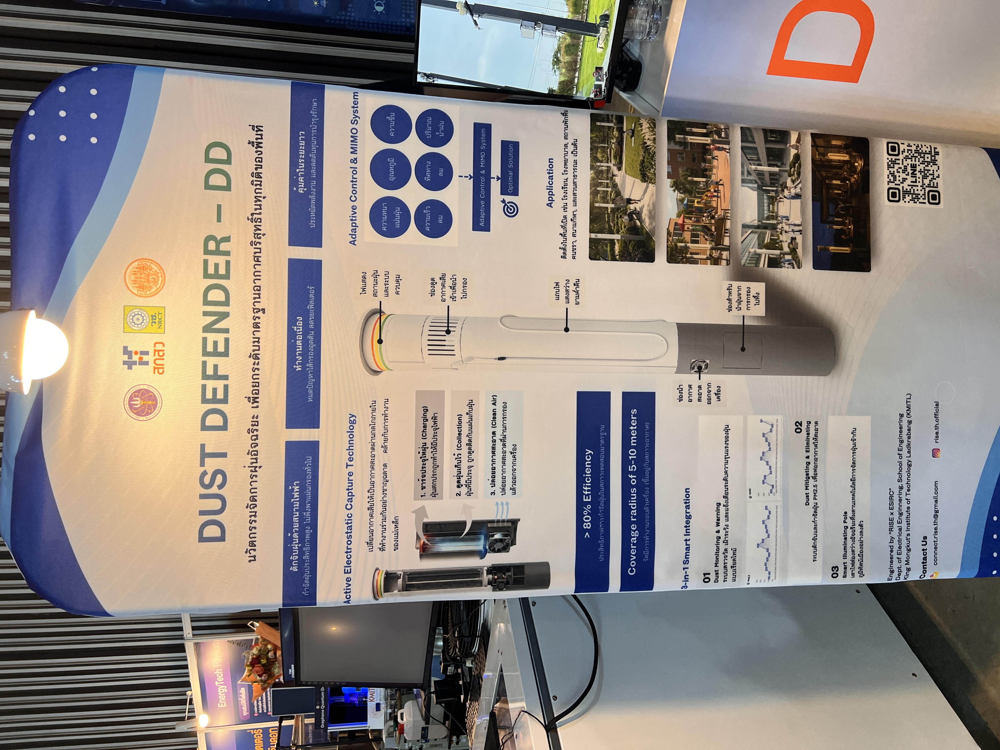
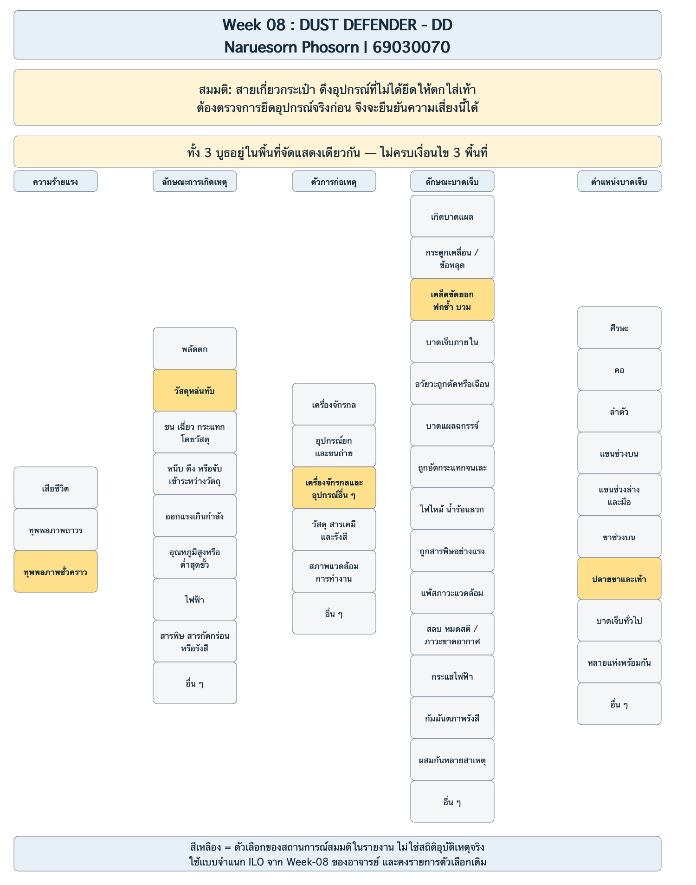
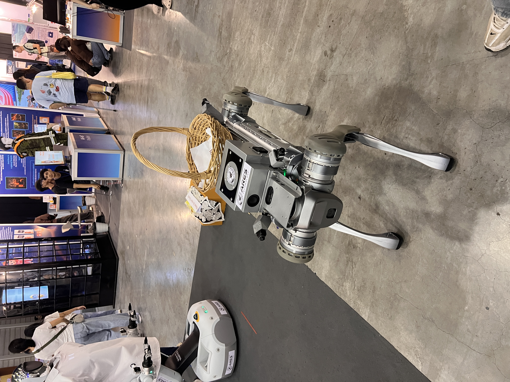
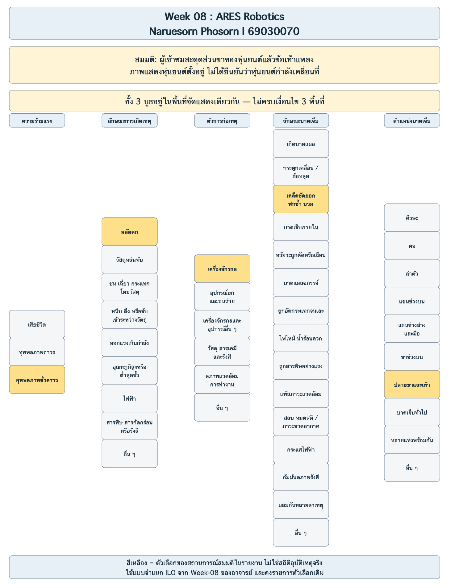

# Week 08 สำรวจความปลอดภัยในงาน KMITL INNOVATION EXPO 2026

**Naruesorn Phosorn | รหัสนักศึกษา 69030070**

ผมเลือกดู 3 บูธ คือ Tokai Student Rocket Project, DUST DEFENDER-DD และ ARES Robotics โดยใช้รูปที่ถ่ายในงานประกอบการวิเคราะห์ ทั้งสามบูธอยู่ในพื้นที่จัดแสดงเดียวกันตามข้อมูลของผม จึงยังไม่ครบเงื่อนไขที่โจทย์ให้สำรวจ 3 พื้นที่ แม้จะมีครบ 3 บูธแล้วก็ตาม

รายงานนี้แยกสิ่งที่เห็นจากภาพออกจากเหตุการณ์ที่อาจเกิดขึ้น การบาดเจ็บที่ใช้เลือกช่อง ILO เป็น **สถานการณ์สมมติเพื่อวิเคราะห์ความเสี่ยง** ไม่ได้หมายความว่ามีคนบาดเจ็บในงานจริง และไม่ได้ใช้คำนวณสถิติหรือวันสูญเสีย

## 1. Tokai Student Rocket Project

### สิ่งที่เห็นจากภาพ

บูธจัดแสดงชิ้นส่วนจรวดและตัวอย่างโครงสร้างแบบผ่าให้เห็นภายใน มีชิ้นส่วนโลหะ ครีบ และกรอบป้ายวางอยู่บนโต๊ะด้านที่ผู้เข้าชมเข้าไปดูได้ใกล้ ภาพ IMG_6623, IMG_6625 และ IMG_6626 เป็นบูธเดียวกัน จึงนับเป็นหนึ่งบูธ

### ประเด็นที่ผมมองว่าควรระวัง

ชิ้นส่วนที่มีขอบหรือปลายยื่นอยู่ใกล้ด้านหน้าของโต๊ะ อาจถูกมือหรือแขนขณะเข้าไปดูใกล้ ๆ ได้ อย่างไรก็ตาม ภาพอย่างเดียวบอกไม่ได้ว่าขอบคมแค่ไหนหรือชิ้นส่วนยึดแน่นหรือไม่ จึงควรตรวจของจริงเพิ่มเติม

**สถานการณ์สมมติ:** ผู้เข้าชมเอื้อมไปดูชิ้นงาน มือเฉี่ยวขอบโลหะจนเป็นแผล และสมมติว่าแผลทำให้ใช้มือทำกิจกรรมตามปกติไม่ได้ชั่วคราว หลังรักษาแล้วกลับมาใช้งานได้ ไม่ได้สมมติว่ามีการจุดเครื่องยนต์หรือทดสอบจรวดในบูธ

| มิติ ILO ตามแบบอาจารย์ | ตัวเลือกที่ระบายสี | เหตุผลในสถานการณ์สมมติ |
|---|---|---|
| ความร้ายแรง | ทุพพลภาพชั่วคราว | สมมติว่าบาดเจ็บจนใช้มือไม่ได้ตามปกติชั่วคราว ไม่ใช่ผลการรักษาที่เกิดขึ้นจริง |
| ลักษณะการเกิดเหตุ | ชน เฉี่ยว กระแทก โดยวัสดุ | มือเฉี่ยวชิ้นส่วนโลหะ |
| ตัวการก่อเหตุ | วัสดุ สารเคมี และรังสี | ในกรณีนี้เลือกเพราะเป็นชิ้นส่วนวัสดุโลหะ ไม่ใช่สารเคมีหรือรังสี |
| ลักษณะบาดเจ็บ | เกิดบาดแผล | สมมติว่าขอบโลหะบาดมือ |
| ตำแหน่งบาดเจ็บ | แขนช่วงล่างและมือ | มือเป็นส่วนที่สัมผัสชิ้นงาน |

**วิธีที่ผมเสนอ:** ขยับชิ้นส่วนที่มีปลายยื่นเข้าไปด้านในโต๊ะ ยึดฐานให้มั่นคง และใช้แผ่นใสกั้นส่วนที่ไม่ให้จับ หากต้องให้ผู้เข้าชมสัมผัส ควรมีผู้ดูแลบอกจุดที่จับได้ก่อน

## 2. DUST DEFENDER - DD

### สิ่งที่เห็นจากภาพ

ป้ายแนะนำเครื่องจัดการฝุ่นด้วยสนามไฟฟ้า มีอุปกรณ์และจออยู่ข้างป้าย ในภาพ IMG_6627 เห็นสายสีดำพาดอยู่บริเวณชุดสาธิตด้านซ้าย ภาพไม่เห็นการเดินสายทั้งหมด จึงยังบอกไม่ได้ว่าสายถูกยึดไว้อย่างไร หรืออุปกรณ์กำลังจ่ายไฟอยู่หรือไม่

### ประเด็นที่ผมมองว่าควรตรวจ

ผมเลือกดูเรื่องสายที่อาจถูกเกี่ยวขณะเข้าใกล้ชุดสาธิต โดยต้องตรวจว่าผู้เข้าชมเข้าถึงสายได้จริงหรือไม่ และปลายสายต่อกับอุปกรณ์ที่ยึดไว้แน่นหรือยัง ข้อนี้เป็นความเสี่ยงแบบมีเงื่อนไข ไม่ใช่การยืนยันว่าบูธวางอุปกรณ์ไม่ปลอดภัย

**สถานการณ์สมมติ:** ถ้าสายอยู่ในระยะที่กระเป๋าผู้เข้าชมเกี่ยวได้ และต่อกับอุปกรณ์ขนาดเล็กที่ไม่ได้ยึด อุปกรณ์อาจถูกดึงตกใส่เท้า สมมติว่าทำให้เท้าฟกช้ำบวมจนเดินลำบากชั่วคราว ก่อนกลับมาเดินได้ตามปกติ ภาพไม่ได้แสดงว่ามีเหตุนี้เกิดขึ้น

| มิติ ILO ตามแบบอาจารย์ | ตัวเลือกที่ระบายสี | เหตุผลในสถานการณ์สมมติ |
|---|---|---|
| ความร้ายแรง | ทุพพลภาพชั่วคราว | สมมติว่าเท้าบวมจนเดินลำบากชั่วคราว |
| ลักษณะการเกิดเหตุ | วัสดุหล่นทับ | อุปกรณ์ถูกดึงตกลงมาใส่เท้า |
| ตัวการก่อเหตุ | เครื่องจักรกลและอุปกรณ์อื่น ๆ | อุปกรณ์สาธิตเป็นสิ่งที่ตกใส่เท้า |
| ลักษณะบาดเจ็บ | เคล็ดขัดยอก ฟกช้ำ บวม | เลือกกรณีฟกช้ำและบวมจากแรงกระแทก |
| ตำแหน่งบาดเจ็บ | ปลายขาและเท้า | เท้าเป็นส่วนที่ถูกอุปกรณ์ตกใส่ |

**วิธีที่ผมเสนอ:** รวบและยึดสายไว้ด้านหลังชุดสาธิต ตรวจฐานอุปกรณ์และจอให้มั่นคง และแยกส่วนที่ให้ทดลองจับจากส่วนที่ต้องมีผู้ดูแล ถ้าตรวจพบว่าสายและอุปกรณ์ยึดแน่นอยู่แล้ว ต้องปรับการประเมินข้อนี้ตามสภาพจริง ส่วนการใช้สนามไฟฟ้าที่เขียนบนป้ายเพียงอย่างเดียว ยังใช้สรุปว่าเกิดไฟดูดหรือมีไฟรั่วไม่ได้

## 3. ARES Robotics

### สิ่งที่เห็นจากภาพ

ภาพ IMG_6629 มีหุ่นยนต์สี่ขาตั้งอยู่บนพื้นใกล้พื้นที่ที่มีผู้เข้าชมเดินผ่าน ส่วนขาของหุ่นยนต์ยื่นออกจากตัวเครื่อง ในขอบเขตภาพนี้ไม่เห็นแนวกั้นรอบตัวหุ่นยนต์ แต่ไม่ได้หมายความว่าไม่มีแนวกั้นหรือมาตรการอื่นนอกภาพ และภาพนิ่งไม่ได้ยืนยันว่าหุ่นยนต์กำลังเดิน

### ประเด็นที่ผมมองว่าควรระวัง

ผู้เข้าชมอาจมองป้ายหรือคุยกันจนไม่ได้สังเกตส่วนขาของหุ่นยนต์ที่อยู่ระดับต่ำ ถ้าเดินเข้าใกล้เกินไปอาจสะดุดได้

**สถานการณ์สมมติ:** ผู้เข้าชมเดินสะดุดส่วนขาของหุ่นยนต์ที่ตั้งอยู่ เสียหลักล้มจนข้อเท้าแพลง สมมติว่าต้องพักการเดินหรือกิจกรรมตามปกติระยะหนึ่ง แล้วฟื้นตัวได้ ไม่มีข้อมูลว่ามีผู้เข้าชมล้มจริง

| มิติ ILO ตามแบบอาจารย์ | ตัวเลือกที่ระบายสี | เหตุผลในสถานการณ์สมมติ |
|---|---|---|
| ความร้ายแรง | ทุพพลภาพชั่วคราว | สมมติว่าข้อเท้าแพลงจนเดินตามปกติไม่ได้ชั่วคราว |
| ลักษณะการเกิดเหตุ | พลัดตก | ใช้ช่องนี้ในแบบของอาจารย์สำหรับกรณีคนสะดุดแล้วล้มในระดับเดียวกัน |
| ตัวการก่อเหตุ | เครื่องจักรกล | ส่วนขาของหุ่นยนต์เป็นสิ่งที่ทำให้สะดุด |
| ลักษณะบาดเจ็บ | เคล็ดขัดยอก ฟกช้ำ บวม | สมมติว่าข้อเท้าแพลงจากการเสียหลัก |
| ตำแหน่งบาดเจ็บ | ปลายขาและเท้า | บาดเจ็บบริเวณข้อเท้า |

**วิธีที่ผมเสนอ:** กำหนดขอบเขตตั้งหรือสาธิตหุ่นยนต์ให้เห็นชัด เว้นทางเดินรอบเครื่อง และมีผู้ดูแลเมื่อให้ทดลองใช้งาน ถ้าจะให้หุ่นยนต์เคลื่อนที่ ควรตรวจพื้นที่ให้โล่งก่อนเริ่ม และเตรียมวิธีหยุดเครื่องตามคู่มือของผู้จัดแสดง

## สิ่งที่ได้จากการสำรวจ

ผมเห็นว่าความปลอดภัยในงานแสดงไม่ได้ขึ้นกับตัวเทคโนโลยีอย่างเดียว การวางชิ้นงาน สายต่อ และการเว้นพื้นที่ให้คนเดินก็มีผลด้วย วิธีปรับปรุงที่เริ่มทำได้คือจัดของให้พ้นทาง ยึดอุปกรณ์ให้มั่นคง และบอกขอบเขตการสัมผัสหรือทดลองให้ชัดเจน

ข้อจำกัดของงานนี้คือทั้งสามบูธอยู่ในพื้นที่เดียวกัน จึงยังขาดอีก 2 พื้นที่ตามโจทย์ ส่วนรายละเอียดที่ภาพยืนยันไม่ได้ เช่น ความคม การยึดอุปกรณ์ หรือการจ่ายไฟ ต้องตรวจเพิ่มก่อนสรุปเป็นข้อบกพร่องจริง หากเหตุการณ์สมมติเกิดเพียงแผลเล็กน้อยและทำกิจกรรมได้ตามปกติ ก็ต้องเปลี่ยนระดับความร้ายแรงตามผลที่เกิดขึ้นจริง ไม่ใช่ยึดคำว่า “ชั่วคราว” ในตัวอย่างนี้ทุกกรณี

## ไฟล์และที่มา

- [แผนผัง ILO แบบแก้ไขได้ 3 หน้า](Week08_69030070.drawio) เปิดด้วย app.diagrams.net > File > Open from > Device ทุกกล่องแก้ข้อความและสีได้ สีเหลืองคือช่องที่เลือกตามสถานการณ์สมมติ
- ภาพแผนผังแบบ SVG: [Tokai](Week08_69030070_page1.svg), [DUST DEFENDER](Week08_69030070_page2.svg), [ARES](Week08_69030070_page3.svg)
- [แบบบันทึก Expo ที่ผมแนบมา](Expo2026@KMITL.pdf) ใช้เป็นหลักฐานประกอบบูธ Rocket และคงไฟล์เดิมไว้ ไม่เติมข้อมูลส่วนที่ยังว่าง
- รูปทั้ง 5 รูปเป็นไฟล์ที่ผมให้ประกอบงานนี้ เก็บต้นฉบับไว้ในโฟลเดอร์ `photos` ชื่อไฟล์เดิม ไม่มีการเพิ่มภาพจากแหล่งอื่น
- โจทย์: [Week-08 Safety survey.md ในรีโพอาจารย์](https://github.com/koson/OHS_2569/blob/c61e123c45f5fbc0f24dc890078d9d574006ee35/Week-08/Week-08%20Safety%20survey.md)
- แบบแผนผังที่นำมาใช้: [ILO Classification_example.svg ของอาจารย์](https://github.com/koson/OHS_2569/blob/c61e123c45f5fbc0f24dc890078d9d574006ee35/Week-08/ILO%20Classification_example.svg) คงรายการตัวเลือกเดิม แยกเป็น 3 หน้า เพิ่มชื่อบูธและหมายเหตุ แล้วระบายสีตามการวิเคราะห์ข้างต้น
