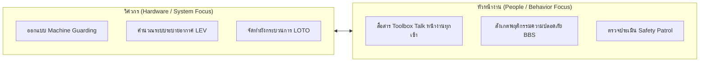
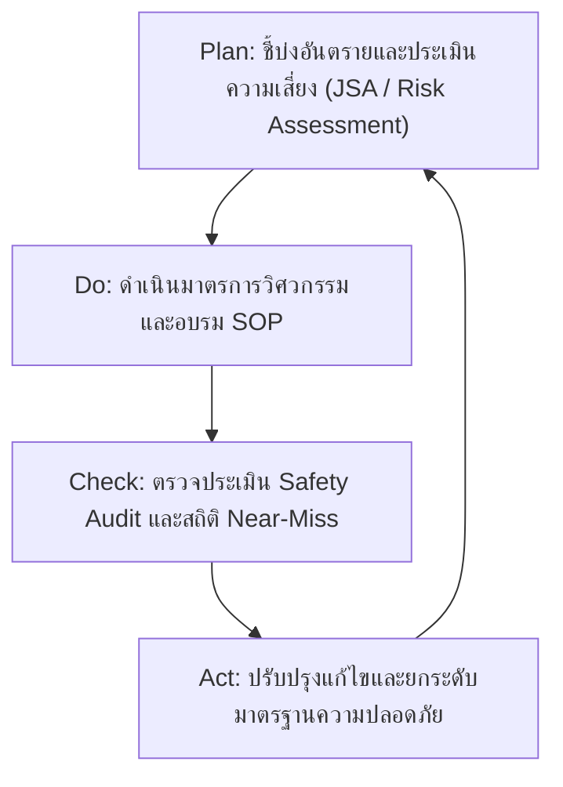

# รูปแบบแนวทางปฏิบัติเพื่อป้องกันอุบัติเหตุ (Accident Prevention Action Patterns)

**วิชา:** OCCUPATIONAL HEALTH AND SAFETY (อาชีวอนามัยและความปลอดภัย)  
**สัปดาห์ที่:** Week 09  
**รหัสนักศึกษา:** 69030091  
**ชื่อ-นามสกุล:** นายทยากร จิตรมาตร  
**ตอนเรียน:** Section 1  

---

## 1. การประสานความร่วมมือระหว่าง Engineer (E) และ Supervisor (S)

---

## 2. ลำดับขั้นการควบคุมอันตราย (Hierarchy of Controls in Practice)

1. **Elimination:** กำจัดขั้นตอนที่มีความเสี่ยงสูงออกจากสายการผลิต
2. **Substitution:** เปลี่ยนสารเคมีไวไฟเป็นสารเคมีไม่ติดไฟ
3. **Engineering Controls:** ติดตั้งม่านแสงนิรภัยและระบบอินเตอร์ล็อก
4. **Administrative Controls:** กำหนดคู่มือ SOP และหมุนเวียนงานลดความล้า
5. **PPE:** อุปกรณ์คุ้มครองความปลอดภัยส่วนบุคคล (เป็นเกราะด่านสุดท้าย)

---

## 3. วงจร PDCA เพื่อการปรับปรุงอย่างต่อเนื่อง

> 📌 **บทสรุป:** อุบัติเหตุในโรงงานจะลดลงจนเป็นศูนย์ (Zero Accident) ได้ ต้องอาศัย **วิศวกรที่ออกแบบระบบให้ผิดพลาดยาก (Safe Hardware)** ร่วมกับ **หัวหน้างานที่สร้างทีมให้ปฏิบัติตามมาตรฐานอย่างมีวินัย (Safe Behavior)**