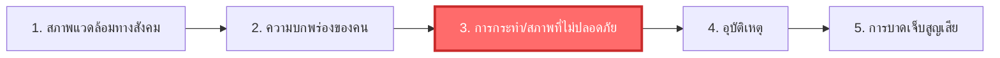

# การป้องกันอุบัติเหตุจากการทำงานและทฤษฎีโดมิโน (Workplace Accident Prevention)

**วิชา:** OCCUPATIONAL HEALTH AND SAFETY (อาชีวอนามัยและความปลอดภัย)  
**สัปดาห์ที่:** Week 09  
**รหัสนักศึกษา:** 69030144  
**ชื่อ-นามสกุล:** นายปฏิภาณ พิพัฒน์พิทยากุล  
**ตอนเรียน:** Section 1  

---

## 1. ทฤษฎีลูกโซ่โดมิโน 5 ตัวของไฮนริช (Heinrich's Domino Theory)

### สัดส่วนสาเหตุการเกิดอุบัติเหตุ
* **การกระทำที่ไม่ปลอดภัย (Unsafe Act):** 88% (เกิดจากพฤติกรรมคน เช่น ประมาท ลัดขั้นตอน ไม่สวม PPE)
* **สภาพการณ์ที่ไม่ปลอดภัย (Unsafe Condition):** 10% (เกิดจากกายภาพ เช่น เครื่องจักรไม่มีการ์ด พื้นลื่น สายไฟชำรุด)
* **เหตุสุดวิสัย (Natural Disasters):** 2%

> 🔑 **การตัดวงจรลูกโซ่อุบัติเหตุ:** หากดึงโดมิโนตัวที่ 3 (Unsafe Act / Condition) ออกไป แรงส่งจากตัวที่ 1 และ 2 จะไม่สามารถส่งผลให้เกิดอุบัติเหตุได้ การบาดเจ็บจึงไม่เกิดขึ้น

---

## 2. ปิรามิดอุบัติเหตุของไฮนริช (1 : 29 : 300 Ratio)
- **1 ครั้ง:** อุบัติเหตุรุนแรงจนเสียชีวิตหรือพิการถาวร (Major Injury)
- **29 ครั้ง:** อุบัติเหตุบาดเจ็บเล็กน้อย เสียเวลาทำงาน (Minor Injury)
- **300 ครั้ง:** เหตุการณ์เกือบเกิดอุบัติเหตุ ไม่บาดเจ็บ (Near-Miss)

**บทเรียนสำคัญ:** การลดอุบัติเหตุร้ายแรง ต้องเริ่มต้นจากการชี้บ่งและแก้ไขที่ฐานของปิรามิด คือการจัดการกับเหตุการณ์เกือบเกิดอุบัติเหตุ (Near-Miss) 300 ครั้งให้หมดไป
