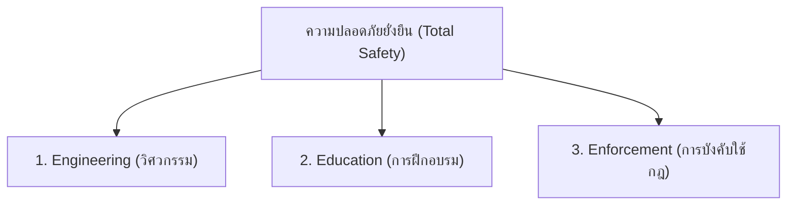

# หลักการ 3E ในการป้องกันอุบัติเหตุ (The 3 Es of Safety)

**วิชา:** OCCUPATIONAL HEALTH AND SAFETY (อาชีวอนามัยและความปลอดภัย)  
**สัปดาห์ที่:** Week 09  
**รหัสนักศึกษา:** 69030144  
**ชื่อ-นามสกุล:** นายปฏิภาณ พิพัฒน์พิทยากุล  
**ตอนเรียน:** Section 1  

---

## 1. เสาค้ำยันความปลอดภัยทั้ง 3 ด้าน (3 Es)

### 1.1 ด้านวิศวกรรม (Engineering)
* **เป้าหมาย:** สร้าง **"Safe Workplace / Safe Machine"** แก้ไขสภาพแวดล้อมที่ไม่ปลอดภัยที่ต้นตอ
* **วิธีการ:** ออกแบบเครื่องจักรให้ปลอดภัยโดยเนื้อแท้ (Inherently Safer Design), ติดตั้ง Machine Guarding, ระบบ LOTO, ระบบดูดอากาศเฉพาะที่ (LEV) และการยศาสตร์ (Ergonomics)

### 1.2 ด้านการศึกษาและการฝึกอบรม (Education)
* **เป้าหมาย:** สร้าง **"Safe Person / Safe Method"** ปรับเปลี่ยนพฤติกรรมและการกระทำที่ไม่ปลอดภัย
* **วิธีการ:** ปฐมนิเทศพนักงานใหม่ (Safety Induction), อบรมขั้นตอนมาตรฐาน SOP, กิจกรรม KYT, การฝึกซ้อมหนีไฟและแผนฉุกเฉิน

### 1.3 ด้านการออกกฎระเบียบและการบังคับใช้ (Enforcement)
* **เป้าหมาย:** สร้าง **"Safe Habit / Safety Discipline"** รักษาวินัยและความต่อเนื่อง
* **วิธีการ:** การตรวจความปลอดภัย (Safety Patrol / Audit), กำหนดบทลงโทษที่ชัดเจนควบคู่กับการให้รางวัลและแรงจูงใจ (Safety Incentive Program)

---

## 2. ตารางสรุปการบูรณาการ

| ด้าน | บทบาทหลัก | ผลลัพธ์ที่คาดหวัง |
| :--- | :--- | :--- |
| **Engineering** | ทำให้สถานที่และเครื่องจักรปลอดภัย | ทำงานได้อย่างปลอดภัย |
| **Education** | ทำให้คนรู้วิธีและมีทัศนคติที่ถูกต้อง | ทำงานเป็นและคิดอย่างปลอดภัย |
| **Enforcement** | ทำให้เกิดวินัยและการปฏิบัติต่อเนื่อง | ทำงานอย่างปลอดภัยสม่ำเสมอ |
