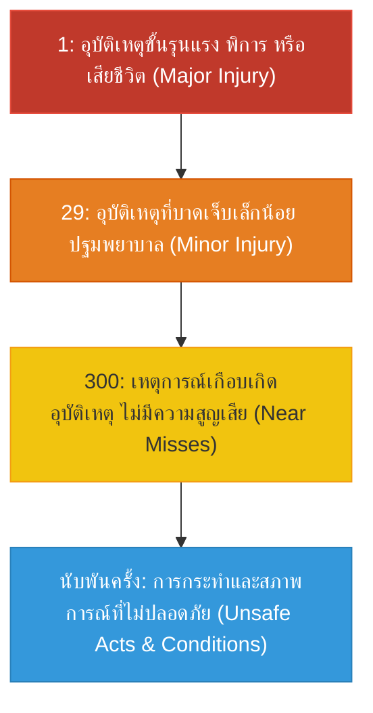

# การคำนวณอัตราการเกิดอุบัติเหตุและการประเมินสถิติความปลอดภัย (Workplace Accident Rate Calculation)

**วิชา:** OCCUPATIONAL HEALTH AND SAFETY (อาชีวอนามัยและความปลอดภัย)  
**สัปดาห์ที่:** Week 09  
**รหัสนักศึกษา:** 69030450  
**ชื่อ-นามสกุล:** นายกิตติศักดิ์ พัฒนนิติศักดิ์  
**ตอนเรียน:** Section 1  

---

## 1. ความสำคัญของการคำนวณสถิติอุบัติเหตุ

ในการประเมินผลการดำเนินงานด้านความปลอดภัย การเปรียบเทียบเพียง "จำนวนครั้งของการเกิดอุบัติเหตุ" ระหว่างโรงงานหรือระหว่างช่วงเวลา ไม่สามารถสะท้อนความจริงได้อย่างถูกต้อง เนื่องจากแต่ละโรงงานมีจำนวนพนักงานและเวลาการทำงานที่แตกต่างกัน

ดังนั้น ตามมาตรฐานสากล (ANSI Z16.1 และกระทรวงแรงงาน) จึงกำหนดให้ใช้การคำนวณเปรียบเทียบบนฐานเวลาทำงานมาตรฐานเดียวกัน คือ **1,000,000 ชั่วโมง-คนทำงาน (Man-Hours)**

---

## 2. สูตรและดัชนีชี้วัดหลักตามมาตรฐานสากล

### 2.1 อัตราความถี่ของการประสบอันตราย (Disabling Injury Frequency Rate: DIFR หรือ $F$)
เป็นตัวชี้วัดความถี่ของการเกิดอุบัติเหตุที่ทำให้พนักงานต้องหยุดงานต่อหนึ่งล้านชั่วโมงการทำงาน:

$$F = \frac{N \times 1,000,000}{m \cdot h}$$

* $N$ = จำนวนครั้งของอุบัติเหตุที่ทำให้หยุดงาน (Disabling Injuries)
* $m \cdot h$ = ชั่วโมงการทำงานรวมของพนักงานทั้งหมด (Total Man-Hours Worked)

### 2.2 อัตราความรุนแรงของการประสบอันตราย (Disabling Injury Severity Rate: DISR หรือ $S$)
เป็นตัวชี้วัดจำนวนวันทำงานที่สูญเสียไปจากอุบัติเหตุต่อหนึ่งล้านชั่วโมงการทำงาน:

$$S = \frac{D \times 1,000,000}{m \cdot h}$$

* $D$ = จำนวนวันทำงานที่สูญเสียไปทั้งหมด (Total Days Lost) รวมวันสูญเสียตามตารางประเมินกรณีทุพพลภาพหรือเสียชีวิต

### 2.3 จำนวนวันสูญเสียเฉลี่ยต่อการเกิดอุบัติเหตุ 1 ครั้ง (Average Days Lost: $ADL$)
สะท้อนระดับความรุนแรงเฉลี่ยของอุบัติเหตุแต่ละครั้งที่เกิดขึ้น:

$$ADL = \frac{D}{N} = \frac{S}{F}$$

### 2.4 ดัชนีรวมความถี่และความรุนแรง (Frequency-Severity Index: $FSI$)
ใช้ในการประเมินประสิทธิภาพความปลอดภัยในภาพรวมแบบดัชนีเดี่ยว:

$$FSI = \sqrt{\frac{F \times S}{1,000}}$$

* **เกณฑ์การแปลผลดัชนี $FSI$:**
  * $FSI < 0.5$ : ระดับดีมาก (Good)
  * $0.5 \le FSI \le 1.0$ : ระดับปานกลาง (Average)
  * $FSI > 1.0$ : ระดับต้องปรับปรุงเร่งด่วน (Poor)

---

## 3. โจทย์ตัวอย่างและการคำนวณอย่างละเอียด (Practical Problem Solving)

### 📋 ข้อมูลสถานประกอบการ:
โรงงานผลิตชิ้นส่วนยานยนต์แห่งหนึ่ง มีข้อมูลการดำเนินงานประจำปีดังนี้:
* จำนวนพนักงานเฉลี่ยตลอดทั้งปี: $500$ คน
* วันทำงานในรอบปี: $260$ วัน
* เวลาทำงานปกติ: $8$ ชั่วโมงต่อวัน
* ชั่วโมงการทำงานล่วงเวลา (OT) รวมทั้งปี: $40,000$ ชั่วโมง
* สถิติการลาหยุดงาน (ลากิจ ลาป่วย ลาพักร้อน) รวมทั้งปี: $5,000$ วัน-คน
* เกิดอุบัติเหตุขึ้นในรอบปีรวม $6$ ครั้ง โดยมีรายละเอียดวันสูญเสียดังนี้:
  * ครั้งที่ 1: นิ้วมือถูกหนีบ หยุดงาน $15$ วัน
  * ครั้งที่ 2: ยกของหนักหลังเคล็ด หยุดงาน $7$ วัน
  * ครั้งที่ 3: สะดุดสายไฟลื่นล้ม หยุดงาน $3$ วัน
  * ครั้งที่ 4: สารเคมีกระเด็นเข้าตา หยุดงาน $10$ วัน
  * ครั้งที่ 5: ชิ้นงานกระเด็นใส่แขน หยุดงาน $5$ วัน
  * ครั้งที่ 6: ชิ้นส่วนเครื่องจักรหนีบสูญเสียปลายนิ้วก้อย (เทียบวันสูญเสียตามตารางมาตรฐาน $100$ วัน)

---

### 🧮 แสดงวิธีทำทีละขั้นตอน:

#### ขั้นตอนที่ 1: คำนวณชั่วโมงการทำงานรวมที่แท้จริง ($m \cdot h$)
$$\text{ชั่วโมงทำงานปกติทั้งหมด} = 500 \times 260 \times 8 = 1,040,000 \text{ ชั่วโมง}$$
$$\text{หักชั่วโมงการลาหยุดงาน} = 5,000 \times 8 = 40,000 \text{ ชั่วโมง}$$
$$\text{บวกชั่วโมงล่วงเวลา (OT)} = 40,000 \text{ ชั่วโมง}$$
$$m \cdot h = 1,040,000 - 40,000 + 40,000 = 1,040,000 \text{ ชั่วโมง-คนทำงาน}$$

#### ขั้นตอนที่ 2: สรุปจำนวนครั้ง ($N$) และวันสูญเสียรวม ($D$)
$$N = 6 \text{ ครั้ง}$$
$$D = 15 + 7 + 3 + 10 + 5 + 100 = 140 \text{ วัน}$$

#### ขั้นตอนที่ 3: คำนวณหาค่า DIFR ($F$)
$$F = \frac{6 \times 1,000,000}{1,040,000} \approx 5.77 \text{ ครั้งต่อล้านชั่วโมงการทำงาน}$$

#### ขั้นตอนที่ 4: คำนวณหาค่า DISR ($S$)
$$S = \frac{140 \times 1,000,000}{1,040,000} \approx 134.62 \text{ วันต่อล้านชั่วโมงการทำงาน}$$

#### ขั้นตอนที่ 5: คำนวณหาค่า $ADL$
$$ADL = \frac{D}{N} = \frac{140}{6} \approx 23.33 \text{ วันต่อครั้ง}$$

#### ขั้นตอนที่ 6: คำนวณหาค่าดัชนี $FSI$
$$FSI = \sqrt{\frac{5.77 \times 134.62}{1,000}} = \sqrt{\frac{776.76}{1,000}} = \sqrt{0.7768} \approx 0.88$$

* **การแปลผล:** ค่า $FSI = 0.88$ อยู่ในช่วง $0.5 - 1.0$ จัดอยู่ในระดับ **"ปานกลาง (Average)"** องค์กรต้องปรับปรุงมาตรการความปลอดภัย โดยเฉพาะมาตรการป้องกันจุดหนีบของเครื่องจักรเพื่อลดความรุนแรงของอุบัติเหตุ

---

## 4. ทฤษฎีพีระมิดอุบัติเหตุ (Heinrich & Bird's Accident Triangle)

**หลักคิดสำคัญ:** หากต้องการกำจัดอุบัติเหตุรุนแรง 1 ครั้ง องค์กรต้องมุ่งเน้นการจัดการที่ฐานรากของพีระมิด นั่นคือการกำจัด Unsafe Act / Unsafe Condition และการรายงาน Near Miss ทุกครั้ง

---

## 5. หลักการ 3E ในการป้องกันอุบัติเหตุ (3E Principles of Safety)

1. **Engineering (วิศวกรรม):** การออกแบบเครื่องจักร สถานที่ทำงาน และระบบป้องกันให้ปลอดภัยตั้งแต่ต้นทาง (Safety by Design)
2. **Education (การศึกษาและฝึกอบรม):** การสร้างความรู้ ความเข้าใจ ทักษะ และจิตสำนึกความปลอดภัยให้แก่บุคลากรทุกระดับ
3. **Enforcement (การบังคับใช้กฎระเบียบ):** การกำหนดระเบียบคู่มือความปลอดภัยที่ชัดเจน และมีการตรวจสอบบังคับใช้อย่างจริงจังเป็นธรรม
