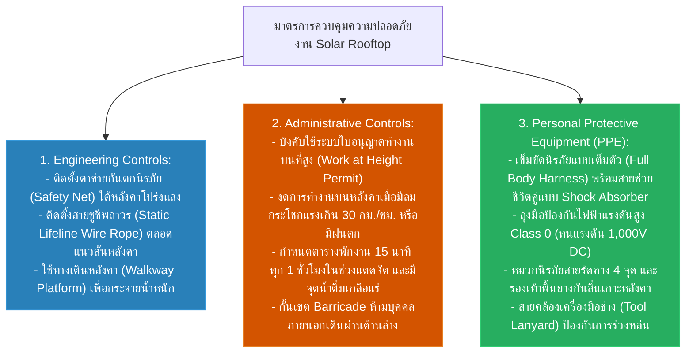

# Workshop Week 11: การประเมินความเสี่ยงและมาตรการควบคุม (Risk Assessment & Hierarchy of Controls)

**วิชา:** OCCUPATIONAL HEALTH AND SAFETY (อาชีวอนามัยและความปลอดภัย)  
**สัปดาห์ที่:** Week 11  
**รหัสนักศึกษา:** 69030450  
**ชื่อ-นามสกุล:** นายกิตติศักดิ์ พัฒนนิติศักดิ์  
**ตอนเรียน:** Section 1  

**งานที่เลือกศึกษา:** งานติดตั้งและบำรุงรักษาระบบผลิตไฟฟ้าพลังงานแสงอาทิตย์บนหลังคาโรงงาน (Rooftop Solar PV Installation & Maintenance)

---

## ส่วนที่ 1: การชี้บ่งอันตรายและผู้มีความเสี่ยง (Hazard Identification)

| ลำดับ | กิจกรรม / จุดปฏิบัติงาน | อันตรายที่ชี้บ่งได้ (Hazard) | แหล่งกำเนิดอันตราย | กลุ่มผู้มีความเสี่ยง | ผลกระทบและความสูญเสียที่อาจเกิดขึ้น |
| :---: | :--- | :--- | :--- | :--- | :--- |
| **1** | การปีนขึ้นและเคลื่อนย้ายบนหลังคาลาดเอียงสูง 10 เมตร | การพลัดตกจากที่สูง และการเหยียบแผ่นหลังคาโปร่งแสง (Translucent Roof) แตกทะลุ | กายภาพ / ความสูง | ช่างติดตั้ง, ช่างไฟฟ้า | พลัดตกลงมากระแทกพื้นด้านล่าง กะโหลกศีรษะแตก กระดูกสันหลังหัก หรือเสียชีวิต |
| **2** | การต่อวงจรไฟฟ้ากระแสตรง (DC String) ของแผงโซลาร์ | ไฟฟ้าดูดจากไฟฟ้าแรงดันสูงกระแสตรง (DC Voltage สูงถึง 600V–1,000V) เมื่อแผงสัมผัสแสงแดด | ไฟฟ้าแรงดันสูง | ช่างไฟฟ้า | หัวใจเต้นผิดจังหวะ ผิวหนังไหม้เกรียมจากประกายไฟอาร์ก (Arc Flash) |
| **3** | การยกย้ายแผงโซลาร์เซลล์ (น้ำหนัก 22–25 กก.) บนหลังคาแคบ | ท่าทางการทำงานที่ไม่ถูกต้อง ท่าก้มเงยเอี้ยวตัวต้านลมแรง | การยศาสตร์ (Ergonomics) | คนงานยกของ | หมอนรองกระดูกทับเส้นประสาท ปวดหลังเรื้อรัง กล้ามเนื้ออักเสบเฉียบพลัน |
| **4** | การปฏิบัติงานกลางแจ้งบนหลังคาเหล็กช่วงเวลา 11.00–14.00 น. | รังสีความร้อนจากแสงแดดและอุณหภูมิสะสมบนหลังคาเหล็กสูงกว่า 45°C | สภาพแวดล้อมทางกายภาพ | ช่างทุกคนบนหลังคา | ภาวะโรคลมแดด (Heat Stroke), ขาดน้ำเฉียบพลัน, หน้ามืดหมดสติพลัดตกจากหลังคา |
| **5** | การใช้อุปกรณ์และเครื่องมือขันยึดโครงสร้าง (Rail Mounting) | เครื่องมือหรือน็อตหลุดมือร่วงหล่นลงสู่พื้นที่ด้านล่าง | วัตถุตกหล่นจากที่สูง | พนักงานและคนเดินเท้าด้านล่าง | ชิ้นส่วนกระแทกศีรษะคนด้านล่าง บาดเจ็บสาหัส |

---

## ส่วนที่ 2: เมทริกซ์การประเมินความเสี่ยง (Risk Assessment Matrix 5x5)

$$\text{ระดับความเสี่ยง (Risk Level)} = \text{โอกาสเกิด (Likelihood: 1–5)} \times \text{ความรุนแรง (Severity: 1–5)}$$

* **เกณฑ์ระดับความเสี่ยง:**
  * **1–3 (ต่ำมาก - Low):** ยอมรับได้ ควบคุมตามขั้นตอนปกติ
  * **4–8 (ปานกลาง - Medium):** ต้องมีมาตรการควบคุมที่ชัดเจน
  * **9–14 (สูง - High):** ต้องปรับปรุงแก้ไขโดยเร็ว มีการเฝ้าระวังเข้มงวด
  * **15–25 (สูงมาก - Very High):** ห้ามเริ่มงานจนกว่าจะลดความเสี่ยงให้อยู่ในเกณฑ์ยอมรับได้

| รายการอันตราย | โอกาสเกิด (L) | ความรุนแรง (S) | ระดับความเสี่ยง (L × S) | ระดับความเสี่ยง | การจัดการ |
| :--- | :---: | :---: | :---: | :---: | :--- |
| **1. พลัดตกจากหลังคา / เหยียบหลังคาแตก** | 3 | 5 | **15** | **สูงมาก (Very High)** | ต้องมีระบบกันตก 100% |
| **2. ไฟฟ้าดูดจากไฟฟ้าแรงดันสูง DC** | 2 | 5 | **10** | **สูง (High)** | สวมถุงมือกันไฟฟ้า ตรวจวัดแรงดัน |
| **3. อาการบาดเจ็บทางการยศาสตร์** | 4 | 2 | **8** | **ปานกลาง (Medium)** | ใช้อุปกรณ์ช่วยยก หมุนเวียนงาน |
| **4. โรคลมแดด (Heat Stroke)** | 3 | 4 | **12** | **สูง (High)** | พักในที่ร่ม จัดน้ำดื่มเพียงพอ |
| **5. เครื่องมือร่วงหล่นใส่คนด้านล่าง** | 3 | 4 | **12** | **สูง (High)** | ผูกเชือกเซฟตี้ กั้นเขตห้ามเข้า |

---

## ส่วนที่ 3: แผนควบคุมความเสี่ยงตามหลัก Hierarchy of Controls

**สรุปผลการประเมิน:**  
หลังจากการนำมาตรการควบคุมทั้ง 3 ระดับมาประยุกต์ใช้ ระดับความเสี่ยงจากการตกจากที่สูงลดลงจาก **15 (สูงมาก)** เหลือเพียง **4 (ปานกลางที่ยอมรับได้)** และความเสี่ยงจากไฟฟ้าแรงดันสูงลดลงเหลือระดับต่ำ ช่วยให้การปฏิบัติงานติดตั้งโซลาร์รูฟท็อปมีความปลอดภัยสูงสุดตามมาตรฐานสากล
