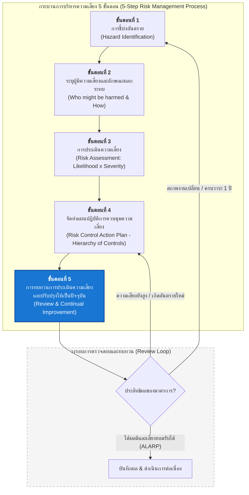
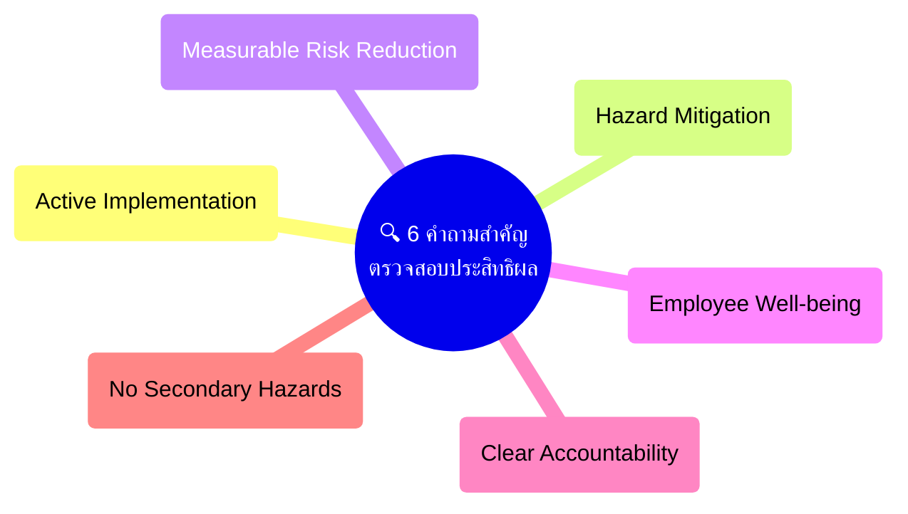
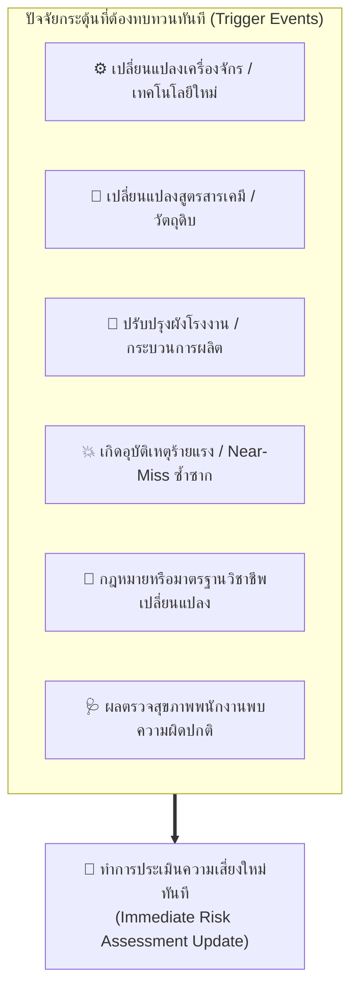
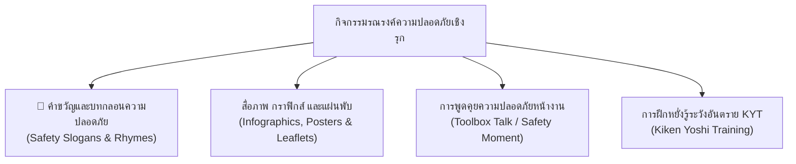

# Week 11 การทบทวนการประเมินความเสี่ยงและการตรวจสอบประสิทธิผลของมาตรการควบคุม

---

## วัตถุประสงค์การเรียนรู้

เมื่อศึกษาเนื้อหาในบทเรียนนี้แล้ว ผู้เรียนจะมีความสามารถดังต่อไปนี้
1. **เข้าใจบทบาทและความสำคัญของขั้นตอนที่ 5** ในกระบวนการบริหารจัดการความเสี่ยง (Review & Continual Improvement) ตามหลักวงจรคุณภาพ PDCA (Plan-Do-Check-Act)
2. **ระบุองค์ประกอบสำคัญที่ต้องบันทึก** ในเอกสารการทบทวนการประเมินความเสี่ยงได้อย่างถูกต้องและเป็นไปตามเกณฑ์มาตรฐานสากล
3. **วิเคราะห์และประเมินประสิทธิผลของมาตรการควบคุมความเสี่ยง** (Hierarchy of Controls) ภายหลังการนำไปปฏิบัติจริงในสถานประกอบกิจการ
4. **กำหนดเงื่อนไขและปัจจัยกระตุ้น (Trigger Events)** ที่จำเป็นต้องทำการทบทวนและปรับปรุงเอกสารการประเมินความเสี่ยงให้เป็นปัจจุบันทันที โดยยึดหลักการบริหารการเปลี่ยนแปลง (Management of Change: MOC)
5. **ออกแบบแผนปฏิบัติการควบคุมความเสี่ยง (Risk Control Action Plan)** และริเริ่มกิจกรรมรณรงค์ส่งเสริมความปลอดภัยเชิงรุก (Proactive Safety Campaigns) ในองค์กรได้อย่างมีประสิทธิภาพ

---

##  กระบวนการบริหารความเสี่ยงและการทบทวนต่อเนื่อง 

---

## 11.1 บทนำและความจำเป็นในการทบทวนการประเมินความเสี่ยง (Introduction & Rationale)

> [!IMPORTANT] นิยามและหลักการสำคัญ (Core Principle)
> **"การประเมินความเสี่ยงไม่ใช่กิจกรรมที่ทำเพียงครั้งเดียวแล้วเสร็จสิ้น (Risk Assessment is NOT a One-Time Exercise, but a Living Document)"**
> 
> สถานประกอบกิจการเป็นสภาพแวดล้อมที่เปลี่ยนแปลงอยู่ตลอดเวลา (Dynamic Workplace) มีการหมุนเวียนของบุคลากร การนำเครื่องจักรหรือเทคโนโลยีใหม่มาใช้งาน การเปลี่ยนสูตรสารเคมี หรือการปรับเปลี่ยนกรรมวิธีการผลิต ดังนั้น เอกสารการประเมินความเสี่ยงที่ทำไว้ในอดีตอาจล้าสมัยและไม่สะท้อนสภาพอันตรายที่แท้จริงหน้างาน การทบทวนการประเมินความเสี่ยงจึงเป็นกลไกตรวจสอบ (Check) และปรับปรุงแก้ไข (Act) ในวงจร **PDCA** เพื่อให้มั่นใจว่าระดับความปลอดภัยของสถานประกอบการอยู่ในระดับที่ยอมรับได้ (As Low As Reasonably Practicable: ALARP) อยู่เสมอ

---

## 11.1.1 องค์ประกอบสำคัญในบันทึกการทบทวนการประเมินความเสี่ยง (Key Elements of Risk Assessment Records)

การทบทวนการประเมินความเสี่ยงที่มีประสิทธิภาพจะต้องได้รับการจัดทำเป็นลายลักษณ์อักษร เพื่อใช้เป็นหลักฐานอ้างอิงทางกฎหมายและเอกสารอ้างอิงในระบบบริหารจัดการความปลอดภัย (เช่น ISO 45001)

### สิ่งที่ต้องปรากฏในบันทึกการทบทวนการประเมินความเสี่ยง

| องค์ประกอบสำคัญ                                                           | รายละเอียดและข้อพิจารณาในการตรวจสอบ                                                                                                                                                                                                             |
| :------------------------------------------------------------------------ | :---------------------------------------------------------------------------------------------------------------------------------------------------------------------------------------------------------------------------------------------- |
| **1. ความครบถ้วนของขอบเขตงาน  (Comprehensiveness)**                    | ตรวจสอบและทบทวนทุกกิจกรรม  - งานประจำ (Routine Tasks) - งานไม่ประจำ (Non-routine Tasks เช่น ซ่อมบำรุง, ล้างทำความสะอาดถัง) - งานในสภาวะฉุกเฉิน (Emergency Situations)                                                                  |
| **2. ความครอบคลุมของกลุ่มบุคคล  (Inclusiveness of Stakeholders)**      | ชี้บ่งอันตรายที่อาจเกิดขึ้นต่อผู้ปฏิบัติงานโดยตรง รวมถึง - ผู้ปฏิบัติงานอื่นที่อยู่ข้างเคียง  - พนักงานรับเหมาค่าแรง (Contractors)  - ลูกค้า  - ผู้มาติดต่อ (Visitors) โดยเฉพาะกลุ่มเปราะบาง (เช่น หญิงมีครรภ์, เยาวชน, แรงงานใหม่) |
| **3. ความเหมาะสมและความเป็นไปได้ของมาตรการ  (Feasibility & Adequacy)** | ตรวจสอบว่ามาตรการควบคุมที่กำหนดขึ้นสอดคล้องกับ **Hierarchy of Controls** และสามารถนำไปปฏิบัติได้จริง - ทางเทคนิค  - งบประมาณ  - พฤติกรรมของบุคลากร                                                                                     |
| **4. ระดับความเสี่ยงคงเหลือ  (Residual Risk Level)**                   | คำนวณและประเมินว่าหลังจากนำมาตรการไปปฏิบัติแล้ว  ระดับความเสี่ยงลดลงมาอยู่ในเกณฑ์ที่ยอมรับได้ (Low หรือ Acceptable Risk) อย่างแท้จริงหรือไม่                                                                                                 |
| **5. วันที่ทำการทบทวนและผู้รับผิดชอบ  (Date & Reviewers Sign-off)**    | ระบุวันที่ทำการทบทวนอย่างชัดเจน  - รายนามคณะผู้ทบทวน (เช่น คณะทำงานชี้บ่งอันตราย, ตัวแทน คปอ., จป.วิชาชีพ)  - มีการลงลายมือชื่อของผู้มีอำนาจอนุมัติ (นายจ้างหรือผู้บริหารระดับสูง)                                                        |

---

## 11.1.2 การตรวจสอบและติดตามประสิทธิผลของมาตรการควบคุม (Monitoring & Evaluating Control Effectiveness)

เมื่อสถานประกอบกิจการได้กำหนดมาตรการควบคุมความเสี่ยง (Risk Control Measures) ไปแล้ว องค์กรต้องจัดให้มีกลไกติดตามตรวจสอบเพื่อตอบคำถามสำคัญ 6 ประการ ดังนี้:

### คำอธิบายเชิงลึก 6 ประการในการประเมินประสิทธิผล

1. **เพื่อให้แน่ใจว่ายังคงมีการดำเนินมาตรการควบคุมนั้นอยู่อย่างต่อเนื่อง (Active Implementation)**
   * บ่อยครั้งที่มาตรการถูกนำมาใช้ในช่วงแรก แต่เมื่อเวลาผ่านไป พนักงานอาจถอดอุปกรณ์ป้องกันออก (Bypassing Guards) ไม่ปฏิบัติตามขั้นตอนการทำงาน หรือขาดการบำรุงรักษา
   * ***ตัวอย่าง*** การ์ดครอบใบเลื่อยวงเดือนยังคงถูกติดตั้งและล็อกไว้อย่างถูกต้องหรือไม่ หรือถูกถอดทิ้งไว้เพราะพนักงานมองว่าทำให้ทำงานช้าลง
     
1. **มีการปรับปรุงแก้ไขอันตรายที่ตรวจพบจากการประเมินความเสี่ยงหรือไม่ (Hazard Mitigation)**
   * อันตรายที่เคยชี้บ่งไว้ได้รับการจัดการทางวิศวกรรมหรือบริหารจัดการตามแผนงานที่ระบุไว้หรือไม่
   * ***ตัวอย่าง*** การปรับปรุงระบบระบายอากาศเฉพาะที่ (Local Exhaust Ventilation: LEV) ในห้องผสมสารเคมีเพื่อดูดไอระเหยสารทำละลาย
     
1. **การดำเนินการทำให้ความเสี่ยงลดลงจริงหรือไม่ (Measurable Risk Reduction)**
   * ตรวจสอบจากสถิติข้อมูลเชิงประจักษ์ เช่น อัตราการเกิดอุบัติการณ์ (Incident Rate), รายงานเหตุการณ์เกือบเกิดอุบัติเหตุ (Near-Miss Reports), หรือการตรวจวัดระดับความเข้มข้นของสารเคมีและเสียงในสภาพแวดล้อม
     
1. **ลูกจ้างได้รับการคุ้มครองดูแลที่ดีขึ้นหรือไม่ (Worker Protection & Feedback)**
   * ประเมินจากผลการตรวจสุขภาพตามปัจจัยเสี่ยง (Health Surveillance) และการรับฟังข้อเสนอแนะจากผู้ปฏิบัติงานหน้างานโดยตรงว่ารู้สึกปลอดภัยขึ้นหรือไม่ มาตรการที่กำหนดสร้างภาระความเมื่อยล้าเพิ่มขึ้นหรือไม่
     
1. **มีการกำหนดผู้ตรวจสอบมาตรการควบคุมความเสี่ยงชัดเจนหรือไม่ (Clear Ownership & Monitoring)**
   * ควรกำหนดหน้าที่ให้หัวหน้างาน (Supervisor), คณะกรรมการความปลอดภัยฯ (คปอ.), หรือเจ้าหน้าที่ความปลอดภัยในการทำงาน (จป.) ตรวจสอบความพร้อมของมาตรการตามรอบเวลาที่กำหนด (Safety Inspection)
     
1. **การติดตามเฝ้าระวังอันตราย ทั้งที่มีอยู่เดิมและอันตรายที่เกิดขึ้นใหม่ (Monitoring Existing & New/Secondary Hazards)**
   * มาตรการควบคุมบางอย่างอาจสร้าง **"อันตรายทุติยภูมิ (Secondary Hazard)"** ขึ้นมาใหม่ เช่น การติดตั้งผนังกั้นเสียงอาจทำให้ความร้อนสะสมในพื้นที่ทำงาน หรือการฉีดละอองน้ำดักฝุ่นอาจทำให้พื้นลื่นล้มได้

---

## 11.1.3 การทบทวนและปรับปรุงข้อมูลการประเมินความเสี่ยงให้เป็นปัจจุบัน (Periodic Reviews & Management of Change: MOC)

การทบทวนการประเมินความเสี่ยงแบ่งออกเป็น 2 รูปแบบหลัก ได้แก่
1. **การทบทวนตามรอบระยะเวลาปกติ (Periodic Review)** 
   
   กำหนดไว้เป็นมาตรฐานอย่างน้อย **ปีละ 1 ครั้ง** หรือตามที่ระบบบริหารจัดการขององค์กรกำหนด
   
1. **การทบทวนกรณีพิเศษหรือเมื่อมีปัจจัยกระตุ้น (Trigger Events / Management of Change)** 
   
   ต้องดำเนินการทันทีเมื่อเกิดเหตุการณ์สำคัญ

> [!WARNING] ข้อกำหนดทางกฎหมายและมาตรฐานสากล
> * **กฎหมายความปลอดภัยของไทย** พระราชบัญญัติความปลอดภัย อาชีวอนามัย และสภาพแวดล้อมในการทำงาน พ.ศ. 2554 กำหนดให้นายจ้างต้องจัดให้มีการประเมินอันตราย ศึกษาผลกระทบของสภาพแวดล้อมในการทำงาน และจัดทำแผนการดำเนินงานด้านความปลอดภัยให้สอดคล้องกับสภาพงานจริง
> * **การเปลี่ยนแปลงที่มีนัยสำคัญ (Significant Change)** หากมีการปรับเปลี่ยนสายการผลิต ขยายอาคาร หรือติดตั้งระบบอัตโนมัติ จะต้องผ่านการประเมินความเสี่ยงตามกระบวนการ **Management of Change (MOC)** ล่วงหน้าก่อนที่จะเริ่มเดินเครื่องจักรเชิงพาณิชย์ทุกครั้ง

---

## 11.1.4 การจัดทำแผนลดและควบคุมความเสี่ยง และกิจกรรมรณรงค์ความปลอดภัยเชิงรุก (Action Plans & Proactive Safety Campaigns)

เมื่อทบทวนความเสี่ยงและระบุประเด็นที่ต้องปรับปรุงแล้ว องค์กรจะต้องดำเนินการ 2 มิติควบคู่กัน
1. **มิติเชิงระบบและวิศวกรรม** 
   
   การจัดทำแผนงานลดและควบคุมความเสี่ยง (Risk Control Action Plan)

1. **มิติเชิงพฤติกรรมและวัฒนธรรม** 
   
   กิจกรรมรณรงค์ส่งเสริมความปลอดภัยเชิงรุก (Proactive Safety Campaigns)

### 1) การจัดทำแผนปฏิบัติการลดและควบคุมความเสี่ยง (Risk Control Action Plan Template)

| ลำดับ | จุดอันตราย / ขั้นตอนงาน         | ระดับความเสี่ยงเดิม | มาตรการควบคุมที่กำหนด (Hierarchy of Controls)                                                           | ผู้รับผิดชอบ            | กรอบเวลาแล้วเสร็จ | งบประมาณ  | ระดับความเสี่ยงคงเหลือ |
| :---: | :------------------------------ | :-----------------: | :------------------------------------------------------------------------------------------------------ | :---------------------- | :---------------: | :-------: | :--------------------: |
|   1   | งานตัดโลหะด้วยเครื่องเลื่อยกล   |     สูงมาก (16)     | **Engineering**   - ติดตั้ง Interlock Guard ป้องกันมือเข้าใกล้ใบเลื่อย                               | ผจก. ซ่อมบำรุง          |   ภายใน 15 วัน    | 12,000 บ. |     ยอมรับได้ (3)      |
|   2   | งานยกเคลื่อนย้ายกระสอบสารเคมี   |      สูง (12)       | **Substitution / Engineering**  - จัดหา Vacuum Lifter (เครื่องช่วยยกสุญญากาศ)                        | หน. แผนกคลัง            |   ภายใน 30 วัน    | 45,000 บ. |     ยอมรับได้ (4)      |
|   3   | งานทำความสะอาดในบ่อบำบัดน้ำเสีย |     สูงมาก (16)     | **Admin & PPE**  - บังคับใช้ระบบ Permit to Work (ใบอนุญาตทำงานในที่อับอากาศ) ตรวจวัดก๊าซ และสวม SCBA | จป.วิชาชีพ / หัวหน้างาน |       ทันที       | 5,000 บ.  |      ปานกลาง (6)       |

---

### 2) กิจกรรมส่งเสริมความปลอดภัยเชิงรุก (Proactive Safety Campaigns)

การสร้างจิตสำนึกด้านความปลอดภัย (Safety Awareness) ให้ฝังลึกในวัฒนธรรมองค์กร ต้องอาศัยเครื่องมือสื่อสารที่เข้าถึงใจพนักงาน จดจำง่าย และกระตุ้นให้เกิดพฤติกรรมที่ปลอดภัยอย่างสม่ำเสมอ:

#### หลักการสร้างสรรค์คำขวัญ บทกลอน และสื่อรณรงค์ความปลอดภัย
1. **วลีที่พูดติดปากได้ง่าย (Catchy & Rhythmic)** 
   
   ใช้สัมผัสคล้องจอง มีจังหวะ ทำให้ท่องจำได้ขึ้นใจโดยไม่ต้องพยายาม
   
1. **สื่อความหมายชัดเจน ตรงประเด็น (Direct & Action-Oriented)** 
   
   บอกชัดเจนว่าต้องทำอะไร หรือห้ามทำอะไรเพื่อความปลอดภัย
   
1. **สะท้อนอารมณ์ความรู้สึกเชิงบวกและห่วงใย (Positive & Empathetic)** 
   
   มุ่งเน้นการกลับบ้านอย่างปลอดภัยไปหาครอบครัว ดีกว่าการข่มขู่ด้วยบทลงโทษ
   
1. **ลดความเสี่ยงได้ผลจริง (Practical Impact)** 
   
   มุ่งเป้าไปที่จุดอันตรายหลักที่องค์กรกำลังเผชิญหน้า

> [!TIP] ตัวอย่างคำขวัญความปลอดภัยที่ทรงพลัง
> * *"ตัดไฟก่อนตรวจ หยุดเครื่องก่อนแตะ ปลอดภัยแน่แท้ กลับบ้านปลอดภัย"* (มาตรการ Lockout/Tagout)
> * *"หมวก แว่น ถุงมือ ใส่ให้ชิน ปลอดภัยทั่วถิ่น ชีวิตยืนยาว"* (การสวมใส่อุปกรณ์คุ้มครองความปลอดภัยส่วนบุคคล)
> * *"ตรวจก่อนใช้ ปลอดภัยก่อนทำ อุบัติเหตุไม่เกิดซ้ำ ถ้าใส่ใจรอบคอบ"* (การตรวจเช็กความปลอดภัยก่อนเริ่มงาน)
> * *"ไม่พร้อมอย่าฝืน ไม่แน่ใจอย่าเสี่ยง ปรึกษาหัวหน้างาน เลี่ยงการสูญเสีย"* (การหยุดงานที่ไม่ปลอดภัย - Stop Work Authority)

---

## 🎯 แบบฝึกหัดและกิจกรรมส่งเสริมการเรียนรู้ (Exercises & Case Studies)

### กิจกรรมที่ 1 การวางแผนลดและควบคุมความเสี่ยงจากกรณีศึกษา (Action Plan Exercise)

**คำสั่ง** 

ให้นักศึกษานำรายการอันตรายที่ได้วิเคราะห์ไว้ใน [Week 10 (Workshop)](file:///d:/GitHubRepos/__ENGEDU/OHS_2569/Week-10/Week10-11%20Workshop.md) มาจัดทำตารางแผนงานลดและควบคุมความเสี่ยง (Risk Control Action Plan) ให้ครบถ้วน 8 ช่องรายการ พร้อมประเมินความเสี่ยงคงเหลือ (Residual Risk)

### กิจกรรมที่ 2 การประกวดสรรค์สร้างสื่อรณรงค์ความปลอดภัยเชิงรุก (Safety Campaign Pitch)
**คำสั่ง** 

ให้นักศึกษาแบ่งกลุ่มละ 3 - 4 คน เลือกหัวข้องานที่มีความเสี่ยงสูง 1 กิจกรรม (เช่น งานยกของหนัก, งานตัดต่อไฟฟ้า, งานขับขี่รถฟอร์คลิฟต์) แล้วร่วมกัน:

1. ออกแบบ **คำขวัญ หรือ บทกลอนความปลอดภัย** ที่คล้องจอง จดจำง่าย และมีพลัง 1 ประโยค
2. สเกตช์ภาพจำลอง **แผ่นพับ หรือ โปสเตอร์ Infographic** ขนาด A4 โดยระบุข้อความ จุดเตือนอันตราย และขั้นตอนการปฏิบัติที่ถูกต้อง
3. นำเสนอแนวคิดต่อเพื่อนร่วมชั้นเรียน โดยระบุว่าสื่อชิ้นนี้จะช่วยลด Unsafe Act หรือ Unsafe Condition ได้อย่างไร

---

## 📝 คำถามทบทวนความรู้ประจำบทเรียน (Review Questions)

1. **เพราะเหตุใดการประเมินความเสี่ยงจึงไม่สามารถทำเพียงครั้งเดียวจบได้ 
   จงยกตัวอย่างปัจจัยที่ทำให้ผลการประเมินความเสี่ยงเดิมล้าสมัยอย่างน้อย 3 ประการ**
   
* **แนวคำตอบ** 
     
     เนื่องจากสภาพแวดล้อมการทำงานมีความเป็นพลวัต (Dynamic) เปลี่ยนแปลงอยู่เสมอ เช่น 
	       (1) การเปลี่ยนเครื่องจักรหรือเทคโนโลยีใหม่ 
	       (2) การเปลี่ยนสูตรสารเคมีหรือวัตถุดิบ 
	       (3) การเกิดอุบัติเหตุหรือเหตุการณ์เกือบเกิดอุบัติเหตุซ้ำซาก 
     ซึ่งชี้ว่ามาตรการเดิมไม่มีประสิทธิผลเพียงพอ
     
     
1. **ในการตรวจสอบประสิทธิผลของมาตรการควบคุมความเสี่ยง มีประเด็นสำคัญใดบ้างที่ต้องตรวจสอบ?**
   
   * **แนวคำตอบ** 
     ต้องตรวจสอบ 6 ประเด็นหลัก ได้แก่ 
	     (1) ยังคงมีการดำเนินมาตรการนั้นอยู่อย่างต่อเนื่องหรือไม่ 
	     (2) อันตรายเดิมได้รับการแก้ไขจริงหรือไม่ 
	     (3) ระดับความเสี่ยงลดลงสู่ระดับที่ยอมรับได้หรือไม่ 
	     (4) ลูกจ้างได้รับการคุ้มครองดีขึ้นหรือไม่ 
	     (5) มีผู้รับผิดชอบการตรวจสอบที่ชัดเจนหรือไม่ และ 
	     (6) มาตรการที่นำมาใช้ได้ก่อให้เกิดอันตรายใหม่ขึ้นมาหรือไม่
	     
1. **"อันตรายทุติยภูมิ (Secondary Hazard)" จากการกำหนดมาตรการควบคุมความเสี่ยงคืออะไร จงยกตัวอย่างประกอบ**
   
* **แนวคำตอบ** 
  
  คืออันตรายหรือความเสี่ยงรูปแบบใหม่ที่เกิดขึ้นจากตัวมาตรการควบคุมความปลอดภัยเอง เช่น 
	(1) การติดตั้งตู้ครอบเพื่อลดเสียงเครื่องจักร ทำให้เกิดการสะสมของความร้อนจนเสี่ยงต่อเพลิงไหม้ 
	(2) การบังคับให้พนักงานสวมหน้ากากกรองอากาศในที่อากาศร้อนจัดจนส่งผลให้เกิดโรคลมแดด (Heat Stroke)

## 1. ทำไมต้องประเมินความเสี่ยงต่อเนื่อง?
ตอบ: เพราะสภาพแวดล้อมการทำงานเปลี่ยนแปลงตลอดเวลา (Dynamic)
 3 ปัจจัย: (1) เปลี่ยนเครื่องจักร/เทคโนโลยีใหม่ (2) เปลี่ยนสูตรสารเคมี/วัตถุดิบ (3) เกิดอุบัติเหตุ/Near-miss ซ้ำซาก
## 2. 6 ประเด็นตรวจประสิทธิผลมาตรการ
ตอบ:
1. ทำต่อเนื่องไหม
2. แก้ปัญหาเดิมได้จริงไหม
3. ความเสี่ยงลดถึงระดับยอมรับได้ไหม
4. ลูกจ้างปลอดภัยขึ้นไหม
5. มีผู้รับผิดชอบชัดเจนไหม
6. เกิดอันตรายใหม่ขึ้นไหม
## 3. อันตรายทุติยภูมิ (Secondary Hazard) คืออะไร?
ตอบ: อันตรายรูปแบบใหม่ที่ เกิดจากตัวมาตรการความปลอดภัยเอง
 ตัวอย่าง: ครอบตู้ลดเสียงเครื่องจักรแต่เกิดความร้อนสะสมเสี่ยงไฟไหม้ หรือ ใส่หน้ากากกันฝุ่นในที่ร้อนจัดจนเป็น Heat Stroke

