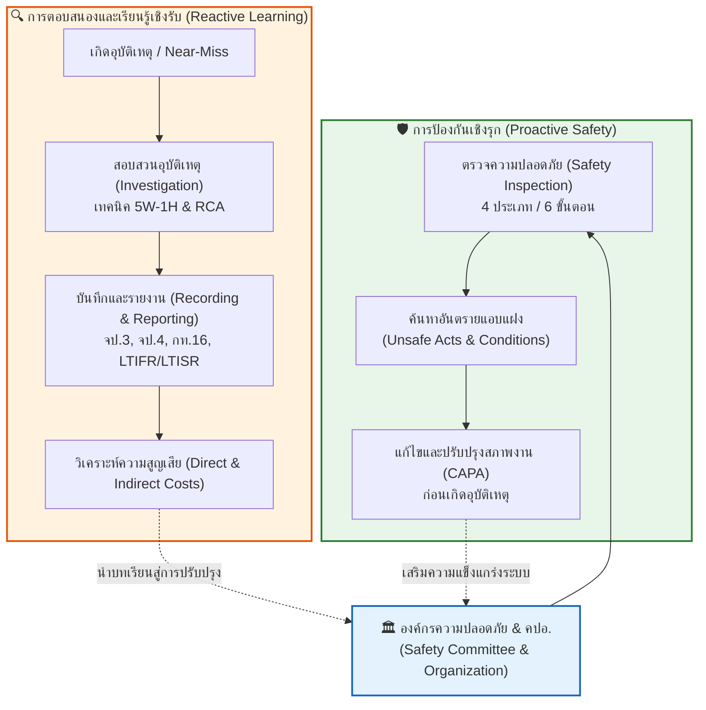
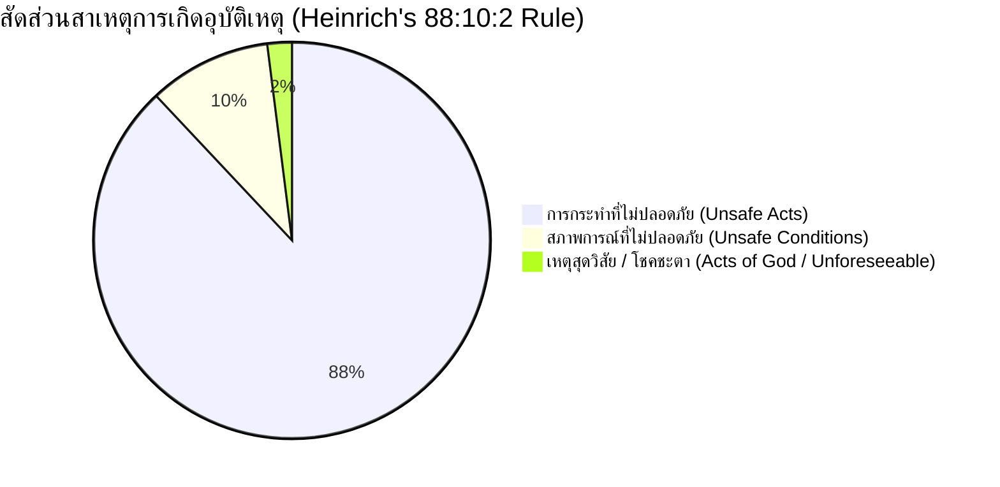
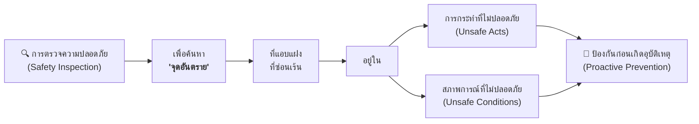
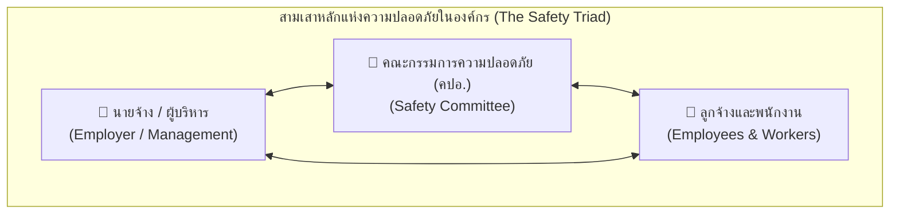
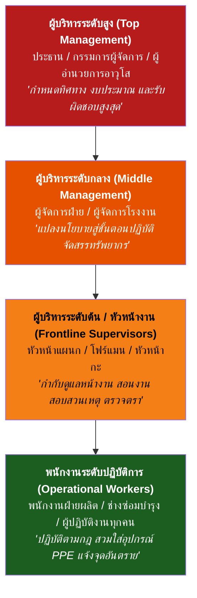
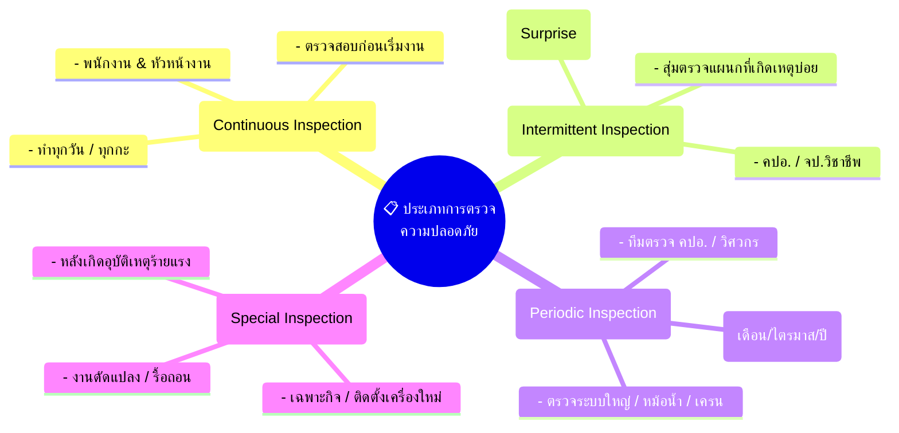

# Week 11.2 การตรวจความปลอดภัย การสอบสวน การบันทึก และการรายงานอุบัติเหตุ

---

##  วัตถุประสงค์การเรียนรู้ประจำบท

เมื่อศึกษาเนื้อหาในบทเรียนนี้ครบถ้วนแล้ว ผู้เรียนจะมีความสามารถดังต่อไปนี้
1. **เข้าใจสัดส่วนสาเหตุการเกิดอุบัติเหตุตามทฤษฎีไฮน์ริช (Heinrich's Domino Theory)** และอธิบายวัตถุประสงค์สำคัญของการตรวจความปลอดภัยเชิงรุก
2. **อธิบายโครงสร้างและบทบาทหน้าที่ของคณะกรรมการความปลอดภัย อาชีวอนามัย และสภาพแวดล้อมในการทำงาน (คปอ.)** และบุคลากรทุกระดับตามกฎหมายแรงงานไทย
3. **จำแนกประเภทของการตรวจความปลอดภัยทั้ง 4 รูปแบบ** และปฏิบัติตามขั้นตอนการตรวจความปลอดภัยในสถานประกอบกิจการได้อย่างถูกต้อง
4. **ประยุกต์ใช้เทคนิค 5W-1H และเครื่องมือในการสอบสวนอุบัติเหตุ** เพื่อค้นหาสาเหตุรากเหง้า (Root Cause Analysis: RCA) จากเหตุการณ์จริง
5. **เข้าใจเกณฑ์การจำแนกอุบัติเหตุและเหตุการณ์เกือบเกิดอุบัติเหตุ (Near-Miss)** ที่จำเป็นต้องทำการสอบสวนและบันทึก
6. **วิเคราะห์ความสูญเสียจากอุบัติเหตุ (ต้นทุนทางตรงและต้นทุนทางอ้อม)** ตามแบบจำลองภูเขาน้ำแข็ง (Iceberg Theory)
7. **คำนวณและแปลผลดัชนีชี้วัดสถิติความปลอดภัยสากล (LTIFR, LTISR, FSI)** ตลอดจนระบุข้อกำหนดในการจัดทำรายงานอุบัติเหตุตามกฎหมายไทย (แบบ จป.3, จป.4, กท.16, กท.44)

---

## แผนผังภาพรวมระบบการตรวจและจัดการอุบัติเหตุ

---

## 11.2 สาเหตุพื้นฐานของการเกิดอุบัติเหตุ

จากการศึกษาทางสถิติอุบัติเหตุในภาคอุตสาหกรรมโดย **เอช. ดับเบิลยู. ไฮน์ริช (H.W. Heinrich)** ซึ่งเป็นบิดาแห่งวิศวกรรมความปลอดภัยเชิงอุตสาหกรรม พบว่าสาเหตุของอุบัติเหตุสามารถจำแนกออกเป็นสัดส่วนสำคัญ 3 กลุ่ม ดังนี้:

1. **การกระทำที่ไม่ปลอดภัย (Unsafe Acts) คิดเป็น 88%**  
   เกิดจากพฤติกรรมของบุคคล เช่น 
	  - ความประมาทเลินเล่อ
	  - ความรีบร้อน
	  - การไม่สวมใส่อุปกรณ์คุ้มครองความปลอดภัยส่วนบุคคล (PPE) 
	  - การลัดขั้นตอนการทำงาน
	  - การหยอกล้อในขณะทำงาน
	  - การทำงานโดยไม่มีอำนาจหน้าที่

2. **สภาพการณ์ที่ไม่ปลอดภัย (Unsafe Conditions) คิดเป็น 10%**  
   เกิดจากความบกพร่องทางกายภาพ สิ่งแวดล้อม หรือเครื่องจักรกล เช่น 
	- เครื่องจักรไม่มีการ์ดป้องกัน 
	- พื้นทางเดินเปียกลื่น 
	- สายไฟฟ้าชำรุด 
	- ระบบระบายอากาศไม่เพียงพอ 
	- แสงสว่างไม่เหมาะสม 
	- โครงสร้างอาคารชำรุด

3. **เหตุสุดวิสัยหรือภัยธรรมชาติ (Acts of God / Unforeseeable Events) คิดเป็น 2%**  
   เป็นเหตุการณ์ที่อยู่นอกเหนือการควบคุมของมนุษย์ 
	- แผ่นดินไหว 
	- พายุฟ้าผ่ารุนแรง 
	- น้ำท่วมฉับพลัน

> [!NOTE] ข้อพิจารณาทางวิศวกรรมความปลอดภัยยุคใหม่
> แม้สถิติจะระบุว่า 88% เกิดจากพฤติกรรมของคน (Unsafe Acts) แต่วิศวกรความปลอดภัยสมัยใหม่ตระหนักดีว่า **"พฤติกรรมที่ไม่ปลอดภัยมักมีต้นตอมาจากสภาพแวดล้อม การออกแบบ หรือระบบการบริหารจัดการที่บกพร่อง"** ดังนั้น การป้องกันอุบัติเหตุที่มีประสิทธิผลจึงต้องเริ่มจากการกำจัดจุดอันตรายด้วยระบบวิศวกรรมและการออกแบบระบบที่ไม่ยอมให้ความผิดพลาดของมนุษย์นำไปสู่การบาดเจ็บ (Fail-Safe & Poka-Yoke)

---

## 11.2.1 วัตถุประสงค์ของการตรวจความปลอดภัย

### เป้าหมายหลักของการตรวจความปลอดภัย
1. **เพื่อค้นหาจุดอันตรายที่แอบแฝงซ่อนเร้น (Latent Hazards)** 
   
   อันตรายหลายอย่างไม่สามารถมองเห็นได้ชัดเจนในสภาวะปกติ เช่น ความล้าของโลหะ การรั่วซึมของสารเคมี หรือพฤติกรรมลัดขั้นตอนของพนักงานเมื่อไม่มีหัวหน้างานดูแล
   
1. **เพื่อตรวจสอบสภาพความพร้อมของเครื่องจักร อุปกรณ์ และสิ่งแวดล้อม** 
   
   ตรวจสอบให้มั่นใจว่าระบบความปลอดภัยและการ์ดป้องกันยังคงทำงานได้อย่างสมบูรณ์
   
1. **เพื่อส่งเสริมการสื่อสารและการสอนงานด้านความปลอดภัย (Safety Coaching)** 
   
   เป็นโอกาสที่ผู้ตรวจจะได้ชี้แนะวิธีการทำงานที่ถูกต้องแก่พนักงานหน้างานโดยตรง
   
1. **เพื่อปรับเปลี่ยนกรอบความคิด** 
   
   มุ่งเน้น **"การค้นหาข้อเท็จจริงเพื่อแก้ไขปรับปรุงระบบ (Fact-Finding)"** มากกว่าการจับผิดเพื่อลงโทษพนักงาน (Fault-Finding)

---

## 11.2.2 การจัดตั้งหน่วยงานความปลอดภัยและคณะกรรมการความปลอดภัย

ตาม **กฎกระทรวงการจัดให้มีเจ้าหน้าที่ความปลอดภัยในการทำงาน บุคลากร หน่วยงาน หรือคณะบุคคลเพื่อดำเนินการด้านความปลอดภัยในสถานประกอบกิจการ พ.ศ. 2565** (ออกตามความในพระราชบัญญัติความปลอดภัย อาชีวอนามัย และสภาพแวดล้อมในการทำงาน พ.ศ. 2554) กำหนดให้นายจ้างในสถานประกอบกิจการตามประเภทและขนาดที่กำหนด ต้องจัดให้มี **คณะกรรมการความปลอดภัย อาชีวอนามัย และสภาพแวดล้อมในการทำงาน (คปอ.)**

### เกณฑ์จำนวนคณะกรรมการความปลอดภัยฯ (คปอ.) ขั้นต่ำตามกฎหมาย

| จำนวนลูกจ้างในสถานประกอบการ | จำนวนกรรมการรวมขั้นต่ำ | ผู้แทนนายจ้างระดับบังคับบัญชา | ผู้แทนลูกจ้างระดับปฏิบัติการ |               ประธานกรรมการ                |            เลขานุการกรรมการ             |
| :-------------------------: | :--------------------: | :---------------------------: | :--------------------------: | :----------------------------------------: | :-------------------------------------: |
|       **50 – 99 คน**        |  **ไม่น้อยกว่า 5 คน**  |             1 คน              |             2 คน             | นายจ้างหรือผู้แทนนายจ้างระดับบริหาร (1 คน) | จป.วิชาชีพ หรือ จป.เทคนิคขั้นสูง (1 คน) |
|      **100 – 499 คน**       |  **ไม่น้อยกว่า 7 คน**  |             2 คน              |             3 คน             | นายจ้างหรือผู้แทนนายจ้างระดับบริหาร (1 คน) |            จป.วิชาชีพ (1 คน)            |
|      **500 คนขึ้นไป**       | **ไม่น้อยกว่า 11 คน**  |             4 คน              |             5 คน             | นายจ้างหรือผู้แทนนายจ้างระดับบริหาร (1 คน) |            จป.วิชาชีพ (1 คน)            |

*(**ที่มา**  กฎกระทรวงการจัดให้มีเจ้าหน้าที่ความปลอดภัยในการทำงานฯ พ.ศ. 2565 กระทรวงแรงงาน)*

> [!IMPORTANT] กฎหมายและแนวปฏิบัติเกี่ยวกับ คปอ.
> * **วาระการดำรงตำแหน่ง** กรรมการ คปอ. มีวาระการดำรงตำแหน่งคราวละ **2 ปี**
> * **การประชุม** ต้องจัดให้มีการประชุมอย่างน้อย **เดือนละ 1 ครั้ง**
> * **การรายงาน** นายจ้างต้องส่งรายงานผลการดำเนินงานของ คปอ. (แบบ จป.3) ให้แก่กรมสวัสดิการและคุ้มครองแรงงานทุกไตรมาส

---

## 11.2.3 บทบาทหน้าที่ของผู้มีส่วนเกี่ยวข้อง

### 11.2.3.1 บทบาทหน้าที่ของคณะกรรมการความปลอดภัยฯ (คปอ.)

1. **พิจารณานโยบายและแผนงาน** 
   
   กำหนดนโยบาย แผนงาน ระเบียบ และมาตรฐานความปลอดภัยในการทำงาน เสนอต่อนายจ้าง

1. **สำรวจและตรวจสอบความปลอดภัย** 
   
   ดำเนินการสำรวจความปลอดภัย อาชีวอนามัย และสภาพแวดล้อมในการทำงานอย่างน้อยเดือนละ 1 ครั้ง และร่วมตรวจสอบกรณีเกิดอุบัติเหตุร้ายแรง

1. **ส่งเสริมและสนับสนุนกิจกรรม** 
   
   รณรงค์และจัดกิจกรรมกระตุ้นจิตสำนึกด้านความปลอดภัยของพนักงาน

1. **รับฟังข้อร้องเรียนและข้อคิดเห็น** 
   
   พิจารณาข้อร้องเรียนและข้อเสนอแนะด้านความไม่ปลอดภัยจากพนักงาน เพื่อเสนอมาตรการแก้ไขต่อนายจ้าง

1. **รายงานและประเมินผล** 
   
   รายงานผลการดำเนินงานและสถิติอุบัติเหตุประจำปีต่อนายจ้าง

### 11.2.3.2 บทบาทหน้าที่ของนายจ้างต่อความปลอดภัย

1. **สนับสนุนทรัพยากรและงบประมาณ** 
   
   จัดสรรงบประมาณ เครื่องมือ และเวลาทำงานสำหรับการดำเนินงานของ คปอ.

1. **รับฟังและปฏิบัติตามคำแนะนำ** 
   
   นำข้อเสนอแนะด้านความปลอดภัยจาก คปอ. ไปสั่งการและปรับปรุงแก้ไขอย่างเป็นรูปธรรม

2. **เปิดเผยข้อมูลที่เป็นจริง** 
   
   แสดงข้อมูลสถิติ สภาพแวดล้อม สารเคมี และประวัติอุบัติเหตุแก่ คปอ. อย่างโปร่งใส

2. **รับผิดชอบทางกฎหมาย** 
   
   รับผิดชอบสูงสุดต่อความปลอดภัยและสุขอนามัยของลูกจ้างทุกคนในสถานประกอบกิจการ

### 11.2.3.3 บทบาทหน้าที่ของพนักงานและลูกจ้าง
1. **ให้ความร่วมมือ** 
   
   เข้าร่วมกิจกรรมความปลอดภัย และปฏิบัติตามกฎระเบียบข้อบังคับอย่างเคร่งครัด

2. **ยอมรับและเชื่อมั่น** 
   
   ปรับเปลี่ยนทัศนคติและพฤติกรรมการทำงานให้ปลอดภัย โดยตระหนักว่าความปลอดภัยเป็นหน้าที่ของทุกคน

3. **ให้ข้อมูลข้อเท็จจริง** 
   
   รายงานเหตุการณ์และสภาพแวดล้อมตามความเป็นจริงแก่ผู้ตรวจหรือทีมสอบสวน

4. **กล้าแสดงออกและใช้สิทธิ** 
   
   เสนอแนะจุดอันตราย หรือใช้สิทธิหยุดการทำงานชั่วคราว (Stop Work Authority) เมื่อพบว่างานมีความเสี่ยงร้ายแรงถึงชีวิต

---

## 11.2.4 บทบาทหน้าที่ของฝ่ายต่าง ๆ ในองค์กรที่เกี่ยวกับความปลอดภัย

ความปลอดภัยไม่ใช่หน้าที่ของฝ่าย จป. เพียงฝ่ายเดียว แต่ต้องบูรณาการเข้ากับทุกสายงานในองค์กร:

| หน่วยงาน                           | บทบาทหน้าที่และความรับผิดชอบด้านความปลอดภัย                                                                                                                                                                                                                                                              |
| :--------------------------------- | :------------------------------------------------------------------------------------------------------------------------------------------------------------------------------------------------------------------------------------------------------------------------------------------------------- |
| **1. ฝ่ายบุคคล (HR)**              | • คัดเลือกและจัดหาบุคลากรที่มีสุขภาพและคุณสมบัติเหมาะสมกับลักษณะงาน • จัดให้มีการตรวจสุขภาพพนักงานใหม่ก่อนเข้าทำงาน (Pre-employment Check) และตรวจสุขภาพประจำปีตามปัจจัยเสี่ยง • จัดทำแผนการฝึกอบรมความปลอดภัยปฐมนิเทศและหลักสูตรกฎหมายบังคับ • ติดตามกฎหมายแรงงานและความปลอดภัยที่ปรับปรุงใหม่ |
| **2. ฝ่ายบัญชีและการเงิน**         | • จัดสรรงบประมาณด้านความปลอดภัย อุปกรณ์ PPE และระบบป้องกันอย่างเหมาะสม • จัดทำบัญชีและติดตามต้นทุนค่าใช้จ่ายทั้งหมดที่เกิดจากอุบัติเหตุ (ต้นทุนทางตรงและทางอ้อม)                                                                                                                                      |
| **3. ฝ่ายจัดซื้อ**                 | • จัดหาเครื่องจักร อุปกรณ์ และสารเคมีที่ได้มาตรฐานความปลอดภัย (มอก., ISO, CE) • บังคับให้ผู้ขายแนบเอกสารข้อมูลความปลอดภัยสารเคมี (Safety Data Sheet: SDS) และคู่มือการใช้งาน • จัดหาอุปกรณ์คุ้มครองความปลอดภัยส่วนบุคคล (PPE) ที่ผ่านการรับรองมาตรฐานสากล                                          |
| **4. ฝ่ายวิศวกรรม**                | • ออกแบบเครื่องจักร สายการผลิต และสิ่งอำนวยความสะดวกตามหลักวิศวกรรมความปลอดภัย (Inherently Safer Design) • ตรวจสอบให้แบบก่อสร้างและการดัดแปลงไม่ขัดต่อกฎหมายความปลอดภัย • ร่วมปรับปรุงสภาพแวดล้อมทางวิศวกรรม เช่น ระบบระบายอากาศ การ์ดป้องกันเครื่องจักร                                           |
| **5. ฝ่ายซ่อมบำรุง**               | • จัดทำประวัติเครื่องจักรและดำเนินการบำรุงรักษาเชิงป้องกัน (Preventive Maintenance: PM) • วิเคราะห์จุดอันตรายของเครื่องจักรและปรับปรุงระบบนิรภัย (Safety Devices & Interlocks) • นำระบบตัดแยกพลังงานอันตราย **Lockout/Tagout (LOTO)** มาใช้ในงานซ่อมแซมอย่างเคร่งครัด                              |
| **6. ฝ่ายควบคุมคุณภาพ (QC/QA)**    | • ควบคุมการผลิตให้เป็นไปตามมาตรฐานเพื่อความปลอดภัยของผู้บริโภคและผู้ปฏิบัติงาน • วิเคราะห์ข้อบกพร่องและจุดอันตรายของกระบวนการผลิต (เช่น FMEA) เพื่อร่วมปรับปรุงงาน                                                                                                                                    |
| **7. ฝ่ายการตลาดและประชาสัมพันธ์** | • จัดทำข้อมูลฉลากคำเตือนและเอกสารแนะนำความปลอดภัยของผลิตภัณฑ์ให้แก่ลูกค้า • สื่อสารภาพลักษณ์และผลงานด้านความรับผิดชอบต่อสังคมและสิ่งแวดล้อม (CSR & ESG)                                                                                                                                               |
| **8. ฝ่ายคลังสินค้าและการขนส่ง**   | • จัดเก็บสินค้าและสารเคมีตามหลักการจัดเก็บที่ปลอดภัย (Separation & Segregation) • ควบคุมความปลอดภัยในการขับขี่รถฟอร์กลิฟต์และการจัดวางพาเลท • ตรวจเช็กสภาพยานพาหนะและควบคุมพฤติกรรมพนักงานขับรถขนส่งสินค้าภายนอก                                                                                   |

---

## 11.2.5 บทบาทหน้าที่ของบุคคลตามสายการบังคับบัญชา (Safety Roles Across Hierarchy)

### 11.2.5.1 ผู้บริหารระดับสูง
* ประกอบด้วย  ประธานบริษัท, รองผู้จัดการใหญ่, ผู้อำนวยการอาวุโส
1. กำหนดนโยบายและเป้าหมายวิสัยทัศน์ความปลอดภัย (Safety Policy) และประกาศให้ทุกคนรับทราบ
2. จัดสรรทรัพยากรและงบประมาณด้านความปลอดภัยอย่างเพียงพอ
3. จัดตั้งโครงสร้างองค์กรความปลอดภัยและคณะกรรมการ คปอ.
4. ติดตามและทบทวนผลการดำเนินงานด้านความปลอดภัยในการประชุมฝ่ายบริหารอย่างสม่ำเสมอ
5. แสดงภาวะผู้นำด้านความปลอดภัย (Safety Leadership) ด้วยการเป็นแบบอย่างที่ดี

### 11.2.5.2 ผู้บริหารระดับกลาง
* ประกอบด้วย  ผู้จัดการโรงงาน, ผู้จัดการฝ่ายบุคคล, ผู้จัดการฝ่ายผลิต, ผู้จัดการฝ่ายวิศวกรรม
1. ถ่ายทอดนโยบายของผู้บริหารระดับสูงลงสู่แผนปฏิบัติการระดับหน่วยงาน
2. จัดทำขั้นตอนการปฏิบัติงานที่ปลอดภัย (Safe Work Procedures: SWP) และข้อบังคับความปลอดภัย
3. ขจัดอุปสรรคและสนับสนุนงบประมาณในการปรับปรุงจุดอันตรายของหน่วยงานใต้บังคับบัญชา
4. ติดตามสถิติอุบัติเหตุและการประเมินความเสี่ยงในสายงานของตน
5. รับผิดชอบต่อความปลอดภัยของพนักงานทุกคนในแผนกที่ตนเองดูแล

### 11.2.5.3 ผู้บริหารระดับต้น / หัวหน้างาน
* ประกอบด้วย  หัวหน้าแผนก, หัวหน้างาน (Supervisor), หัวหน้ากะ, โฟร์แมน (Foreman)
> [!TIP] หัวหน้างาน: กุญแจสำคัญที่สุดของความปลอดภัยหน้างาน
> หัวหน้างานคือผู้ที่อยู่ใกล้ชิดกับพนักงานและหน้างานมากที่สุด ความสำเร็จหรือล้มเหลวของความปลอดภัยขึ้นอยู่กับบทบาทของหัวหน้างานเป็นหลัก

1. จัดการอบรมความปลอดภัยหน้างานและการพูดคุยความปลอดภัยประจำวัน (Toolbox Talk)
2. ตรวจตราสภาพการทำงานและพฤติกรรมของพนักงานอย่างสม่ำเสมอ (Unannounced Inspections)
3. ตักเตือนและแก้ไขการทำงานที่ไม่ปลอดภัยทันทีที่พบเห็น
4. ดำเนินการสอบสวน บันทึก และรายงานอุบัติเหตุหรือเหตุการณ์เกือบเกิดอุบัติเหตุทันที
5. ปรับปรุงจุดอันตรายและสภาพแวดล้อมที่ได้รับมอบหมายให้แล้วเสร็จตามกำหนด

### 11.2.5.4 พนักงานระดับปฏิบัติการ
* ประกอบด้วย ช่างเทคนิค, พนักงานฝ่ายผลิต, พนักงานคลังสินค้า, ผู้ปฏิบัติงานทุกคน
1. เคร่งครัดในขั้นตอนและข้อบังคับความปลอดภัยในการทำงาน
2. ตรวจสอบเครื่องจักร เครื่องมือ และอุปกรณ์ PPE ก่อนเริ่มทำงานทุกครั้ง
3. สวมใส่และดูแลรักษาอุปกรณ์คุ้มครองความปลอดภัยส่วนบุคคลอย่างถูกต้อง
4. รายงานสภาพการณ์และเครื่องมือที่ชำรุดเสียหายต่อหัวหน้างานทันที
5. หลีกเลี่ยงการใช้เครื่องจักรหรือสารเคมีที่ตนเองไม่ได้รับการฝึกอบรมหรือไม่มีความชำนาญ

---

## 11.2.6 บทบาทหน้าที่ของเจ้าหน้าที่ความปลอดภัยในการทำงาน (Safety Officers: จป.)

ตามกฎกระทรวงฯ พ.ศ. 2565 กำหนดให้มีเจ้าหน้าที่ความปลอดภัยในการทำงาน (จป.) 5 ระดับ ได้แก่
1. **จป. ระดับบริหาร** (นายจ้างหรือผู้บริหารระดับสูง)
2. **จป. ระดับหัวหน้างาน** (หัวหน้างานตามสายการผลิต)
3. **จป. ระดับเทคนิค**
4. **จป. ระดับเทคนิคขั้นสูง**
5. **จป. ระดับวิชาชีพ** (ผู้สำเร็จการศึกษาปริญญาตรีสาขาอาชีวอนามัยและความปลอดภัย หรือเทียบเท่า)

### บทบาทหน้าที่หลักของเจ้าหน้าที่ความปลอดภัยในการทำงานระดับวิชาชีพ
1. **จัดทำแผนงานและข้อเสนอแนะ** จัดทำแผนงานโครงการความปลอดภัย เสนอต่อนายจ้างและ คปอ.
2. **ตรวจตราความปลอดภัยเชิงรุก** ตรวจสอบสภาพแวดล้อม สารเคมี แสงสว่าง เสียง และการปฏิบัติงานของลูกจ้าง
3. **สอบสวนและรายงานอุบัติเหตุ** ดำเนินการสอบสวน วิเคราะห์สาเหตุรากเหง้า และจัดทำรายงานอุบัติเหตุร้ายแรง
4. **จัดทำรายงานตามกฎหมายแรงงาน**
   * **แบบ จป.2** แจ้งแต่งตั้ง จป. หรือ คปอ.
   * **แบบ จป.3** รายงานผลการดำเนินงานของ จป.วิชาชีพ ส่งทุก 3 เดือน (รายไตรมาส)
   * **แบบ จป.4** รายงานการประสบอันตราย เจ็บป่วย หรือสูญหายจากการทำงานร้ายแรง
1. **วิเคราะห์สถิติความปลอดภัย** รวบรวมข้อมูลอุบัติเหตุ คำนวณดัชนีชี้วัดสากล (LTIFR, LTISR) และเสนอแนะมาตรการป้องกันเชิงระบบ

---

## 11.3 ประโยชน์ที่ได้รับจากการตรวจความปลอดภัย

1. **สร้างสัมพันธภาพและความไว้วางใจ** 
   
   เกิดการมีส่วนร่วมและการพูดคุยแลกเปลี่ยนระหว่างฝ่ายบริหาร หัวหน้างาน และผู้ปฏิบัติงาน

1. **การมีส่วนร่วมของพนักงาน (Employee Empowerment)** 
   
   พนักงานมีช่องทางแสดงความคิดเห็นในการแก้ไขปัญหาหน้างาน

1. **ลดความสูญเสียทางเศรษฐกิจ** 
   
   ป้องกันการสูญเสียชีวิต การบาดเจ็บ ค่ารักษาพยาบาล และค่าซ่อมแซมเครื่องจักร

1. **กระตุ้นความตระหนักรู้อย่างต่อเนื่อง** 
   
   การตรวจอย่างสม่ำเสมอช่วยรักษามาตรฐานวินัยความปลอดภัยไม่ให้หย่อนยาน

1. **ส่งเสริมการสอนงาน (On-the-Job Coaching)** 
   
   สามารถแก้ไขพฤติกรรมที่ไม่ปลอดภัยได้ทันที ณ จุดปฏิบัติงานจริง

1. **ยกระดับสุขอนามัยและ 5ส** 
   
   สถานที่ทำงานมีความสะอาด เป็นระเบียบเรียบร้อย ลดความเสี่ยงจากการลื่น หกล้ม และเพลิงไหม้

---

## 11.4 ประเภทของการตรวจความปลอดภัย

| ประเภทการตรวจ                                               | ความถี่และลักษณะการตรวจ                                                               | ผู้รับผิดชอบหลัก                                | ตัวอย่างกิจกรรมและรายการตรวจ                                                                                             |
| :---------------------------------------------------------- | :------------------------------------------------------------------------------------ | :---------------------------------------------- | :----------------------------------------------------------------------------------------------------------------------- |
| **1. ตรวจแบบต่อเนื่อง (Continuous Inspection)**             | ตรวจสอบเป็นประจำทุกวัน ทุกกะ หรือก่อนเริ่มเดินเครื่องจักร                             | พนักงานประจำเครื่อง, หัวหน้างาน                 | การตรวจเช็กสภาพเครื่องมือก่อนใช้ (Pre-operation Check) การตรวจรอยรั่วซึม ความสะอาดทางเดิน การสวมใส่ PPE         |
| **2. ตรวจแบบไม่กำหนดช่วงเวลา (Intermittent / Unannounced)** | ไม่แจ้งล่วงหน้า ทำการสุ่มตรวจเมื่อมีข้อมูลบ่งชี้ หรือสถิติอุบัติเหตุในแผนกนั้นสูงขึ้น | ผู้จัดการต่างแผนก, จป.วิชาชีพ, ตัวแทน คปอ.      | สุ่มตรวจพฤติกรรมการทำงานในกะดึก ตรวจสอบการปฏิบัติตามระบบ Permit to Work สุ่มตรวจการสวมใส่ PPE                      |
| **3. ตรวจตามกำหนดเวลา (Periodic Inspection)**               | มีตารางและรอบเวลาชัดเจน (รายเดือน, ราย 3 เดือน, 6 เดือน หรือรายปี)                    | คณะกรรมการ คปอ., จป.วิชาชีพ, วิศวกรผู้เชี่ยวชาญ | ตรวจระบบดับเพลิง ตรวจหม้อน้ำ (Boiler) ตรวจเครนและปั้นจั่น ตรวจระบบไฟฟ้าแรงสูง ตรวจพื้นที่รอบโรงงาน           |
| **4. ตรวจกรณีพิเศษ (Special Inspection)**                   | ตรวจสอบเฉพาะกิจเมื่อมีสถานการณ์พิเศษ หรือมีความเสี่ยงสูงเกิดขึ้น                      | คณะทำงานพิเศษ, ผู้เชี่ยวชาญเฉพาะด้าน            | ติดตั้งเครื่องจักรใหม่ ก่อสร้างอาคารใหม่ การรื้อถอนโครงสร้าง การเปลี่ยนแปลงสารเคมีใหม่ ตรวจหลังเกิดภัยพิบัติ |

---
