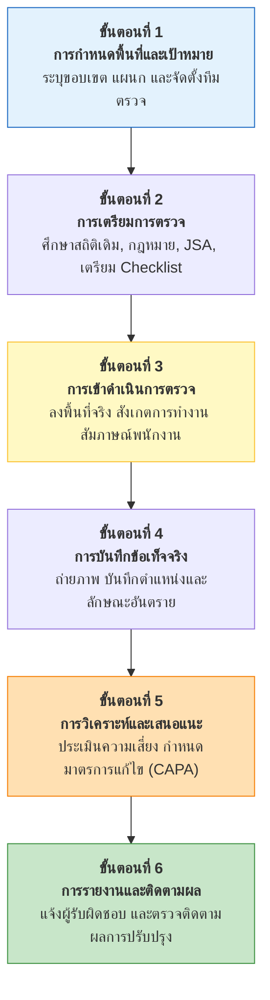
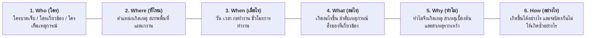
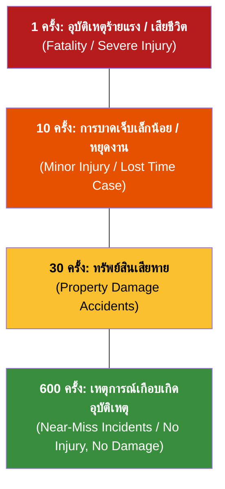
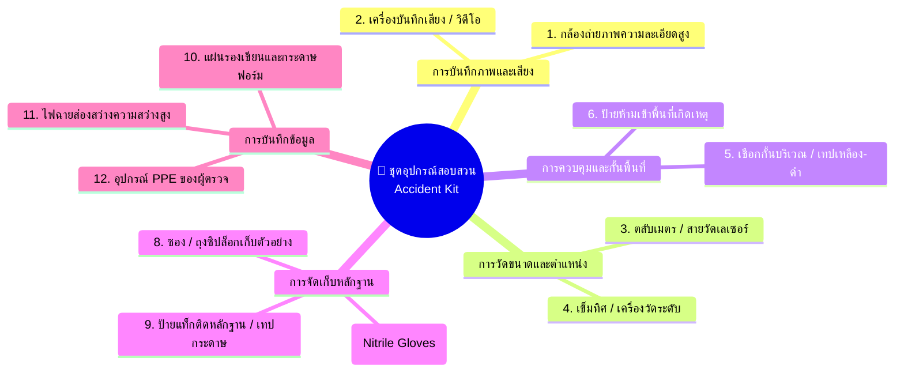
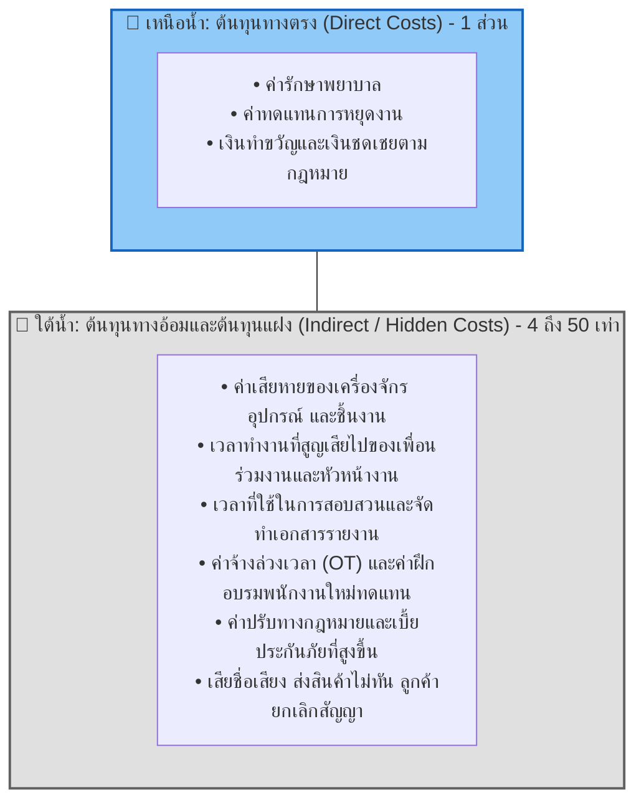

# Week 11.5 ขั้นตอนและกระบวนการตรวจความปลอดภัยอย่างเป็นระบบ

### รายละเอียดการปฏิบัติในแต่ละขั้นตอน
1. **การกำหนดพื้นที่และเป้าหมาย** 
   - แบ่งพื้นที่โรงงานออกเป็นโซนที่ชัดเจน และจัดทีมผู้ตรวจที่ประกอบด้วยตัวแทนนายจ้าง ลูกจ้าง และ จป.

1. **การเตรียมการตรวจ**
   * ศึกษาสถิติอุบัติเหตุและข้อร้องเรียนในอดีตของแผนกนั้น
   * จัดเตรียม **แบบตรวจสอบความปลอดภัย (Safety Checklist)** ที่เหมาะสมกับลักษณะงาน
   * ศึกษาเอกสารการวิเคราะห์งานเพื่อความปลอดภัย (Job Safety Analysis: JSA)
     
1. **การเข้าดำเนินการตรวจหน้างาน**
   * ตรวจดูทั้งสภาพแวดล้อมทางกายภาพและพฤติกรรมของพนักงาน
   * พูดคุยสอบถามพนักงานอย่างเป็นมิตร รับฟังปัญหาความไม่สะดวกในการทำงาน
   * หลีกเลี่ยงการขัดจังหวะการทำงานในจังหวะที่มีความเสี่ยงสูง
     
1. **การบันทึกข้อเท็จจริง**
   * จดบันทึกสิ่งที่พบเห็นอย่างละเอียด ระบุวัน เวลา สถานที่ และเครื่องจักร
   * ถ่ายภาพประกอบหลักฐานที่ชัดเจน (ทั้งมุมกว้างและมุมแคบ)

1. **การวิเคราะห์ปัญหาและจัดทำข้อเสนอแนะ**
   * ค้นหาสาเหตุที่แท้จริง ไม่มองแค่ผิวเผิน
   * กำหนดแนวทางแก้ไขตามหลัก **Hierarchy of Controls** โดยระบุผู้รับผิดชอบและวันแล้วเสร็จ (CAPA)

1. **การแจ้งผลและติดตามการปรับปรุง**
   * สรุปรายงานต่อผู้จัดการแผนกและที่ประชุม คปอ.
   * มีระบบตรวจติดตามซ้ำ (Follow-up Audit) เพื่อให้มั่นใจว่าอันตรายได้รับการแก้ไขจริง

---

## 11.6 จุดตรวจสอบความปลอดภัยที่สำคัญในสถานประกอบกิจการ

| จุดตรวจสอบสำคัญ                       | รายการที่ต้องตรวจสอบอย่างละเอียด (Checkpoints)                                                                                                                                                                                                               |
| :------------------------------------ | :----------------------------------------------------------------------------------------------------------------------------------------------------------------------------------------------------------------------------------------------------------- |
| **1. ระบบไฟฟ้าและอุปกรณ์**            | • สภาพสายไฟ ปลั๊ก เต้ารับ ไม่แตกหัก เปื่อย หรือมีรอยต่อพันเทปไม่เรียบร้อย • มีสายดิน (Grounding) และระบบตัดไฟรั่ว (RCD/ELCB) • ตู้ควบคุมไฟฟ้ามีฝาปิดสนิท ไม่มีสิ่งของวางกีดขวางในระยะ 1 เมตร และมีป้ายเตือนอันตรายไฟฟ้า                                |
| **2. เครื่องจักรและชิ้นส่วนหมุน**     | • ติดตั้งการ์ดป้องกันจุดหมุน จุดตัด จุดหนีบ (Pulleys, Gears, Shafts, Blades) • ปุ่มหยุดฉุกเฉิน (Emergency Stop) อยู่ในตำแหน่งเข้าถึงง่ายและใช้งานได้ทันที • มีป้ายเตือนอันตรายและระบบ Interlock ไม่ถูกดัดแปลงหรือปลดล็อก                               |
| **3. สารเคมีอันตรายและวัตถุไวไฟ**     | • ถังบรรจุมีฉลากชัดเจน (GHS Labels) และมีเอกสารข้อมูลความปลอดภัย (SDS) ประจำจุด • มีถาดรองรับการรั่วไหล (Spill Containment Pallets) และชุดดูดซับสารเคมี (Spill Kits) • มีอ่างล้างตาฉุกเฉินและฝักบัวชำระร่างกายที่ใช้งานได้ทันที และมีแรงดันน้ำสม่ำเสมอ |
| **4. สภาพแวดล้อมทั่วไปและกายภาพ**     | • แสงสว่างเพียงพอต่อความละเอียดของงาน ไม่มีแสงจ้าบาดตา • ระดับเสียงดังไม่เกินมาตรฐานที่กฎหมายกำหนด (เกิน 85 dBA ต้องมีมาตรการอนุรักษ์การได้ยิน) • ทางเดินและทางออกฉุกเฉินโล่ง ไม่มีสิ่งของวางกีดขวาง ประตูหนีบไฟเปิดออกด้านนอกได้ตลอดเวลา              |
| **5. การทำงานและสุขอนามัยของพนักงาน** | • พนักงานสวมใส่อุปกรณ์ PPE ที่ถูกต้องและเหมาะสมกับความเสี่ยง • ท่าทางการทำงานถูกต้องตามหลักการยศาสตร์ (Ergonomics) เช่น การยกของด้วยกำลังขา • พนักงานไม่หยอกล้อ ไม่ใช้โทรศัพท์มือถือขณะควบคุมเครื่องจักร หรือเดินในเส้นทางรถยก                         |

---

## 11.7 เหตุผลและความสำคัญในการสอบสวน บันทึก และรายงานอุบัติเหตุ

> [!IMPORTANT] หัวใจของการสอบสวนอุบัติเหตุ
> **"เราสอบสวนอุบัติเหตุเพื่อค้นหาว่าระบบบกพร่องอย่างไร และจะป้องกันไม่ให้เกิดซ้ำได้อย่างไร มิใช่การมุ่งหาคนผิดมาลงโทษ" (Investigate to Find Root Causes and Prevent Recurrence, NOT to Blame)**

### เหตุผล 4 ประการที่ต้องสอบสวน บันทึก และรายงานอุบัติเหตุ

1. **เพื่อค้นหาสาเหตุที่แท้จริง (Root Cause)** 
   - อุบัติเหตุเกือบทั้งหมดเป็นผลมาจากความบกพร่องสะสมในระบบ 
   - การสอบสวนช่วยเจาะลึกผ่านพฤติกรรมผิวเผินไปสู่รากเหง้าของปัญหา

1. **เพื่อนำข้อเท็จจริงมาสร้างความตระหนักรู้** 
   - ข้อมูลจากเหตุการณ์จริงเป็นบทเรียนที่ดีที่สุดในการอบรมและเตือนใจพนักงานและผู้ควบคุมงาน

1. **เพื่อยกระดับมาตรการความปลอดภัย** 
   - ข้อมูลที่ได้จะนำไปสู่การปรับปรุงขั้นตอนการทำงาน 
   - การออกแบบทางวิศวกรรม 
   - การจัดซื้ออุปกรณ์ที่ปลอดภัยยิ่งขึ้น

1. **เพื่อจัดทำสถิติและปฏิบัติตามกฎหมาย** 
   - รวบรวมข้อมูลสถิติเพื่อเปรียบเทียบมาตรฐานความปลอดภัย 
   - เป็นหลักฐานทางกฎหมายในการยื่นรับเงินทดแทนจากกองทุนเงินทดแทน

---

## 11.8 การประยุกต์ใช้เทคนิค 5W-1H ในการสอบสวนอุบัติเหตุ

| คำถาม 5W-1H | ประเด็นคำถามที่ต้องเจาะลึก                                                        | ตัวอย่างการสืบสวนหน้างาน                                                                     |
| :---------: | :-------------------------------------------------------------------------------- | :------------------------------------------------------------------------------------------- |
|   **Who**   | ใครคือผู้ประสบอุบัติเหตุ?  ใครเป็นพยานรู้เห็น?  ใครเป็นหัวหน้างาน?          | นายสมชาย (อายุงาน 3 เดือน, แผนกตัดโลหะ, ผ่านการอบรมเบื้องต้นแล้ว)                            |
|  **Where**  | อุบัติเหตุเกิดขึ้นที่จุดไหนอย่างแม่นยำ?  สภาพแวดล้อมรอบจุดเกิดเหตุเป็นอย่างไร? | บริเวณเครื่องเลื่อยสายพาน หมายเลข 4 แผนกแปรรูปโลหะ อาคาร B                                   |
|  **When**   | เกิดขึ้นเมื่อวันใด เวลาใด?  ผู้บาดเจ็บทำงานต่อเนื่องมากี่ชั่วโมงแล้ว?          | วันที่ 14 ตุลาคม เวลา 15.45 น. (ทำงานกะเช้าต่อเนื่องเข้าสู่ชั่วโมงที่ 7)                     |
|  **What**   | เกิดอะไรขึ้นตามลำดับเวลา (Timeline)?  อวัยวะใดบาดเจ็บ?  ทรัพย์สินใดเสียหาย? | มือซ้ายไถลเข้าสัมผัสใบเลื่อยสายพาน เกิดแผลฉีกขาดลึกที่นิ้วชี้และนิ้วกลาง                     |
|   **Why**   | ทำไมมือจึงไถล?  ทำไมเครื่องจักรจึงไม่มีการ์ด?  ทำไมชิ้นงานจึงหลุดมือ?       | ชิ้นงานมีคราบน้ำมันหล่อลื่น และการ์ดป้องกันถูกถอดออกระหว่างการปรับตั้งเครื่องแต่ไม่ได้ใส่คืน |
|   **How**   | กลไกการเกิดเหตุเป็นอย่างไร?  และจะมีมาตรการแก้ไขป้องกันถาวรได้อย่างไร?         | ติดตั้ง Interlock Guard ที่เครื่องจะไม่หมุนถ้าไม่มีการ์ด และจัดทำ Standard Work Procedure    |

---

## 11.9 ระดับและประเภทของอุบัติเหตุที่ต้องทำการสอบสวน

ตามหลักการบริหารจัดการความปลอดภัยสมัยใหม่ องค์กรต้องไม่รอให้เกิดการบาดเจ็บรุนแรงจึงจะเริ่มทำการสอบสวน แต่ต้องสอบสวนเหตุการณ์ทุกระดับตาม **ทฤษฎีสามเหลี่ยมอุบัติเหตุของ แฟรงก์ อี. เบิร์ด (Frank E. Bird's Incident Triangle)**:

### รายการอุบัติเหตุและเหตุการณ์ที่ต้องทำการสอบสวน

1. **เหตุการณ์เกือบเกิดอุบัติเหตุ (Near-Miss Incident)** 
   - เหตุการณ์ที่เกือบทำให้เกิดอันตราย 
	   - ชิ้นงานเหล็กหล่นเฉียดศีรษะพนักงาน 
	   - การสอบสวน Near-Miss คือการตัดไฟแต่ต้นลมที่มีประสิทธิภาพสูงสุด

1. **อุบัติเหตุปฐมพยาบาล (First Aid Case: FAC)** 
   - การบาดเจ็บเล็กน้อย 
	   - มีดบาด 
	   - แผลฟกช้ำ ที่สามารถทำแผลแล้วกลับไปปฏิบัติงานต่อได้ทันที

1. **อุบัติเหตุต้องรับการรักษาทางการแพทย์ (Medical Treatment Case: MTC)** 
   - การบาดเจ็บที่ต้องได้รับการตรวจรักษาโดยแพทย์ แต่ไม่ถึงขั้นต้องหยุดงาน

1. **อุบัติเหตุถึงขั้นหยุดงาน (Lost Time Injury: LTI)** 
   - พนักงานบาดเจ็บจนไม่สามารถมาปฏิบัติงานได้ในกะทำงานถัดไป

1. **อุบัติเหตุถึงขั้นสูญเสียอวัยวะหรือทุพพลภาพ (Permanent Disability)** 
   - สูญเสียนิ้ว 
   - ตาบอด 
   - หูหนวก 
   - อัมพาต

1. **อุบัติเหตุร้ายแรงถึงแก่ชีวิต (Fatality)** 
   - มีผู้เสียชีวิตในสถานที่ทำงานหรือเสียชีวิตต่อเนื่องจากการบาดเจ็บในการทำงาน

2. **อุบัติเหตุต่อทรัพย์สินและเครื่องจักร (Property Damage)** 
   - ไฟไหม้ 
   - เครื่องจักรระเบิด 
   - สารเคมีรั่วไหลไหลลงสู่แหล่งน้ำสาธารณะ

---

## 11.10 เครื่องมือและอุปกรณ์ในชุดสอบสวนอุบัติเหตุ

เพื่อให้การรวบรวมพยานหลักฐานในสถานที่เกิดเหตุเป็นไปอย่างรวดเร็ว ถูกต้อง และไม่ถูกทำลาย ทีมสอบสวนความปลอดภัยควรมีกระเป๋าชุดอุปกรณ์สอบสวน (Investigation Kit) ที่พร้อมใช้งานตลอดเวลา:

---

## 11.11 รูปแบบ โครงสร้าง และวิธีการรายงานอุบัติเหตุ

การรายงานอุบัติเหตุเป็นขั้นตอนสุดท้ายของการสอบสวน เพื่อถ่ายทอดข้อเท็จจริง สถิติ และมาตรการแก้ไขให้แก่ผู้บริหาร คปอ. และหน่วยงานราชการที่เกี่ยวข้อง

### 11.11.1 การรายงานเกี่ยวกับข้อเท็จจริงของอุบัติเหตุ
* **ข้อมูลทั่วไป** 
	  - วัน เวลา 
	  - กะทำงาน 
	  - สถานที่เกิดเหตุ 
	  - แผนกงาน 
	  - และผู้พบเห็นเหตุการณ์
* **ลำดับเหตุการณ์ (Chronological Timeline)** 
  - สรุปเหตุการณ์เป็นลำดับขั้นตอนก่อนเกิดเหตุ   ขณะเกิดเหตุ    และการตอบสนองฉุกเฉินหลังเกิดเหตุ
* **สาเหตุของการเกิดเหตุ (Causal Breakdown)**
  * *สาเหตุโดยตรง (Direct Causes):* การกระทำที่ไม่ปลอดภัย (Unsafe Acts) และสภาพการณ์ที่ไม่ปลอดภัย (Unsafe Conditions)
  * *สาเหตุรากเหง้า (Root Causes):* นโยบายการบริหาร การบำรุงรักษา การฝึกอบรม หรือระบบการควบคุมงานที่บกพร่อง
* **มาตรการแก้ไขและป้องกัน (CAPA)** 
  - ระบุมาตรการระยะสั้น (ทำทันที) และมาตรการระยะยาว พร้อมชื่อผู้รับผิดชอบและวันกำหนดเสร็จ

---

### 11.11.2 การรายงานเกี่ยวกับข้อมูลผู้ได้รับบาดเจ็บ
* **ข้อมูลส่วนบุคคล** 
  - ชื่อ-นามสกุล
  - ตำแหน่ง
  - อายุ
  - ประสบการณ์การทำงานในตำแหน่งปัจจุบัน
  - การผ่านการอบรมที่เกี่ยวข้อง
* **ข้อมูลทางการแพทย์**
  * ลักษณะการบาดเจ็บตามมาตรฐาน ILO (Nature of Injury) เช่น 
	    - แผลฉีกขาด 
	    - กระดูกหัก 
	    - แผลไหม้
  * อวัยวะที่ได้รับบาดเจ็บ (Location of Injury)
  * ระดับการรักษา
	    - ปฐมพยาบาล
	    - นำส่งคลินิก
	    - พักรักษาตัวในโรงพยาบาล (In-patient)
* **การประเมินวันหยุดงานและการชดเชย** 
  - จำนวนวันที่แพทย์สั่งให้หยุดงานชั่วคราว 
  - การประเมินการสูญเสียสมรรถภาพของร่างกาย เพื่อประกอบการขอรับเงินทดแทนจากกองทุนเงินทดแทน

---

### 11.11.3 การรายงานเกี่ยวกับความเสียหายและต้นทุน

ความสูญเสียจากอุบัติเหตุไม่ได้มีเพียงค่ารักษาพยาบาล แต่เปรียบเสมือน **"ภูเขาน้ำแข็ง (The Safety Iceberg)"**:

* **อัตราส่วนไฮน์ริช (Heinrich's Cost Ratio)** ต้นทุนทางตรง : ต้นทุนทางอ้อม = **1 : 4**
* **แบบจำลองของเบิร์ด (Bird's Iceberg Model)** ต้นทุนทางอ้อมที่มองไม่เห็นอาจสูงถึง **5 ถึง 50 เท่า** ของต้นทุนทางตรง

---

### 11.11.4 การรายงานเกี่ยวกับสถิติความปลอดภัยและการวิเคราะห์ดัชนีชี้วัด

การวัดผลการดำเนินงานด้านความปลอดภัยต้องคำนวณดัชนีชี้วัดตามมาตรฐานสากล (OSHA / ANSI Z16.1 / ILO) เพื่อนำไปเปรียบเทียบกับองค์กรอื่นในอุตสาหกรรมเดียวกัน:

#### 1) อัตราความถี่ของการเกิดอุบัติเหตุถึงขั้นหยุดงาน (Lost Time Injury Frequency Rate: LTIFR)

$$\text{LTIFR} = \frac{\text{จำนวนครั้งของการบาดเจ็บถึงขั้นหยุดงาน} \times 1,000,000}{\text{จำนวนชั่วโมงการทำงานรวมของลูกจ้างทั้งหมด (Total Man-Hours)}}$$

*หมายเหตุ: ตัวคูณ $1,000,000$ หมายถึงการเปรียบเทียบต่อการทำงานหนึ่งล้านชั่วโมงทำงานของพนักงาน*

#### 2) อัตราความรุนแรงของการเกิดอุบัติเหตุ (Lost Time Injury Severity Rate: LTISR)

$$\text{LTISR} = \frac{\text{จำนวนวันทำงานที่สูญเสียรวม} \times 1,000,000}{\text{จำนวนชั่วโมงการทำงานรวมของลูกจ้างทั้งหมด (Total Man-Hours)}}$$

#### 3) ดัชนีความถี่และความรุนแรงร่วม (Frequency Severity Index: FSI)

$$\text{FSI} = \sqrt{\frac{\text{LTIFR} \times \text{LTISR}}{1,000}}$$

---

### ตารางสรุปแบบฟอร์มการรายงานอุบัติเหตุตามกฎหมายไทย

|   แบบฟอร์ม    | หน่วยงานที่กำกับดูแล                  | วัตถุประสงค์และเงื่อนไขการส่งรายงาน                                                         | กำหนดเวลาส่งรายงาน                                                 |
| :-----------: | :------------------------------------ | :------------------------------------------------------------------------------------------ | :----------------------------------------------------------------- |
| **แบบ จป.3**  | กรมสวัสดิการและคุ้มครองแรงงาน         | รายงานผลการดำเนินงานด้านความปลอดภัยของ จป.วิชาชีพ และสถิติอุบัติเหตุ                        | ทุก 3 เดือน (ภายใน 30 วันหลังสิ้นไตรมาส)                           |
| **แบบ จป.4**  | กรมสวัสดิการและคุ้มครองแรงงาน         | รายงานการประสบอันตราย เจ็บป่วย หรือสูญหายร้ายแรง (เสียชีวิต หรือหยุดงานตั้งแต่ 3 วันขึ้นไป) | ภายในระยะเวลาที่กฎหมายกำหนด (แจ้งเบื้องต้น 24 ชม. ส่งรายงาน 7 วัน) |
| **แบบ กท.16** | สำนักงานประกันสังคม (กองทุนเงินทดแทน) | แบบแจ้งการประสบอันตราย เจ็บป่วย หรือสูญหาย เพื่อขอรับประโยชน์ทดแทนค่ารักษาพยาบาลและค่าทดแทน | ภายใน 15 วัน นับแต่วันที่ทราบการประสบอันตราย                       |
| **แบบ กท.44** | สำนักงานประกันสังคม (กองทุนเงินทดแทน) | ใบรับรองแพทย์และรายงานการประเมินการสูญเสียสมรรถภาพของร่างกาย                                | ยื่นประกอบพร้อมความเห็นแพทย์ผู้ทำการรักษา                          |

---

## 📌 สรุปสาระสำคัญประจำบทเรียน

1. **สัดส่วนสาเหตุอุบัติเหตุ** 
   - ไฮน์ริชชี้ว่าอุบัติเหตุเกิดจาก Unsafe Acts 88%, Unsafe Conditions 10%, และสุดวิสัย 2% แต่วิศวกรความปลอดภัยต้องควบคุมทั้งสภาพแวดล้อมทางวิศวกรรมและพฤติกรรมมนุษย์

1. **การตรวจความปลอดภัย** 
   - มีวัตถุประสงค์เพื่อค้นหาจุดอันตรายแอบแฝงก่อนเกิดเหตุ แบ่งออกเป็น 4 ประเภท (ต่อเนื่อง, ไม่กำหนดเวลา, ตามกำหนดเวลา, กรณีพิเศษ) ผ่าน 6 ขั้นตอนตามหลักวงจร PDCA

1. **คณะกรรมการความปลอดภัยฯ (คปอ.)** 
   - เป็นกลไกไตรภาคีร่วมระหว่างนายจ้างและลูกจ้าง กฎหมายกำหนดให้สถานประกอบกิจการที่มีลูกจ้าง 50 คนขึ้นไปต้องจัดตั้ง คปอ. (5, 7 หรือ 11 คนตามขนาดลูกจ้าง)

1. **การสอบสวนอุบัติเหตุ** 
   - ยึดหลักการค้นหาข้อเท็จจริงและสาเหตุรากเหง้า (RCA) มิใช่การหาคนผิด โดยใช้เทคนิค **5W-1H** และต้องสอบสวนตั้งแต่ระดับเหตุการณ์เกือบเกิดอุบัติเหตุ (Near-Miss)

1. **ความสูญเสียจากอุบัติเหตุ** 
   - ต้นทุนทางอ้อมเปรียบเหมือนส่วนล่างของภูเขาน้ำแข็งที่มีมูลค่าสูงกว่าต้นทุนทางตรง 4 ถึง 50 เท่า

1. **สถิติและรายงานทางกฎหมาย** 
   - การวัดผลใช้ดัชนีชี้วัดสากล LTIFR และ LTISR พร้อมทั้งต้องส่งแบบรายงาน จป.3, จป.4 ต่อนายทะเบียนแรงงาน และแบบ กท.16 ต่อกองทุนเงินทดแทนตามกำหนดเวลา

---

## 🎯 คำถามทบทวนความรู้ประจำบทเรียน

1. **จงอธิบายความแตกต่างระหว่าง "การตรวจความปลอดภัยแบบต่อเนื่อง (Continuous Inspection)" และ "การตรวจความปลอดภัยตามกำหนดเวลา (Periodic Inspection)" ทั้งในด้านผู้รับผิดชอบและความถี่**
   * **แนวคำตอบ** 
     * **การตรวจแบบต่อเนื่อง** ดำเนินการทุกวันหรือทุกกะการทำงาน ผู้รับผิดชอบคือพนักงานประจำเครื่องและหัวหน้างาน เน้นตรวจสอบความพร้อมของอุปกรณ์ก่อนเริ่มงาน ความสะอาด และพฤติกรรม
     * **การตรวจตามกำหนดเวลา** มีรอบเวลาแน่นอน เช่น ทุกเดือน ทุก 3 เดือน หรือทุกปี ผู้รับผิดชอบคือคณะกรรมการ คปอ., จป.วิชาชีพ หรือวิศวกรผู้เชี่ยวชาญ เน้นตรวจสอบระบบใหญ่ เช่น หม้อน้ำ เครน หรือระบบดับเพลิง

1. **หากสถานประกอบกิจการมีลูกจ้างรวมทั้งสิ้น 250 คน กฎหมายไทยกำหนดให้ต้องจัดให้มีคณะกรรมการความปลอดภัยฯ (คปอ.) จำนวนขั้นต่ำกี่คน และมีสัดส่วนผู้แทนฝ่ายใดบ้าง?**
   * **แนวคำตอบ** ต้องมีกรรมการ คปอ. ไม่น้อยกว่า **7 คน** ประกอบด้วย:
     * ประธานกรรมการ (นายจ้างหรือผู้แทนนายจ้างระดับบริหาร) 1 คน
     * ผู้แทนนายจ้างระดับบังคับบัญชา 2 คน
     * ผู้แทนลูกจ้างระดับปฏิบัติการ (จากการเลือกตั้ง) 3 คน
     * เลขานุการ (จป. ระดับวิชาชีพ) 1 คน

1. **เพราะเหตุใดองค์กรจึงต้องให้ความสำคัญกับการสอบสวน "เหตุการณ์เกือบเกิดอุบัติเหตุ (Near-Miss)" เท่าเทียมกับอุบัติเหตุที่เกิดการบาดเจ็บจริง? จงอธิบายโดยอ้างอิงทฤษฎีสามเหลี่ยมอุบัติเหตุของเบิร์ด**
   *  **แนวคำตอบ** ตามทฤษฎีสามเหลี่ยมอุบัติเหตุของ แฟรงก์ อี. เบิร์ด (1:10:30:600) ชี้ว่าภายใต้อุบัติเหตุร้ายแรง 1 ครั้ง จะมีเหตุการณ์เกือบเกิดอุบัติเหตุ (Near-Miss) เกิดขึ้นถึง 600 ครั้ง ซึ่งมีสาเหตุรากเหง้าเดียวกัน หากองค์กรตรวจพบและสอบสวนแก้ไขตั้งแต่ขั้น Near-Miss จะสามารถตัดวงจรและป้องกันไม่ให้อุบัติเหตุพัฒนาไปสู่การสูญเสียชีวิตหรือพิการได้

1. **โรงงานผลิตชิ้นส่วนอิเล็กทรอนิกส์แห่งหนึ่ง มีพนักงาน 500 คน ทำงานเฉลี่ยคนละ 2,000 ชั่วโมงต่อปี ในรอบปีที่ผ่านมาเกิดอุบัติเหตุถึงขั้นหยุดงาน 5 ครั้ง มีวันหยุดงานรวม 40 วัน จงคำนวณหาค่า LTIFR และ LTISR ของโรงงานแห่งนี้**
   *  **แนวคำตอบและการคำนวณ**
     * ชั่วโมงการทำงานรวม (Total Man-Hours) = $500 \times 2,000 = 1,000,000$ ชั่วโมง
     * $\text{LTIFR} = \frac{5 \times 1,000,000}{1,000,000} = 5.0$ ครั้งต่อหนึ่งล้านชั่วโมงทำงาน
     * $\text{LTISR} = \frac{40 \times 1,000,000}{1,000,000} = 40.0$ วันต่อหนึ่งล้านชั่วโมงทำงาน
